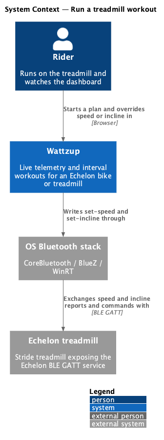
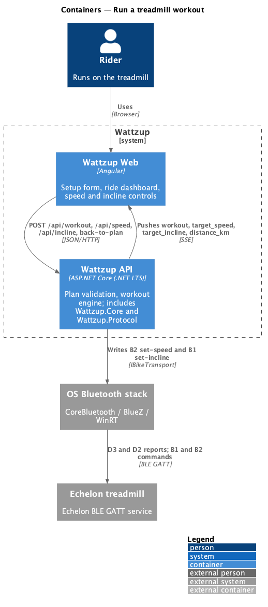
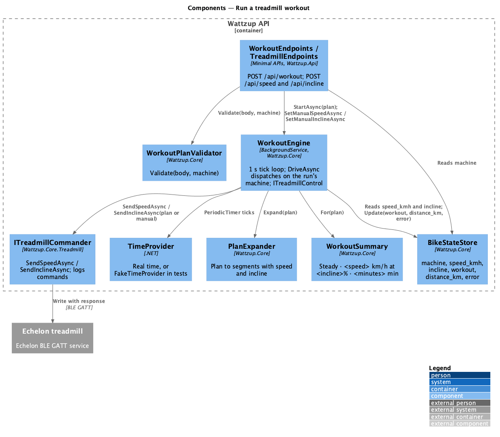
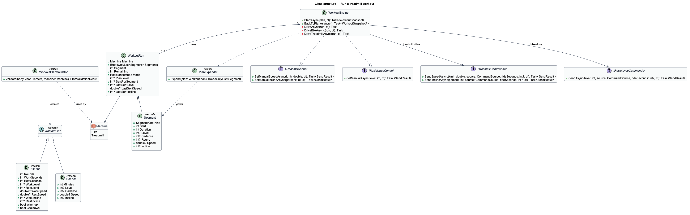
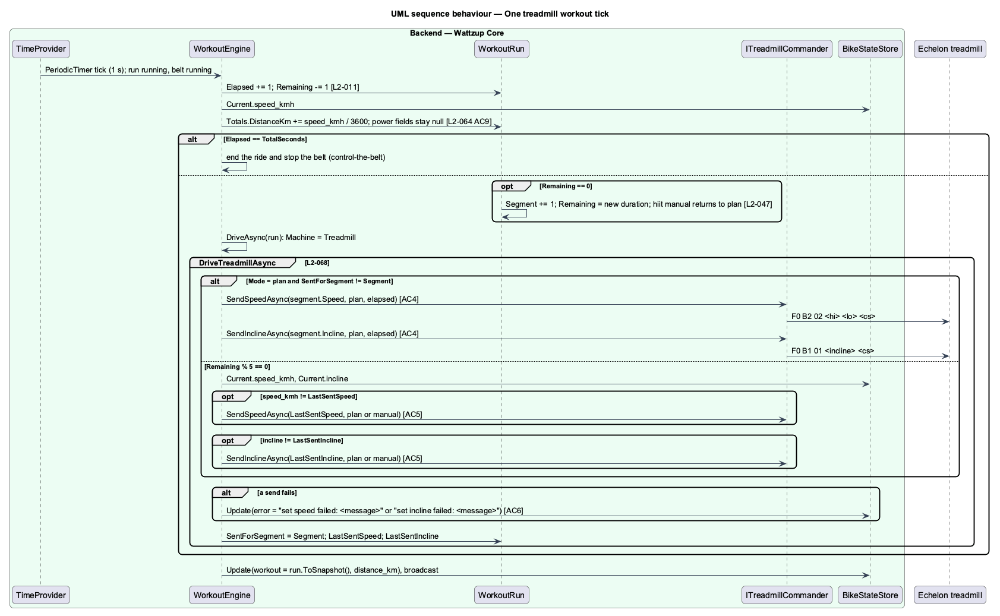
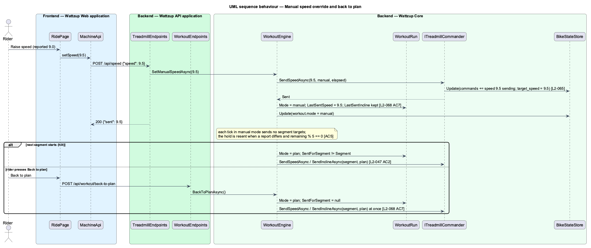
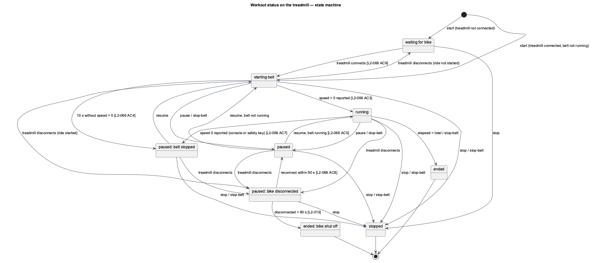

# Run a treadmill workout

## Overview

With the treadmill chosen, the rider runs the same two kinds of plan as on the bike, `hiit` and `flat`, with speeds and inclines in place of resistance levels and the cadence goal. The backend validates the plan against the treadmill's ranges, expands it into segments, and sets the treadmill's speed and incline for each segment. The rider can override the speed or incline mid-ride; the plan takes over again at the next segment or on Back to plan. The ride's distance is integrated from the reported speed; the bike's power and energy estimates do not apply (ADR 0003, ADR 0009).

**treadmill plan** — `hiit` or `flat` plan whose targets are speeds in km/h (0.8–19.3, at most 1 decimal) and inclines in whole percent (0–10) (L2-067, ADR 0010)

**segment speed** — speed in km/h the engine sets for a segment, `speed` in the segment

**segment incline** — incline in percent the engine sets for a segment, `incline` in the segment

**drive** — engine step that sends the current segment's targets to the machine, once per segment and again on the 5-second resend rule (L2-012, L2-068)

**manual hold** — speed and incline the engine keeps after a rider override, resending them by the same rule until the next segment or Back to plan (L2-068)

The engine is the single workout loop of `workouts/run-interval-workout`, unchanged in its ticking, segment advance, pause, shut-off grace and replacement. This feature adds what differs on the treadmill: the plan fields and their validation, the expansion with speed and incline, and the drive of speed and incline instead of the level. The belt countdown, the start timeout and the belt stop belong to `treadmill/control-the-belt`; the speed and incline commands and their log entries to `treadmill/control-speed-and-incline`; the setup form and the dashboard to `treadmill/treadmill-dashboard-and-setup`.

## Description

All types live in `Wattzup.Core` unless stated otherwise.

### Plan and validation

- **`WorkoutPlan`** — keeps the `kind` discriminator with `hiit` and `flat`.
  - **`HiitPlan`** gains `WorkSpeed`, `RestSpeed` (`double?`), `WorkIncline` and `RestIncline` (`int?`). `WorkLevel` and `RestLevel` become `int?`.
  - **`FlatPlan`** gains `Speed` (`double?`) and `Incline` (`int?`). `Level` and `Cadence` become `int?`.
  - A plan accepted for one machine carries `null` in the other machine's fields, written and never omitted (L2-067 criterion 7, L2-014).
- **`WorkoutPlanValidator.Validate(body, machine)`** — remains the only creator of `WorkoutPlan`. The endpoint passes `store.Current.Machine`. With `Machine.Bike` the L2-010 rules apply unchanged and the treadmill's fields are ignored. With `Machine.Treadmill` the bike's `work_level`, `rest_level`, `level` and `cadence` are ignored and these rules apply, reporting every failing field (L2-067):

| Kind | Field | Rule | Message |
|---|---|---|---|
| `hiit` | `rounds`, `work_seconds`, `rest_seconds`, `warmup`, `cooldown` | as L2-010 | as L2-010 |
| `hiit` | `work_speed`, `rest_speed` | number 0.8–19.3 | `Speed must be 0.8 to 19.3 km/h.` |
| `flat` | `speed` | number 0.8–19.3 | `Speed must be 0.8 to 19.3 km/h.` |
| any | a speed field that is not a number or has more than 1 decimal (`9.25`) | | `Enter a speed like 9.0.` |
| `hiit` | `work_incline`, `rest_incline` | integer 0–10 | `Incline must be 0 to 10 %.` |
| `flat` | `incline` | integer 0–10 | `Incline must be 0 to 10 %.` |
| any | an incline field that is not an integer | | `Enter a whole number.` |
| `flat` | `minutes` | integer 1–180 | `Enter 1 to 180 minutes.` |

  The decimal check reads the JSON number's text, so `9.0` and `9` pass and `9.25` fails. The range limits are `EchelonTreadmillCommands.MinSpeedKmh`, `MaxSpeedKmh`, `MinIncline` and `MaxIncline` (`Wattzup.Protocol`), so the validator and the command builder share one source. A rejection is the ProblemDetails of L2-010 with `code` = `invalid_workout` (`workouts/start-and-stop-workout`).
- **`WorkoutSummary.For(plan)`** — a treadmill `flat` plan reads `Steady · <speed> km/h at <incline>% · <minutes> min`, with the speed to 1 decimal (`Steady · 6.5 km/h at 8% · 30 min`). The UI calls a `flat` plan *Steady* on the treadmill; the contract keeps `flat` (ADR 0010). A `hiit` plan reads as L2-060 on both machines (L2-067 criterion 8).

### Expansion

- **`Segment`** — becomes `(SegmentKind Kind, int Start, int Duration, int? Level, int? Cadence, int? Round, double? Speed, int? Incline)`. On the bike `Speed` and `Incline` are `null`; on the treadmill `Level` and `Cadence` are `null` (L2-068 criterion 3, L2-070).
- **`PlanExpander.Expand(plan)`** — chooses the rules by the plan's fields: a plan with a speed is a treadmill plan (L2-068).
  - A treadmill `flat` plan yields one `steady` segment of `minutes × 60` s at `speed` and `incline` (criterion 2).
  - A treadmill `hiit` plan with `warmup` starts with a `warmup` segment of 180 s at `rest_speed` + 1.0 km/h, at most 19.3, and `rest_incline`.
  - Each round r adds a `work` segment at `work_speed` and `work_incline` and a `rest` segment at `rest_speed` and `rest_incline`, round r.
  - With `cooldown`, the last round has no `rest` segment, and a `cooldown` segment of 120 s at `rest_speed` and incline 0 ends the plan.
  - Durations, rounds and `start` follow L2-045 (criterion 1). The default treadmill plan, *Minute on* (6 × 1:00 / 1:00, 13.0 / 6.0 km/h, 2 / 1 %, warm-up and cool-down, L2-072 criterion 4), therefore yields a 16:00 timeline: a 3:00 warm-up at 7.0 km/h and 1 %, 6 work and 5 rest segments, and a 2:00 cool-down at 6.0 km/h and 0 %.
- **`WorkoutRun`** — `PlanLevel` is `int?` and is `null` on the treadmill, so `plan_level` is `null` (L2-070). The engine reads the machine from `store.Current.Machine`, which cannot change while a run is active (L2-062). The run gains `LastSentSpeed` (`double?`) and `LastSentIncline` (`int?`) beside `SentForSegment` and `LastSentLevel`.

### Drive

`WorkoutEngine.DriveAsync(run)` dispatches on the chosen machine. The bike path is unchanged (`IResistanceCommander`, L2-012). The treadmill path drives speed and incline through `ITreadmillCommander` (`Wattzup.Core.Treadmill`) with the same rule. It runs only on ticks where the belt is `running` (`treadmill/control-the-belt`).

1. **Plan mode, new segment.** When `SentForSegment` differs from `Segment`, it calls `SendSpeedAsync(segment.Speed, CommandSource.Plan, elapsed)` and `SendInclineAsync(segment.Incline, CommandSource.Plan, elapsed)` once each (L2-068 criterion 4). This covers the first running tick after the belt starts, every new segment and the restart after a resume.
2. **Resend.** When `Remaining % 5 == 0`, it sends the speed again if the reported `speed_kmh` differs from `LastSentSpeed`, and the incline again if the reported `incline` differs from `LastSentIncline`. Speed and incline are judged separately (criterion 5). A reported speed within 0.05 km/h of the speed last sent counts as the same.
3. **Record.** After any attempt it sets `SentForSegment`, `LastSentSpeed` and `LastSentIncline`, so a failed send is retried by the 5-second rule and not every second.
4. **Failure.** A failed speed send sets `error` to `set speed failed: <message>`; a failed incline send sets `set incline failed: <message>`. The commander marks the entry `failed` and the workout keeps running (criterion 6).

Each successful send sets `target_speed` or `target_incline`, and the command log entry carries `command` `speed` or `incline` and `value` (L2-065, `treadmill/control-speed-and-incline`).

### Manual override

`WorkoutEngine` implements `ITreadmillControl`, the one Core service behind `POST /api/speed` and `POST /api/incline` (L2-069). Both methods post a command to the engine loop, as `SetManualAsync` does for the bike.

- **`SetManualSpeedAsync(kmh, ct)`** calls `SendSpeedAsync(kmh, CommandSource.Manual, run?.Elapsed)`. When it is sent and a run is active, the run's `Mode` becomes `manual` and `LastSentSpeed` is `kmh`. `LastSentIncline` keeps its value, so the manual hold is the new speed with the incline last sent (L2-068 criterion 7).
- **`SetManualInclineAsync(percent, ct)`** does the same for the incline.
- In `manual` mode, Drive sends no segment targets. The resend rule of step 2 applies to the manual hold instead.
- When the next segment starts, a `hiit` run returns to `plan` mode and the new segment's speed and incline are sent (L2-047 criterion 2). A `flat` run stays `manual` until Back to plan.
- **`BackToPlanAsync`** sets `Mode` to `plan` and clears `SentForSegment`, so the segment's speed and incline are sent at once (L2-068 criterion 7).
- With no workout, the send goes out with source `manual` and nothing else happens. Wattzup does not start the belt for a manual speed (L2-068 criterion 8).

### Ride totals

On a treadmill run, each running tick adds `speed_kmh ÷ 3600` to `distance_km`, as on the bike (L2-049 criterion 4). `power`, `target_power`, `avg_power` and `kcal` stay `null`, and the power trace history records nothing (L2-064 criterion 9, ADR 0003). `RideTotals` is unchanged; on the treadmill the engine publishes `null` for `target_power`, `avg_power` and `kcal` and does not append to the power trace history.

### Acceptance tests

Each test runs `Wattzup.Api.AcceptanceTests` through `WebApplicationFactory` with `--machine treadmill`, `SimulatedBikeTransport` (which advertises `STRIDE-SIM-0001`) and `FakeTimeProvider`. It starts a ride with `POST /api/workout`, advances the clock past the belt countdown, and awaits the expected SSE message from `/api/events` with a timeout that fails naming the last message received. Writes are read from `SimulationControl.Writes`; the simulated treadmill reports a set speed while its belt runs and a set incline at once, and only on change.

- `A_treadmill_hiit_plan_is_accepted_with_bike_fields_null` (L2-067 AC1, AC7)
- `A_treadmill_flat_plan_is_accepted_with_its_summary` (L2-067 AC2, AC8)
- `Given_the_treadmill_when_speeds_and_inclines_are_out_of_range_then_each_field_is_named` (L2-067 AC3, AC5, one representative path)
- `On_the_treadmill_the_bikes_fields_are_ignored` (L2-067 AC6)
- `Given_the_treadmill_when_the_default_hiit_plan_is_posted_then_it_starts_with_speeds_and_null_levels` (L2-068 AC1, L2-070 AC2)
- `Given_the_belt_reports_a_speed_then_the_ride_runs_and_the_segments_speed_and_incline_are_sent` (L2-068 AC4)
- `A_treadmill_that_drifts_is_corrected_on_multiples_of_5_seconds` (L2-068 AC5)
- `A_failed_speed_send_sets_error_and_the_ride_keeps_running` (L2-068 AC6)
- `A_manual_speed_holds_until_the_next_segment` (L2-068 AC7)
- `Given_manual_mode_when_back_to_plan_is_called_then_the_segments_speed_and_incline_are_sent_at_once` (L2-068 AC7)
- `A_manual_speed_with_no_workout_does_not_start_the_belt` (L2-068 AC8)
- `Given_a_running_treadmill_ride_when_the_next_segment_starts_then_its_speed_and_incline_are_sent` (L2-064 AC9)

`Wattzup.Core.Tests` holds the tables, one case per row:

- `WorkoutPlanValidatorTests` — one case per row of the treadmill table above, including 0.7, 19.4, 9.25, `"9"` as a string, -1, 11 and 2.5, plus one bike plan checked against `Machine.Treadmill` and one treadmill plan against `Machine.Bike` (L2-067 AC6).
- `PlanExpanderTests` — treadmill flat; treadmill warm-up at `rest_speed` + 1.0 and `rest_incline`; a `rest_speed` of 18.8 capped at 19.3; rounds; cool-down drops the last rest; bike plans give `null` speed and incline (L2-068 AC1 to AC3).
- `WorkoutSummaryTests` — the treadmill flat summary `Steady · 6.5 km/h at 8% · 30 min`.
- `WorkoutEngineTreadmillDriveTests` — with a test double of `ITreadmillCommander`: speed drift only, incline drift only, both, a failed send retried at the next multiple of 5, and manual hold.

### Open questions

- **Rounded comparison.** The resend rule compares the reported `speed_kmh` with the last sent speed at 1 decimal. A treadmill that settles 0.1 km/h away from the request would be resent every 5 s; the hardware smoke test (`echelon-treadmill-frames.md`, item 8) shows whether that happens.
- **Expansion by field.** `PlanExpander` tells the machine from the plan's fields rather than from a machine argument, because a validated plan carries only one machine's fields. Passing the run's machine explicitly is an equal alternative.
- **Back to plan in plan mode.** L2-068 criterion 7 sends the segment's targets at once on Back to plan. The design sends them whatever the current mode, as the bike does.

## Requirements

| L2 ID | Refines (L1) | Requirement |
|-------|--------------|-------------|
| `L2-067` | `L1-013` | Treadmill plan validation. With the treadmill chosen, `POST /api/workout` accepts the plan kinds of L2-010 with speeds and inclines in place of levels and the cadence goal, and reports every failing field. |
| `L2-068` | `L1-013` | Automatic and manual speed and incline. A treadmill plan expands as L2-045 with speeds and inclines in place of levels and cadence aims, and the engine drives the treadmill as L2-012 and L2-047 drive the bike. |
| `L2-064` | `L1-013` | Treadmill telemetry decoding. Each running tick adds `speed_kmh` ÷ 3600 to `distance_km`, and the power and energy fields stay `null` (criterion 9). |

## Diagrams

### System context

The engine sets the treadmill's speed and incline on a schedule, with no rider action after start beyond an optional override.

### Containers

The engine runs inside the Wattzup API container; Wattzup Web submits the plan and the overrides and receives the workout over SSE.

### Components

`WorkoutPlanValidator` checks the plan against the chosen machine. `WorkoutEngine` expands it with `PlanExpander` and drives speed and incline through `ITreadmillCommander`, reading the reports from `BikeStateStore`.

### Class structure

One plan hierarchy and one `Segment` carry both machines' fields, with the other machine's fields `null`. The engine dispatches the drive on the run's machine.

### Behaviour — one treadmill tick

A running tick counts, advances the segment, adds distance and drives speed and incline: once per segment, then again on multiples of 5 s while a report differs from the last value sent (L2-068 criteria 4 to 6).

### Behaviour — manual override and back to plan

`POST /api/speed` during a plan switches to `manual` and holds the new speed with the last incline. The next segment or Back to plan returns to the plan's targets (L2-068 criterion 7).

### State machine — workout status on the treadmill

The treadmill adds `starting belt` before every start and resume, and `paused: belt stopped` after a console stop or a start timeout. A reconnect lands in `paused`, not `running` (L2-066).

