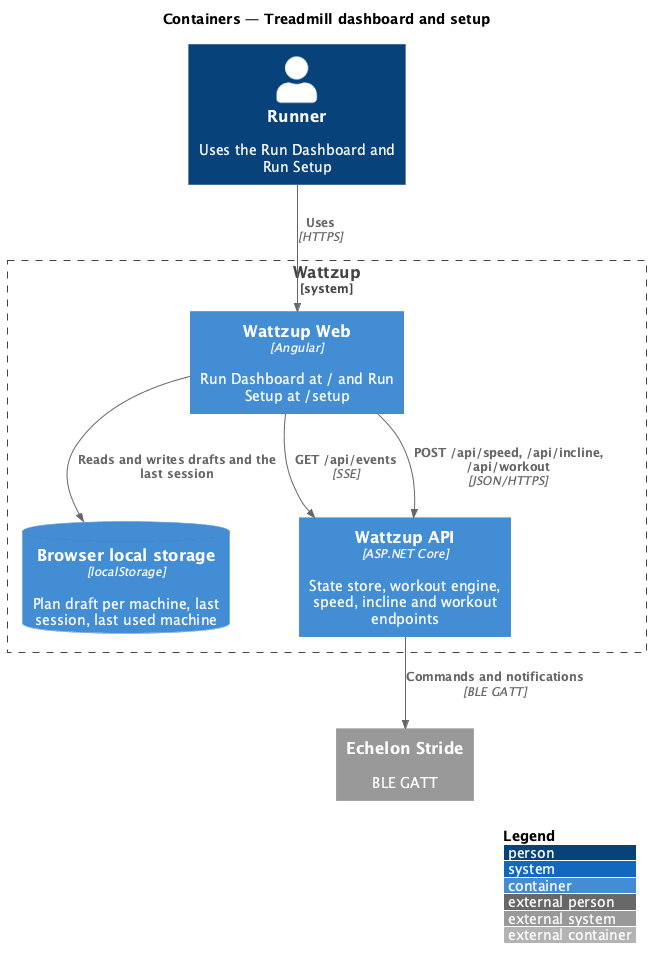
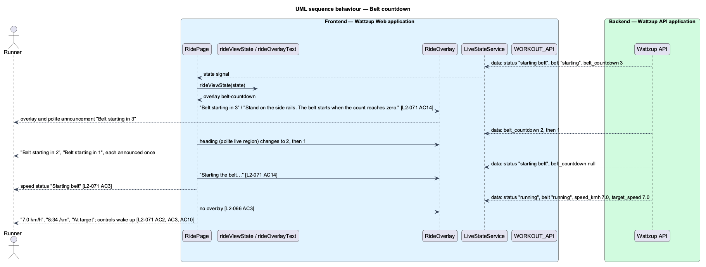
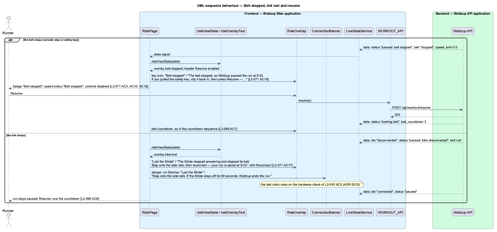
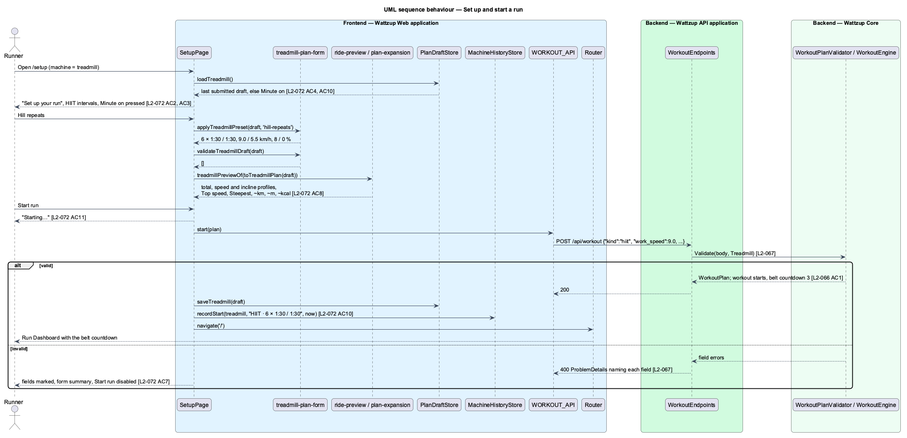

# Treadmill dashboard and setup

## Overview

Wattzup drives one machine at a time, the Echelon bike or the Echelon Stride treadmill (L2-062). With the treadmill chosen, the ride dashboard at `/` becomes the *Run Dashboard* and the setup screen at `/setup` becomes *Run Setup*, after the Magic Patterns frames of those names (ADR 0010). The dashboard shows the belt's speed with its pace, the incline, a trace of speed against the plan with an incline lane, and the run's pace, distance, climb and energy. Its side panel sets the speed and incline. Before every belt start it shows a 3-second countdown and announces it. The setup screen builds a treadmill plan from presets, speeds and inclines, and previews the run's distance, climb and energy. This feature is the frontend half of treadmill support. The backend behaviour it shows belongs to the sibling designs in `docs/detailed-designs/treadmill/`.

**run** — the UI's word for a ride on the treadmill; the API keeps the workout's identifiers and `workout.status` strings on both machines (ADR 0010)

**Steady** — the UI's name for a treadmill `flat` plan: one speed and one incline held for the whole run

**the Stride** — the UI's name for the treadmill; Wattzup drives only the Echelon Stride (L2-063)

**belt** — the treadmill's moving surface; its state is `belt`, one of `stopped`, `starting` or `running`, and `null` on the bike or while the treadmill is not connected (L2-066)

**belt countdown** — 3, 2, 1 sequence in `belt_countdown` that precedes every start of the belt (L2-066)

**target speed** — speed last requested from the treadmill, km/h, `target_speed` (L2-065)

**target incline** — incline last requested from the treadmill, %, `target_incline` (L2-065)

**pace** — time per kilometre at a speed, 3600 ÷ km/h seconds, shown `m:ss` `/km` (L2-071 criterion 2)

**incline picker** — row of 11 bars for 0 to 10 %, exposed to assistive technology as a slider (L2-071 criterion 9)

**preset** — named set of plan values that fills the setup form in one press, shown pressed while every value it sets still matches (L2-072 criterion 3)

**treadmill plan draft** — the setup form's working copy of a treadmill plan, in the units the rider edits (`1:00`, `13.0`, `2`, `30`); turned into a `WorkoutPlan` (L2-067) only when it is valid

The bike screens of `dashboard/` and `workouts/set-up-ride` are unchanged when `machine` is `bike`, apart from the setup header of L2-072 criterion 1.

The mocks are the source of truth for the UI: `docs/mocks/pages/ride/treadmill*.html` (default, paused, flat, manual, countdown, belt-stopped, disconnected, scanning), `docs/mocks/pages/setup/treadmill*.html` (default, flat, invalid, submitting), and the treadmill states of the end-ride and replace-ride dialogs, the connection banner, the ride toast and the phase banner. Their BEM classes are kept, because the e2e locators depend on them.

Related designs:

- `treadmill/choose-machine` — the machine page at `/machine`, `POST /api/machine` and the reset of the machine-specific fields (L2-062, L2-070, L2-073).
- `treadmill/decode-treadmill-telemetry` — `speed_kmh`, `incline`, `belt`, `distance_km`, `climb_m` and `kcal` on the treadmill (L2-064).
- `treadmill/control-speed-and-incline` — `POST /api/speed`, `POST /api/incline` and the `speed` and `incline` command log entries (L2-065, L2-069).
- `treadmill/control-the-belt` — the belt countdown, the start and stop commands, and `paused: belt stopped` (L2-066).
- `treadmill/run-treadmill-workout` — treadmill plan validation and expansion, and the engine's speed and incline targets (L2-067, L2-068).

## Description

### API contract and live state

- **`api-types.ts`** — aliases `Machine`, `BeltState`, `NearbyMachine`, `SetSpeedRequest`, `SpeedSent`, `SetInclineRequest` and `InclineSent` from the generated schema in `src/app/api/`, which comes from the backend's OpenAPI document (L2-014, L2-070). `BikeState` gains `climb_m` and `nearby` there. No type is hand-written.
- **`MachineApi`** (`core/machine-api.ts`) — the contract behind the token `MACHINE_API`: `choose(machine)`, `setSpeed(speed)` and `setIncline(incline)`. The two setters reject with `RequestTimeoutError` after 5 s, as `BikeApi.setResistance` does. `HttpMachineApi` (`http-api.ts`) implements it, and `app.config.ts` binds it.
- **`LiveStateService`** — unchanged and still the only owner of the `EventSource`. Every machine-aware view reads `state().machine`. No component opens its own connection or polls.

### Pure helpers

Each helper lives in `frontend/src/app/core/`, has its unit tests beside it, and has no Angular dependency.

- **`machine-words.ts`** — `machineWords(machine)` returns `{noun, title, label, panelTitle, ride, otherMachine}`: on the treadmill `treadmill`, `Echelon treadmill`, `Treadmill`, `Sent to treadmill`, `run` and `bike`; on the bike `bike`, `Echelon bike`, `Bike`, `Sent to bike`, `ride` and `treadmill`.
- **`pace.ts`** — `formatPace(speedKmh)` returns 3600 ÷ speed seconds per kilometre as `m:ss`, so 13.0 km/h reads `4:37`. A speed below 0.5 km/h or `null` reads `–:––` (L2-071 criterion 2). `formatAvgPace(elapsedSeconds, distanceKm)` returns elapsed ÷ distance as `m:ss`, or `–:––` while the distance is 0 (L2-071 criterion 7).
- **`treadmill-view.ts`** — what the readouts show:
  - `speedView(state)` returns `{valueText, paceText, statusText, statusTone}`. `valueText` is `speed_kmh` to 1 decimal or `--`, and `paceText` is `<pace> /km`. `statusText` is `Starting belt` while `workout.status` is `starting belt`, `Belt paused` while it is `paused`, `Belt stopped` while `belt` is `stopped` otherwise, `Ramping to <target_speed>` while the belt runs more than 0.05 km/h from `target_speed`, and `At target` otherwise. `statusTone` is `warning` for *Ramping* and `success` for *At target*; the text carries the state as well (L2-071 criteria 2 and 3).
  - `inclineView(state)` returns `{valueText, noteText}`. `noteText` is `Deck moving to <target_incline>%` while `target_incline` differs from `incline`, else `Plan <n>%` with the current segment's incline (L2-071 criterion 4).
- **`treadmill-controls.ts`** — the side panel's rules (L2-071 criteria 8 to 11):
  - Constants `MIN_SPEED` 0.8, `MAX_SPEED` 19.3, `SPEED_STEP` 0.5, `QUICK_SPEEDS` `[5, 8, 10, 12, 14, 16]`, `MIN_INCLINE` 0, `MAX_INCLINE` 10 and `INCLINE_STEP` 1, shared with `treadmill-plan-form.ts`.
  - `baseSpeed(state)` is `target_speed`, else the current segment's speed, else 7.0. `stepSpeed(state, dir)` adds or subtracts 0.5 km/h, clamped to 0.8–19.3 and rounded to 1 decimal.
  - `baseIncline(state)` is `target_incline`, else `incline`, else 0. `stepIncline(state, dir)` adds or subtracts 1 %, clamped to 0–10.
  - `treadmillControlsState(state, commandsEnabled)` returns the disabled flags of Slower, Faster, Lower incline, Raise incline, the quick speeds and the picker, the pressed quick speed (the one equal to `target_speed`), and a note. Each button is disabled at its limit. While `belt` is not `running`, every control is disabled; with no paused workout the note reads `Speed and incline controls wake up once the belt is running.`
  - `treadmillPlanNote(state)` returns the plan note: `Following the plan — speed and incline change with each interval.` (`hiit`, `plan` mode), `Holding one speed and incline for the whole run.` (`flat`), or in `manual` mode `Manual speed.`, `Manual incline.` or `Manual speed and incline.` (by which of the two differs from the segment), followed on `hiit` by `Plan takes over next interval.`, with `Back to plan` shown.
- **`treadmill-trace.ts`** (new) — `treadmillTraceGeometry(workout, elapsed, samples)` returns the scene for the speed trace and its incline lane (L2-071 criterion 6):
  - `speedMaxFor(topSpeed)` is min(20, max(10, ⌈top × 1.2 ÷ 5⌉ × 5)) km/h, with grid lines every 5 km/h.
  - Each segment is a block at its target speed, toned `work`, `rest` or `easy` as `profileTone` tones it, and the reported speeds form the *Actual* line up to `elapsed`.
  - The incline lane (`inclineLane(workout, history)`) runs from 0 to 10 %, with the plan's incline as a dashed step line and the reported incline as a filled area. The speed scene is in tenths of km/h, so the shared `traceDrawList` keeps whole units, with a grid every 50 tenths.
  - `treadmillTickStep(total)` is 120 s for runs up to 15 min, 180 s up to 30 min, else 300 s.
- **`TreadmillTraceHistory`** (new, `core/treadmill-trace-history.ts`) — the browser's copy of the run's reported speed and incline per running second, `[ride second, speed × 10, incline]` in typed arrays of `TRACE_CAPACITY` (10,800) entries, appended from the stream by `TreadmillTraceStore` as `PowerTraceStore` appends power. It is cleared when a new workout starts.
- **`treadmill-energy.ts`** (new) — `kcalPerSecond(speedKmh, incline)`, the ACSM estimate of L2-064 criterion 11 for a 75 kg runner, mirroring the backend's `TreadmillEnergy`. The setup preview uses it for *Expected energy*.
- **`treadmill-plan-form.ts`** — the treadmill plan draft's rules (L2-072):
  - The limits above, and the messages of L2-067: `Speed must be 0.8 to 19.3 km/h.`, `Enter a speed like 9.0.`, `Incline must be 0 to 10 %.` and `Enter a whole number.`
  - `TREADMILL_PRESETS` — HIIT `Sprints 30/30` (10 × 0:30 / 0:30, 15.0 / 5.5 km/h, 1 / 0 %), `Minute on` (6 × 1:00 / 1:00, 13.0 / 6.0 km/h, 2 / 1 %), `Hill repeats` (6 × 1:30 / 1:30, 9.0 / 5.5 km/h, 8 / 0 %), `Norwegian 4×4` (4 × 4:00 / 3:00, 12.5 / 6.0 km/h, 3 / 1 %); Steady `Hill walk` (6.5 km/h, 8 %, 30 min), `Easy run` (9.5 km/h, 1 %, 30 min) and `Tempo` (12.5 km/h, 1 %, 20 min) (L2-072 criterion 3). `presetPressed(draft, id)` is true while every value the preset sets matches the draft.
  - `DEFAULT_TREADMILL_DRAFT` is HIIT with the `Minute on` values and warm-up and cool-down on; its Steady fields hold the `Hill walk` values (L2-072 criterion 4).
  - `stepTreadmillDraft(draft, field, dir)` steps speeds by 0.5 km/h within 0.8–19.3, inclines by 1 % within 0–10, and Duration by 5 minutes (L2-072 criteria 5 and 6).
  - `validateTreadmillDraft(draft)` returns, for each failing field of the current mode, the L2-067 message and the summary link text of L2-072 criterion 7: `Work speed — 0.8 to 19.3 km/h`, `Recover speed — 0.8 to 19.3 km/h`, `Speed — 0.8 to 19.3 km/h`, `Work incline — 0 to 10 %`, `Recover incline — 0 to 10 %` or `Incline — 0 to 10 %`.
  - `toTreadmillPlan(draft)` returns the generated `WorkoutPlan` for a valid draft.
- **`plan-expansion.ts`** — `expandPlan(plan)` expands a treadmill plan by L2-068 criteria 1 and 2, mirroring `PlanExpander`: the warm-up at `rest_speed` + 1.0 km/h (at most 19.3) and `rest_incline`, the cool-down at `rest_speed` and 0 %. `planSummary(plan)` reads `Steady · <speed> km/h at <incline>% · <minutes> min` for a treadmill `flat` plan (L2-067 criterion 8).
- **`ride-preview.ts`** — `treadmillPreviewOf(plan)` returns the *Your run* panel (L2-072 criterion 8): the total time; a speed profile, each bar's height the segment's speed on a 19.3 km/h scale; an incline profile from 0 to 10 % on the same time axis; and the rows Structure, Top speed `<n> km/h · <pace> /km`, Steepest `<n>%`, Expected distance `~<n.nn> km`, Expected climb `~<n> m` and Expected energy `~<n> kcal`. Distance, climb and energy sum each expanded segment as L2-064 criteria 9 to 11 sum each tick. For *Minute on* they read 16:00, `6 × 1:00 / 1:00`, `13.0 km/h · 4:37 /km`, `2%`, `~2.35 km`, `~35 m` and `~184 kcal`.
- **`MachineHistoryStore`** (`core/machine-history.store.ts`, from `treadmill/choose-machine`) — `recordStart(machine, summary, startedAt)` keeps the last session and the last used machine (L2-072 criterion 10).
- **`PlanDraftStore`** (`plan-draft.store.ts`) — keeps the last submitted draft per machine under `wattzup.planDraft` and `wattzup.treadmillPlanDraft`. `readTreadmillDraft` yields `DEFAULT_TREADMILL_DRAFT` for missing, unreadable or out-of-range data, so a draft saved under the old 16.0 km/h and 15 % limits that no longer validates falls back to the default (L2-072 criterion 10).
- **Helpers that word the machine** — each reads `machine` from the state or takes it as an argument:
  - `statusBadge(status, machine)` (`segment-labels.ts`) reads `Starting belt`, `Belt stopped`, `Treadmill disconnected`, `Waiting for treadmill` and `Treadmill shut off` on the treadmill (L2-071 criterion 18).
  - `rideViewState` (`ride-view-state.ts`) — `RideOverlayKind` covers `belt-countdown` (`belt_countdown` 3, 2 or 1), `belt-starting` (`starting belt` with `belt_countdown` `null`), `belt-stopped` (`paused: belt stopped`), `bike-lost` and `scanning`. Resume stays enabled under `belt-stopped` (L2-071 criteria 1, 14 and 16).
  - `rideOverlayText(kind, state)` (`ride-overlay-text.ts`) words each overlay on the treadmill (L2-071 criteria 14 and 16 to 18):
    - `belt-countdown`: `Belt starting in <n>` / `Stand on the side rails. The belt starts when the count reaches zero.`
    - `belt-starting`: `Starting the belt…`
    - `belt-stopped`: `Belt stopped` / `The belt stopped, so Wattzup paused the run at <elapsed>. If you pulled the safety key, clip it back in, then press Resume — the belt starts after a 3-second countdown.`, with a key icon and `Resume`
    - `bike-lost`: `Lost the Stride` / `The Stride stopped answering and stopped its belt. Step onto the side rails, then reconnect — your run is saved at <elapsed>.`, with `Reconnect`
    - `scanning`: `Looking for your Stride` / `No Echelon treadmill found yet — switch it on and clip in the safety key. Wattzup scans again every 20 seconds.`, adding `Your run starts as soon as the Stride connects: 
.` when a workout is waiting
  - `connectionStatus` (`connection-status.ts`) names `Echelon treadmill` `Scanning…` while scanning and `<device_label>` `Connected` when connected (L2-018, L2-071 criteria 1 and 18).
  - `banners` (`connection-banners.ts`) gives the danger banner without Dismiss `Lost the Stride` / `Step onto the side rails. If the Stride stays off for 90 seconds, Wattzup ends the run.` and the simulated banner `Simulated treadmill` / `No hardware connected — Wattzup started with --simulate and is generating speed and incline.` (L2-071 criteria 17 and 18).
  - `bannerText`, `announcement` and `nextLabel` (`cue-text.ts`) read `WORK · <speed> KM/H · <incline>% · GO!` or `<KIND> · <speed> KM/H · <incline>%`, announce `Work, 13.0 km/h, incline 2%, 1 minute`, and read `Next: <Kind> <m:ss> at <speed> km/h, <incline>%` or `Last stretch` (L2-071 criteria 5 and 19).
  - `commandLabel(entry)` (`command-log-view.ts`) returns `SPD <value>` or `INC <value>%` from the entry's `command` (L2-071 criterion 12).
- **`TreadmillCommandService`** (`core/`, root-provided) — sends a stepped, quick or picked speed or incline through `MACHINE_API`. A 503 answer shows the danger toast `Couldn't set speed` or `Couldn't set incline` / `The Stride isn't connected. Switch it on, then try again.` through `ToastService` (L2-071 criterion 13). It holds no state; the reported and target values come back over the event stream.
- **`RideActions.switchMachine(target)`** (`core/ride-actions.ts`) — serves `End and switch to bike` on the treadmill dashboard and `Switch to bike` / `Switch to treadmill` on setup: the end dialog first when a workout is active, then `/machine` (`treadmill/choose-machine`, L2-073 criterion 9).

### Components

Each component is standalone, `OnPush`, and split into `name.ts`, `name.html` and `name.scss` under `frontend/src/app/dashboard/`. The components hold no rule of their own.

**Run Dashboard** (`RidePage` with `machine` `treadmill`):

| Component | Selector | Role |
|---|---|---|
| `AppBar` | `wz-app-bar` | Status line `<device_label>` `Connected`, the plan's `summary`, the clock `<elapsed> / <total>`, Pause or `Resume` (disabled during the belt countdown and while disconnected), and a danger-tinted `Stop belt` (`btn--stop-belt`) in place of End that opens the end dialog (L2-071 criterion 1) |
| `Readout` | `wz-readout` | `kind` `speed`: `<value>` `km/h`, `<pace> /km` and the status from `speedView`; `kind` `incline`: `<value>` `%` and `noteText`. No mph is shown (L2-071 criteria 2 to 4) |
| `Interval` | `wz-interval` | Kind, round, countdown and the next line from `nextLabel` (L2-071 criterion 5) |
| `RideTrace` | `wz-ride-trace` | With `machine` `treadmill`, titled `Speed vs. plan · incline below` with the legend Actual, Work and (on `hiit`) Recover; draws the speed scene of `treadmillTraceGeometry` through the existing `TraceRenderer` (WebGL with the Canvas 2D fallback, ADR 0006), so the animation loop pauses when the tab is hidden and respects reduced motion. The incline lane below it is a small SVG (`.trace__lane`, as the design system draws it) whose reported line holds one point per incline change; the video and trace views render from one template on both machines (L2-071 criterion 6, L2-076) |
| `MetricsStrip` | `wz-metrics-strip` | Heart rate (`--` `bpm`), Avg pace, Distance (`km`, 2 decimals), Climbed (`m`) and Energy (`kcal`, thousands separator); no power or cadence (L2-071 criterion 7) |
| `SpeedControl` | `wz-speed-control` | Section `Speed`: `Slower` and `Faster` around the target (`speed-control__readout--hero`, `km/h target · <pace> /km`), then `wz-quick-speeds` (L2-071 criterion 8) |
| `QuickSpeeds` | `wz-quick-speeds` (new) | 6 buttons `5` to `16` with `aria-pressed` on the one equal to `target_speed`; emits the speed |
| `InclineControl` | `wz-incline-control` | Section `Incline`: `Lower incline` and `Raise incline` around `<target>%` `of 10%`, then `wz-level-picker` with the `level-picker--incline` modifier, 11 bars as a slider (`aria-valuemin` 0, `aria-valuemax` 10, arrow keys by 1 %) (L2-071 criterion 9) |
| `PlanNote` | `wz-plan-note` | `treadmillPlanNote` with `Back to plan` (L2-071 criterion 11) |
| `CmdLog` | `wz-cmd-log` | `Sent to treadmill`, `BLE · <last 6 characters of device>`, the newest 4 entries as `<m:ss> SPD <value> · <source>` or `INC <value>%`, with `ack <n>ms`, `sending` or `failed`; `No commands yet this session.` when empty. Below it, in `ride-aside__foot`, `End and switch to bike` (L2-071 criterion 12) |
| `RideOverlay` | `wz-ride-overlay` | The countdown numeral large and hidden from assistive technology; the heading `Belt starting in <n>` is the polite live region, so each number is announced once. Also the belt-stopped, *Lost the Stride* and scanning overlays (L2-071 criteria 14 and 16 to 18) |
| `PhaseBanner` | `wz-phase-banner` | The segment-change banner of `bannerText` (L2-071 criterion 19) |
| `EndRideDialog` | `wz-end-ride-dialog` | CDK Dialog: `Stop the belt and end this run?` / `You're <elapsed> into <total>. Wattzup stops the belt; your trace and totals stay on the dashboard until you start a new run.` with `Keep running` (focused) and `Stop belt` (L2-071 criterion 15) |
| `ReplaceRideDialog` | `wz-replace-ride-dialog` | CDK Dialog: `Replace the run in progress?` / `You're <elapsed> into 
. Starting <new summary> ends it and begins the new run at 0:00. Wattzup stops the belt first, then counts down 3 seconds before starting it again.` with `Keep current run` (focused) and `Replace run` (L2-071 criterion 15) |

Under 1024 px the side panel follows the main area, and under 640 px the metrics strip shows 2 columns, as the bike's dashboard does (L2-040, L2-071 criterion 20).

**Run Setup** (`SetupPage` with `machine` `treadmill`):

| Component | Selector | Role |
|---|---|---|
| `SetupPage` | `wz-setup-page` | Header with `wz-status-line` (`<device_label>`), the `Switch to bike` link (`Switch to treadmill` on the bike) through `RideActions.switchMachine`, and `Close` (`app-bar__close`); no machine radio group on either machine (L2-072 criterion 1). Title `Set up your run` with `Wattzup drives the Stride's belt speed and incline for you. Pick how.` (L2-072 criterion 2) |
| `ModeCards` | `wz-mode-cards` | `HIIT intervals` / `Hard and easy efforts on repeat. Speed and incline switch at every interval.` and `Steady` / `One speed and one incline, held the whole run. Good for hill walks and easy miles.` |
| `Presets` | `wz-presets` | The mode's presets from `TREADMILL_PRESETS`, each with `aria-pressed` from `presetPressed` (L2-072 criterion 3) |
| `NumStepper` | `wz-num-stepper` | Rounds, Work and Recover (L2-029), and Steady's `Duration (min)` stepping by 5 (L2-072 criteria 5 and 6) |
| `EffortRow` | `wz-effort-row` (new) | One row, `Work`, `Recover` or Steady's `Hold`: a typable speed field between `Slower <row>` and `Faster <row>` with its pace `<m:ss> /km`, and an incline picker (`wz-level-picker`, `level-picker--incline`) showing `<n>%`. `aria-invalid` and the L2-067 message mark an out-of-range field (L2-072 criteria 5 to 7) |
| `Toggles` | `wz-toggles` | `Warm-up` `3 min, brisk walk` and `Cool-down` `2 min, walk, deck back to 0%` |
| `FormSummary` | `wz-form-summary` | `<n> thing(s) to fix before you start` with the links of `validateTreadmillDraft` (L2-072 criterion 7) |
| `RidePreview` | `wz-ride-preview` | `Your run`: the total, the speed profile above the incline profile (`profile--incline`), the summary rows of `treadmillPreviewOf`, then `Clip the safety key to your clothes. The belt starts 3 seconds after you tap Start.` above `Start run`, or `Fix the field marked in red to start.` with Start run disabled (L2-072 criteria 7 to 9) |

Steady shows the line `You can still change speed and incline mid-run from the dashboard.` under the `Hold` row (L2-072 criterion 6). *Start run* reads `Starting…` while the request runs and follows the bike's start flow of `workouts/set-up-ride`: the replace dialog when a workout is active, else `WORKOUT_API.start(toTreadmillPlan(draft))`. On success it saves the draft, calls `MachineHistoryStore.recordStart`, and navigates to `/`, where the belt countdown runs (L2-072 criteria 10 and 11).

Every button is a native `button` with a visible or accessible name, at least 44 × 44 px, and works by touch and keyboard. The belt state, the ramp state and the pressed preset or quick speed are carried by text or an ARIA attribute as well as colour.

### Acceptance tests

Playwright (`frontend/e2e/`), Chromium only. The shared fixture answers every `/api/**` request, and the SSE fixture serves `/api/events` and pushes treadmill state messages. The responses for `POST /api/speed`, `POST /api/incline` and a treadmill `POST /api/workout` are re-recorded against the backend running with `--simulate --machine treadmill`, because the limits and messages changed.

- Page objects: `e2e/pages/ride.page.ts` gains the speed and incline readouts with their status, the trace title, the metrics, the Speed and Incline sections, the quick speeds, the incline picker, the belt overlays, the live region, `Stop belt` and `End and switch to bike`. `e2e/pages/setup.page.ts` gains the header link, the presets, the effort rows and the *Your run* rows. The end and replace dialogs keep their page objects.
- `e2e/treadmill-ride.spec.ts`:
  - `shows the Stride in the status line and Stop belt in place of End` (L2-071 AC1)
  - `shows speed in km/h with pace, and no mph` (L2-071 AC2)
  - `words the speed status: starting, paused, stopped, ramping and at target` (L2-071 AC3)
  - `shows the incline with its plan or Deck moving to` (L2-071 AC4)
  - `reads the next interval with its speed and incline` (L2-071 AC5)
  - `titles the trace Speed vs. plan with an incline lane` (L2-071 AC6)
  - `shows heart rate, avg pace, distance, climbed and energy` (L2-071 AC7)
  - `steps speed by 0.5 from the target and sends a quick speed` (L2-071 AC8)
  - `steps the incline by 1 and picks it from the bars` (L2-071 AC9)
  - `disables speed and incline until the belt runs` (L2-071 AC10)
  - `words the plan note and offers Back to plan in manual mode` (L2-071 AC11)
  - `titles the log Sent to treadmill with the newest 4 SPD and INC entries` (L2-071 AC12)
  - `shows a danger toast when a speed or incline send answers 503` (L2-071 AC13)
  - `counts down the belt start and announces each number once` (L2-071 AC14)
  - `words the end and replace dialogs for the belt` (L2-071 AC15)
  - `shows Belt stopped with Resume and the header Resume enabled` (L2-071 AC16)
  - `shows Lost the Stride with the side-rails banner` (L2-071 AC17)
  - `words the scanning status, overlay, badges and simulated banner` (L2-071 AC18)
  - `shows the segment-change banner with speed and incline` (L2-071 AC19)
  - `moves the side panel under the main area under 1024 px` (L2-071 AC20)
- `e2e/treadmill-setup.spec.ts`:
  - `shows the device status line, Switch to bike and Close, and no machine choice` (L2-072 AC1)
  - `titles the screen Set up your run with the HIIT and Steady cards` (L2-072 AC2)
  - `fills a preset and shows it pressed until a value changes` (L2-072 AC3)
  - `shows the Minute on and Hill walk defaults on first use` (L2-072 AC4)
  - `steps speed by 0.5 within its limits and picks an incline` (L2-072 AC5)
  - `shows the Hold row and the Duration stepper for Steady` (L2-072 AC6)
  - `names an out-of-range speed or incline and disables Start run` (L2-072 AC7)
  - `previews the Minute on run: 16:00, 2.35 km, 35 m and 184 kcal` (L2-072 AC8)
  - `shows the safety-key line above Start run` (L2-072 AC9)
  - `restores the last submitted run and records the last session` (L2-072 AC10)
  - `starts a run, shows Starting…, and opens the dashboard` (L2-072 AC11)

Unit tests in `src/app/core/`: `pace.spec.ts` (13.0, 0.4, `null`, and the average pace), `treadmill-view.spec.ts` (each status of L2-071 criterion 3, each incline note), `treadmill-controls.spec.ts` (each base fallback, each limit, the belt gate, each plan note), `treadmill-trace.spec.ts` (the scale at top speeds 8, 13 and 19.3, each tick step), `treadmill-energy.spec.ts` (the rows of the backend's `TreadmillEnergyTests`), `treadmill-plan-form.spec.ts` (one case per row of the L2-067 table, each preset and its pressed rule), `plan-draft.store.spec.ts` (a draft under the old limits falls back), `plan-expansion.spec.ts` (the warm-up rule and the Steady summary), `ride-preview.spec.ts` (the *Minute on* figures), and the treadmill cases of `segment-labels`, `ride-view-state`, `ride-overlay-text`, `connection-status`, `connection-banners`, `cue-text` and `command-log-view`.

### Open questions

- **Trace after a reload.** `GET /api/workout/trace` serves power only (L2-050), so the treadmill's *Actual* line and reported incline start again from the reload; the plan blocks are complete. Restoring them needs L2-050 to carry speed and incline, a requirement change.
- **Preview rounding.** *Minute on*'s expected climb is exactly 34.5 m. Summed one second at a time, as the engine sums ticks, it is 34.5000…1 m, which rounds to 35 under L2-064 criterion 10; the preview therefore reads `~35 m`, the figure the dashboard shows at the end of the run, and L2-072 criterion 8 states it.
- **Heart rate.** The mocks show a heart rate, but `heart_rate` is always `null` and reads `--` `bpm` (ADR 0003, L2-071 criterion 7).
- **Disconnect copy.** *Lost the Stride* assumes the treadmill stops its own belt when the link drops; it holds only after the hardware check of L2-043 criterion 5 (ADR 0010).
- **Copy the requirements do not give.** The shut-off overlay, the reconnected banner and the recover phase detail keep the wording the current implementation uses (`Ride ended — the treadmill shut off`, `<label> is back. The run is paused at <t> — press Resume to start the belt again.`, `1:00 · next: Work at 13.0 km/h`); L2-071 should adopt or replace them.
- **Bike wording left on the treadmill.** The network-sharing banner, the offline note and the loading skeleton keep the bike's wording, because the machine is unknown before the first state.

## Requirements

| L2 ID | Refines (L1) | Requirement |
|-------|--------------|-------------|
| `L2-071` | `L1-013` | Treadmill dashboard. With `machine` `treadmill`, the ride dashboard shows the treadmill's metrics and controls in place of the bike's, following the Run Dashboard frame; the UI calls the ride a *run* and the treadmill *the Stride*. |
| `L2-072` | `L1-013` | Set up a run on the treadmill. With `machine` `treadmill`, the `/setup` screen builds a treadmill plan, following the Run Setup frame; the machine is chosen on the machine page (L2-073). |
| `L2-014` | `L1-005` | State model contract. The JSON state must keep the prototype's snake_case field names so the contract is stable across the rewrite, and add the fields the design needs. |

## Diagrams

### System context

The runner sets up a run and watches it in Wattzup, which drives the Stride's speed, incline and belt.

### Containers

Wattzup Web reads the live state from the Wattzup API over SSE and sends the speed, incline and workout requests to it over HTTPS. It keeps the plan drafts and the last session in the browser's local storage.

### Components

`RidePage` and `SetupPage` read `LiveStateService` and render the treadmill components. The pure helpers hold every rule. `TreadmillCommandService` and `SetupPage` reach the backend through `MACHINE_API` and `WORKOUT_API`, and `RideTrace` draws the speed trace through `TraceRenderer`.

### Class structure

`MachineApi` is a contract with one HTTP implementation. The components depend on the token and the pure helpers, and the views are plain records the helpers build from the generated `BikeState`.

### Behaviour — belt countdown

A start or resume runs the countdown overlay with one announcement per number, then `Starting the belt…` until the treadmill reports speed and the speed readout reads `At target` (L2-071 criteria 3 and 14, L2-066).

### Behaviour — belt stopped and resume

A belt stopped from the console or by the safety key shows `Belt stopped` with Resume; Resume runs the countdown again. A dropped link shows *Lost the Stride* and the side-rails banner instead (L2-071 criteria 16 and 17).

### Behaviour — step the speed

`Faster` sends 0.5 km/h above the target speed. A 200 leaves the readout to the stream, which reads `Ramping to <n>` until the treadmill reports it. A 503 shows a danger toast (L2-071 criteria 3, 8 and 13).

### Behaviour — set up and start a run

A preset fills the form and the preview recomputes. Start run posts the treadmill plan, saves the draft and the last session, and opens the dashboard, where the belt countdown runs (L2-072 criteria 3, 8, 10 and 11).

