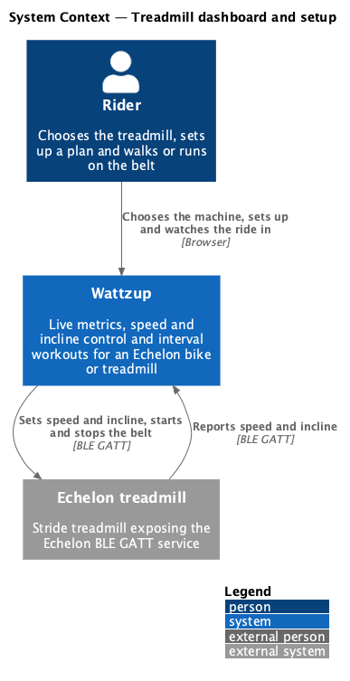
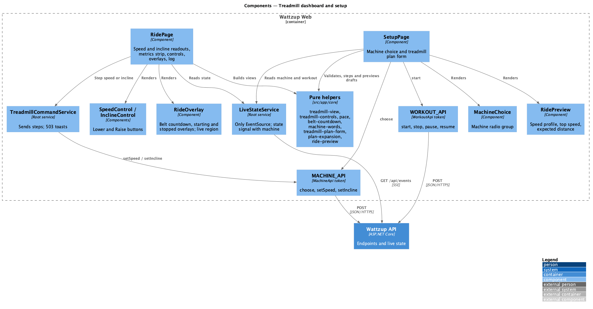
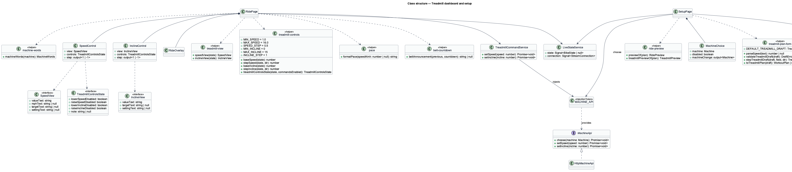
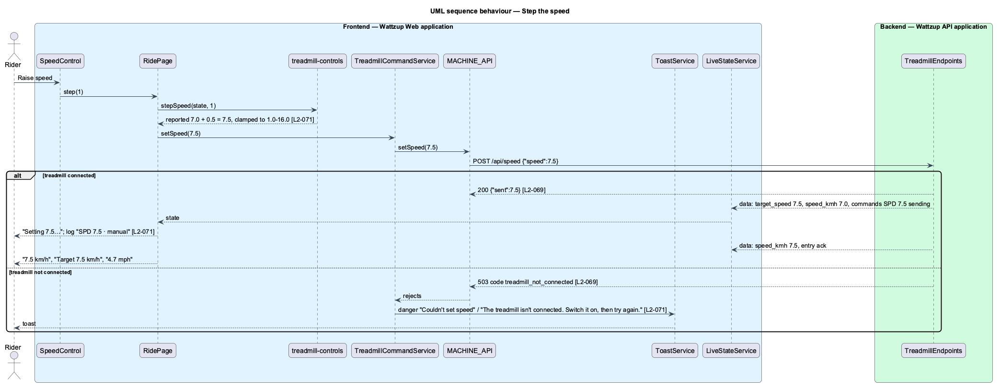
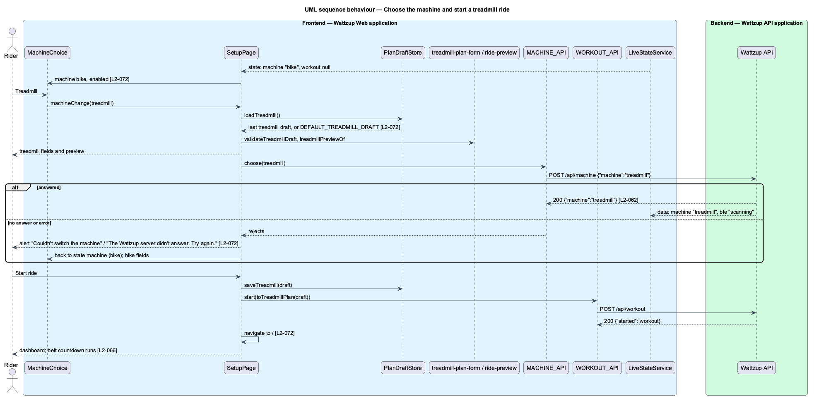

# Treadmill dashboard and setup

## Overview

Wattzup drives one machine at a time, the Echelon bike or the Echelon treadmill (ADR 0009, L2-062). With the treadmill chosen, the ride dashboard at `/` shows the treadmill's speed, incline, distance and pace instead of the bike's power, cadence and resistance. Its side panel steps the speed and incline. Before and during the belt start it shows a 3-second countdown and announces it. The setup screen at `/setup` lets the rider choose the machine and build a treadmill plan with speeds and inclines instead of resistance levels. This feature is the frontend half of treadmill support. The backend behaviour it shows belongs to the sibling designs in `docs/detailed-designs/treadmill/`.

**machine** — the device Wattzup drives, `bike` or `treadmill`, carried in the state as `machine` (L2-062)

**belt** — the treadmill's moving surface; its state is `belt`, one of `stopped`, `starting` or `running`, and `null` on the bike or while the treadmill is not connected (L2-066)

**belt countdown** — 3, 2, 1 sequence in `belt_countdown` that precedes every start of the belt (L2-066)

**target speed** — speed last requested from the treadmill, km/h, `target_speed` (L2-065)

**target incline** — incline last requested from the treadmill, %, `target_incline` (L2-065)

**pace** — minutes per kilometre at the reported speed, 60 ÷ `speed_kmh`, shown `m:ss` `/km` (L2-071)

**treadmill plan draft** — the setup form's working copy of a treadmill plan, in the units the rider edits (`0:40`, `9.0`, `2`, `30`); turned into a `WorkoutPlan` (L2-067) only when it is valid

**machine words** — the nouns and titles that name the chosen machine in the UI (`bike` or `treadmill`, `Echelon bike` or `Echelon treadmill`)

The workout status strings stay contract identifiers on both machines (`waiting for bike`, `paused: bike disconnected`, `ended: bike shut off`); the UI words them for the chosen machine (L2-014, L2-071). The bike screens of `dashboard/` and `workouts/set-up-ride` are unchanged when `machine` is `bike`.

The mocks are the source of truth for the UI: the treadmill states under `docs/mocks/pages/ride/` and `docs/mocks/pages/setup/`, added by the mock change, and the design system extracted from them. Their BEM classes are kept, because the e2e locators depend on them.

Related designs:

- `treadmill/choose-machine` — `POST /api/machine` and the reset of the machine-specific fields (L2-062, L2-070).
- `treadmill/decode-treadmill-telemetry` — `speed_kmh`, `speed_mph`, `incline`, `belt` and `distance_km` on the treadmill (L2-064).
- `treadmill/control-speed-and-incline` — `POST /api/speed`, `POST /api/incline` and the `speed` and `incline` command log entries (L2-065, L2-069).
- `treadmill/control-the-belt` — the belt countdown, the start and stop commands, and `paused: belt stopped` (L2-066).
- `treadmill/run-treadmill-workout` — treadmill plan validation and expansion, and the engine's speed and incline targets (L2-067, L2-068).

## Description

### API contract and live state

- **`api-types.ts`** — gains `Machine` (`BikeState['machine']`), `BeltState`, `SetSpeedRequest`, `SpeedSent`, `SetInclineRequest`, `InclineSent`, `ChooseMachineRequest` and `MachineChosen`. Each alias reads the generated schema in `src/app/api/`, which comes from the backend's OpenAPI document (L2-014, L2-070). No type is hand-written.
- **`MachineApi`** (`src/app/core/machine-api.ts`) — the contract for the three treadmill and machine endpoints, with the injection token `MACHINE_API`:
  - `choose(machine)` — `POST /api/machine {machine}` (L2-062).
  - `setSpeed(speed)` — `POST /api/speed {speed}` (L2-069). It rejects with `RequestTimeoutError` after 5 s, as `BikeApi.setResistance` does.
  - `setIncline(incline)` — `POST /api/incline {incline}` (L2-069), with the same 5 s timeout.
- **`HttpMachineApi`** (`http-api.ts`) — the HTTP implementation. `app.config.ts` binds it to `MACHINE_API`. Components and services depend on the token only.
- **`LiveStateService`** — unchanged and still the only owner of the `EventSource`. Every machine-aware view reads `state().machine` from its `state` signal. No component opens its own connection or polls.

### Pure helpers

Each helper lives in `frontend/src/app/core/`, has its unit tests beside it, and has no Angular dependency.

- **`machine-words.ts`** — `machineWords(machine)` returns `{noun, title, label, panelTitle}`: `bike`, `Echelon bike`, `Bike`, `Sent to bike`, or `treadmill`, `Echelon treadmill`, `Treadmill`, `Sent to treadmill` (L2-071 criteria 11 and 14).
- **`pace.ts`** — `formatPace(speedKmh)` returns 60 ÷ speed minutes per kilometre as `m:ss`, so 9.0 km/h reads `6:40`. Speed 0 or `null` reads `--` (L2-071 criterion 3).
- **`treadmill-view.ts`** — what the speed and incline readouts show (L2-071 criteria 1 and 2):
  - `speedView(state)` returns `{valueText, mphText, targetText, settingText}`. `valueText` is `speed_kmh` to 1 decimal or `--`. `mphText` is `<speed_mph> mph`. `targetText` is `Target <target_speed> km/h`. `settingText` is `Setting <target_speed>…` when the target differs from the reported speed, else `null`.
  - `inclineView(state)` returns `{valueText, targetText, settingText}` with `Target <n> %` and `Setting <n>…` by the same rule.
- **`treadmill-controls.ts`** — the side panel's rules (L2-071 criteria 5 and 6):
  - Constants `MIN_SPEED` 1.0, `MAX_SPEED` 16.0, `SPEED_STEP` 0.5, `MIN_INCLINE` 0, `MAX_INCLINE` 15 and `INCLINE_STEP` 1.
  - `baseSpeed(state)` is the reported speed, else `target_speed`, else 7.0. `stepSpeed(state, dir)` adds or subtracts 0.5 km/h, clamped to 1.0–16.0 and rounded to 1 decimal.
  - `baseIncline(state)` is the reported incline, else `target_incline`, else 0. `stepIncline(state, dir)` adds or subtracts 1 %, clamped to 0–15.
  - `treadmillControlsState(state, commandsEnabled)` returns the four disabled flags and a note. Each button is disabled at its limit (1.0 or 16.0 km/h, 0 or 15 %). With `ble` not `connected`, every button is disabled and the note reads `Speed and incline controls wake up once the treadmill connects.`
- **`belt-countdown.ts`** — `beltAnnouncement(previousCountdown, countdown)` returns `Belt starting in <n>` only when `belt_countdown` changes to a new number, else `null`. The polite live region therefore announces each number once (L2-071 criterion 8).
- **`treadmill-plan-form.ts`** — the treadmill plan draft's rules (L2-072):
  - `TreadmillPlanDraft` holds the mode, Rounds, Work, Recover, Work speed, Recover speed, Work incline, Recover incline, the warm-up and cool-down switches, and the flat Speed, Incline and Duration.
  - `DEFAULT_TREADMILL_DRAFT` is HIIT with 18 rounds, work 0:40, recover 0:20, work speed 9.0, recover speed 7.0, both inclines 0, warm-up and cool-down on; its flat fields are 7.0 km/h, 0 % and 30 minutes (L2-072 criteria 4 and 5).
  - `parseSpeed(text)` accepts a number with at most 1 decimal. Other text is invalid.
  - `validateTreadmillDraft(draft)` returns, for each failing field of the current mode, the message of L2-067 (`Speed must be 1.0 to 16.0 km/h.`, `Enter a speed like 9.0.`, `Incline must be 0 to 15 %.`, `Enter a whole number.`) and the summary link text of L2-072 criterion 7 (for example `Work speed — 1.0 to 16.0 km/h`). Rounds, Work, Recover and Duration reuse the rules and messages of `plan-form.ts` (L2-010).
  - `stepTreadmillDraft(draft, field, dir)` steps speed fields by 0.5 km/h and incline fields by 1 %, and the other fields as `stepDraft` does (L2-072 criterion 6).
  - `toTreadmillPlan(draft)` returns the generated `WorkoutPlan` with the treadmill fields for a valid draft.
- **`PlanDraftStore`** (`plan-draft.store.ts`) — gains `loadTreadmill()` and `saveTreadmill(draft)` under the `localStorage` key `wattzup.treadmillPlanDraft`. The bike key `wattzup.planDraft` is unchanged. Missing, unreadable or invalid data yields `DEFAULT_TREADMILL_DRAFT` (L2-072 criterion 9).
- **`plan-expansion.ts`** — `expandPlan(plan)` expands a treadmill plan by the rules of L2-068 criteria 1 and 2, mirroring `PlanExpander`: segment `speed` and `incline` set, `level` and `cadence` `null`. `planSummary(plan)` reads `Flat · <speed> km/h · <minutes> min` for a treadmill flat plan (L2-067 criterion 8). `expectedDistanceKm(segments)` returns the sum of each segment's speed × duration ÷ 3600.
- **`ride-preview.ts`** — `treadmillPreviewOf(plan)` returns the *Your ride* values for a treadmill plan (L2-072 criterion 8): the total time, a speed profile of the segments, Structure, Time under load (`hiit` only), Top speed `<n> km/h` and Expected distance `~<n.n> km`. Each profile bar's height is the segment's speed in a view box 16 km/h high.
- **Existing helpers that word the machine** — each reads `machine` from the state or takes it as an argument:
  - `statusBadge(status, machine)` (`segment-labels.ts`) adds `Starting belt` for `starting belt` and `Belt stopped` for `paused: belt stopped`. On the treadmill it reads `Treadmill disconnected`, `Waiting for treadmill` and `Treadmill shut off` for the three bike-named statuses (L2-071 criterion 11).
  - `rideViewState` (`ride-view-state.ts`) — `RideOverlayKind` gains `belt-countdown` (while `belt_countdown` is 3, 2 or 1), `belt-starting` (`starting belt` with `belt_countdown` `null`) and `belt-stopped` (`paused: belt stopped`). Resume stays enabled under `belt-stopped` (L2-071 criteria 8 and 9).
  - `rideOverlayText(kind, state)` (`ride-overlay-text.ts`) words each overlay. `belt-countdown` reads `Belt starting in <n>` / `Stand on the side rails. The belt starts when the count reaches zero.` `belt-starting` reads `Starting the belt…`. `belt-stopped` reads `Belt stopped` / `The treadmill's belt stopped, so Wattzup paused the ride at <elapsed>. Press Resume to start the belt again after a 3-second countdown.` On the treadmill `bike-lost` reads `Lost the treadmill` with the safety-key sentence, and `scanning` reads `Looking for your treadmill` (L2-071 criteria 8 to 11).
  - `connectionStatus` and `banners` (`connection-status.ts`, `connection-banners.ts`) name `Echelon treadmill` while scanning, carry the safety-key sentence in the disconnect banner, and word the simulated banner `Simulated treadmill` / `No hardware connected — Wattzup started with --simulate and is generating speed and incline.` (L2-071 criteria 10 and 11).
  - `bannerText` and `announcement` (`cue-text.ts`) use the segment's speed on the treadmill: `WORK · <speed> KM/H · GO!` or `<KIND> · <speed> KM/H`, and `Work, 9.0 km/h, incline 0 %, 40 seconds`. `nextLabel` reads `Next: <Kind> <m:ss> at <speed> km/h` (L2-071 criterion 13).
  - `commandLabel(entry)` (`command-log-view.ts`) returns `RES <level>`, `SPD <value>` or `INC <value>` from the entry's `command` (L2-071 criterion 14).
- **`TreadmillCommandService`** (`src/app/core/`, root-provided, like `ResistanceCommandService`) — sends a stepped speed or incline through `MACHINE_API`. A 503 answer shows the danger toast `Couldn't set speed` or `Couldn't set incline` / `The treadmill isn't connected. Switch it on, then try again.` through `ToastService` (L2-071 criterion 7). It holds no state of its own; the reported and target values come back over the event stream.

### Components

Each component is standalone, `OnPush`, and split into `name.ts`, `name.html` and `name.scss` under `frontend/src/app/dashboard/`. The components hold no rule of their own.

| Component | Selector | Role |
|---|---|---|
| `Readout` | `wz-readout` | `kind` gains `speed` and `incline`. The speed readout shows `valueText` `km/h` with `targetText` or `settingText` and `mphText`; the incline readout shows `valueText` `%` with `targetText` or `settingText` (L2-071 criteria 1 and 2) |
| `SpeedControl` | `wz-speed-control` | `Lower speed` and `Raise speed` buttons, mirroring `LevelControl`; emits `step` with `1` or `-1` |
| `InclineControl` | `wz-incline-control` | `Lower incline` and `Raise incline` buttons, mirroring `LevelControl` |
| `MetricsStrip` | `wz-metrics-strip` | On the treadmill: heart rate (`--` `bpm`), distance (`<n.nn>` `km`) and pace (`m:ss` `/km`); average power and energy are not shown (L2-071 criterion 4) |
| `RidePage` | `wz-ride-page` | With `machine` `treadmill`, shows the speed and incline readouts in place of power and cadence, and drops `wz-ride-trace`. The aside is labelled `Treadmill control` and titled `Speed and incline`, and holds the two controls, the controls note, `wz-plan-note` and `wz-cmd-log` |
| `RideOverlay` | `wz-ride-overlay` | Renders the three belt overlays. The countdown numeral is shown large; the announcement goes to a polite live region fed by `beltAnnouncement` |
| `CmdLog` | `wz-cmd-log` | Titled from `machineWords(machine).panelTitle`; each entry reads `commandLabel(entry)` with `· <source>` and its status |
| `EndRideDialog` | `wz-end-ride-dialog` | On the treadmill reads `You're <elapsed> into <total>. Wattzup stops the belt.` (L2-071 criterion 12) |
| `ReplaceRideDialog` | `wz-replace-ride-dialog` | On the treadmill adds `Wattzup stops the belt first, then counts down 3 seconds before starting it again.` (L2-071 criterion 12) |
| `MachineChoice` | `wz-machine-choice` | `fieldset` radio group with the legend `Machine` and the options `Bike` and `Treadmill`, checked from `machine`. While a workout is active it is disabled and reads `End the ride in progress to change the machine.` (L2-072 criteria 1 and 3) |
| `SetupPage` | `wz-setup-page` | Places `MachineChoice` first and switches the form by machine (below) |
| `RidePreview` | `wz-ride-preview` | Shows the speed profile and the treadmill summary rows from `treadmillPreviewOf` |

`SetupPage` on the treadmill:

- **HIIT** shows `wz-presets`, then Rounds, Work, Recover, Work speed, Recover speed, Work incline and Recover incline as `wz-num-stepper` fields, and `wz-toggles` (L2-072 criterion 4).
- **Flat** shows Speed (km/h), Incline (%) and Duration (minutes) as `wz-num-stepper` fields (L2-072 criterion 5).
- **Machine change** — choosing the other machine with no active workout calls `MACHINE_API.choose(machine)`. The form switches to that machine's fields and draft at once. If the request fails, the alert `Couldn't switch the machine` / `The Wattzup server didn't answer. Try again.` shows and the radio group returns to the state's `machine` (L2-072 criterion 2).
- **Start ride** saves the draft through `saveTreadmill`, then follows the bike's start flow of `workouts/set-up-ride`: the replace-ride dialog when a workout is active, else `WORKOUT_API.start(toTreadmillPlan(draft))`, then navigation to `/`, where the belt countdown runs (L2-072 criterion 10).

Every button is a native `button` with a visible name, at least 44 × 44 px, and works by touch and keyboard. The belt state and the setting state are carried by text as well as colour.

### Acceptance tests

Playwright (`frontend/e2e/`), Chromium only. The shared fixture answers every `/api/**` request, and the SSE fixture serves `/api/events` and pushes treadmill state messages. The responses for `POST /api/machine`, `POST /api/speed`, `POST /api/incline` and a treadmill `POST /api/workout` are recorded against the backend running with `--simulate --machine treadmill`.

- Page objects: `e2e/pages/ride.page.ts` gains the speed and incline readouts, the pace metric, the speed and incline controls, the belt overlay and the live region. `e2e/pages/setup.page.ts` gains the machine choice and the treadmill fields.
- `e2e/treadmill-ride.spec.ts`:
  - `shows speed with target and mph, and Setting while the treadmill catches up` (L2-071 AC1)
  - `shows incline with target, and Setting while it changes` (L2-071 AC2)
  - `shows pace 6:40 /km at 9.0 km/h and -- when stopped` (L2-071 AC3)
  - `shows heart rate, distance and pace, and hides power, cadence and the trace` (L2-071 AC4)
  - `steps speed by 0.5 and incline by 1, disabled at their limits` (L2-071 AC5)
  - `disables the controls with a note until the treadmill connects` (L2-071 AC6)
  - `shows a danger toast when a speed or incline send answers 503` (L2-071 AC7)
  - `counts down the belt start and announces each number once` (L2-071 AC8)
  - `shows Belt stopped with Resume enabled` (L2-071 AC9)
  - `shows the safety-key sentence when the treadmill is lost` (L2-071 AC10)
  - `words the status line, scanning overlay, badges and simulated banner for the treadmill` (L2-071 AC11)
  - `words the end-ride and replace-ride dialogs for the belt` (L2-071 AC12)
  - `shows the next segment and the segment-change banner in km/h` (L2-071 AC13)
  - `titles the log Sent to treadmill and reads SPD and INC entries` (L2-071 AC14)
- `e2e/treadmill-setup.spec.ts`:
  - `shows the Machine choice first with the current machine checked` (L2-072 AC1)
  - `switches the machine and the form, and reverts with an alert on failure` (L2-072 AC2)
  - `disables the machine choice during a ride` (L2-072 AC3)
  - `shows the treadmill HIIT defaults` (L2-072 AC4)
  - `shows the treadmill flat defaults` (L2-072 AC5)
  - `steps speed by 0.5 and incline by 1` (L2-072 AC6)
  - `names an out-of-range speed or incline and lists it in the summary` (L2-072 AC7)
  - `previews the speed profile, top speed and expected distance` (L2-072 AC8)
  - `restores the last submitted treadmill plan after a reload` (L2-072 AC9)
  - `starts a treadmill ride and goes to the dashboard` (L2-072 AC10)

Unit tests in `src/app/core/`: `machine-words.spec.ts`, `pace.spec.ts` (9.0, 0, `null`), `treadmill-view.spec.ts`, `treadmill-controls.spec.ts` (each base fallback and each limit), `belt-countdown.spec.ts`, `treadmill-plan-form.spec.ts` (one case per row of the L2-067 table and its messages), `plan-draft.store.spec.ts` (the treadmill key), `plan-expansion.spec.ts` (the same rows as the backend's treadmill `PlanExpanderTests` and the flat summary), `ride-preview.spec.ts` (top speed and expected distance), and the treadmill cases of `segment-labels`, `ride-view-state`, `ride-overlay-text`, `connection-status`, `connection-banners`, `cue-text` and `command-log-view`.

### Open questions

- **Choice in the browser while a request runs.** L2-072 criterion 2 switches the form when the request is sent and reverts on failure. Between the two, a state message still carries the old `machine`. The page shows the chosen machine until the request settles, then follows the state. `<TO SUPPLY>` whether the mocks show a busy state for the radio group.
- **Draft per machine.** L2-072 criterion 9 restores the last submitted plan for each machine, so the design keeps two storage keys. The bike key keeps its name so existing drafts survive.
- **Speed readout in mph.** The readout shows mph beside km/h, and the controls step in km/h only; mph input is not built (ADR 0009).
- **No speed trace.** The treadmill dashboard drops the power trace and draws no speed trace (ADR 0009). The space it frees is laid out as the mocks show.

## Requirements

| L2 ID | Refines (L1) | Requirement |
|-------|--------------|-------------|
| `L2-014` | `L1-005` | State model contract. The JSON state must keep the prototype's snake_case field names so the contract is stable across the rewrite, and add the fields the design needs. |
| `L2-071` | `L1-013` | Treadmill dashboard. With `machine` `treadmill`, the ride dashboard shows the treadmill's metrics and controls in place of the bike's. |
| `L2-072` | `L1-013` | Machine choice and treadmill plan on setup. The `/setup` screen lets the rider choose the machine and build a treadmill plan. |

## Diagrams

### System context

The rider chooses the treadmill, sets up a plan and watches the ride in Wattzup, which drives the treadmill's speed, incline and belt.

### Containers

Wattzup Web reads the live state from the Wattzup API over SSE and sends the machine, speed, incline and workout requests to it over HTTPS.

### Components

`RidePage` and `SetupPage` read `LiveStateService` and render the treadmill components. The pure helpers hold every rule. `TreadmillCommandService` and `SetupPage` reach the backend through `MACHINE_API` and `WORKOUT_API`.

### Class structure

`MachineApi` is a contract with one HTTP implementation. The components depend on the token and the pure helpers, and the views are plain records the helpers build from the generated `BikeState`.

### Behaviour — belt countdown, belt stopped and resume

A start or resume runs the countdown overlay with one announcement per number, then `Starting the belt…` until the treadmill reports speed. A belt stopped from the console shows `Belt stopped`, and Resume runs the countdown again (L2-071 criteria 8 and 9, L2-066).

### Behaviour — step the speed

`Raise speed` sends 0.5 km/h above the base speed. A 200 leaves the readout to the stream, which shows `Setting <n>…` until the treadmill reports it. A 503 shows a danger toast (L2-071 criteria 1, 5 and 7).

### Behaviour — choose the machine and start a treadmill ride

Choosing the treadmill posts the choice and switches the form; a failure shows an alert and reverts the choice. Start ride posts the treadmill plan and opens the dashboard, where the belt countdown runs (L2-072 criteria 2 and 10).

