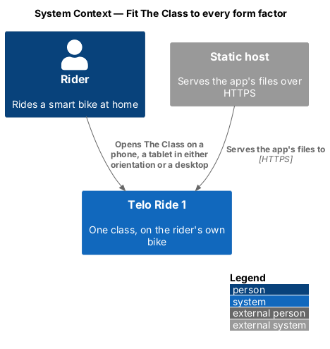
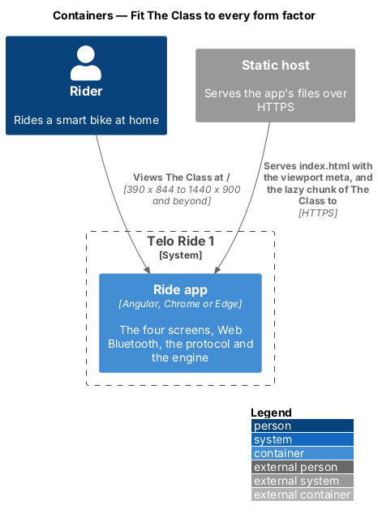
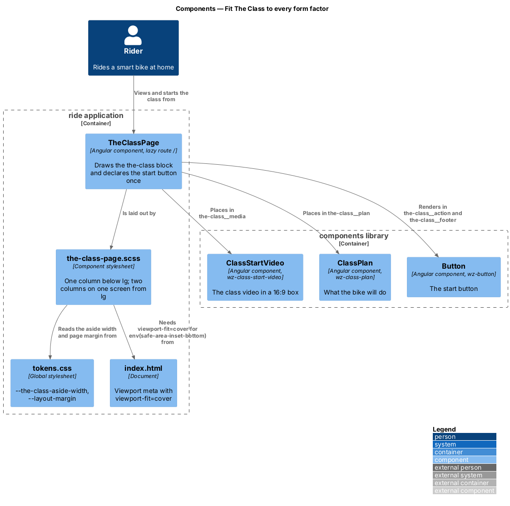
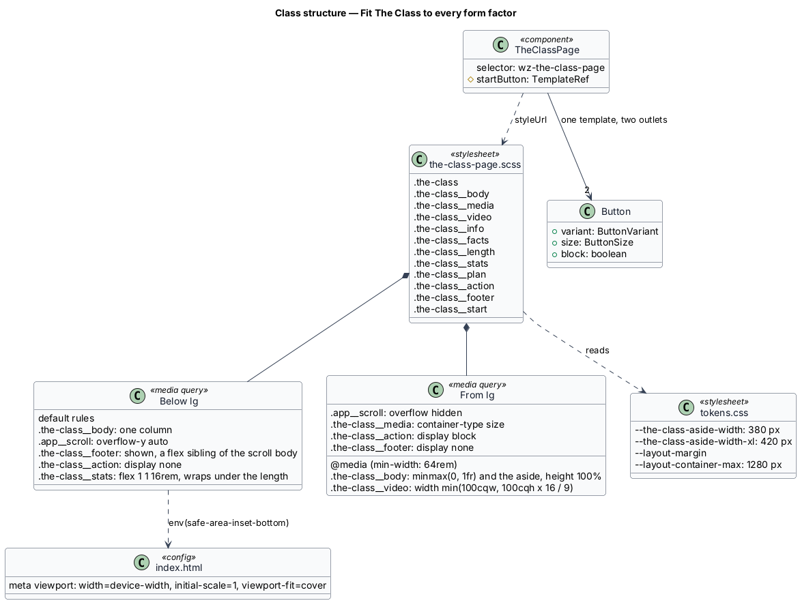
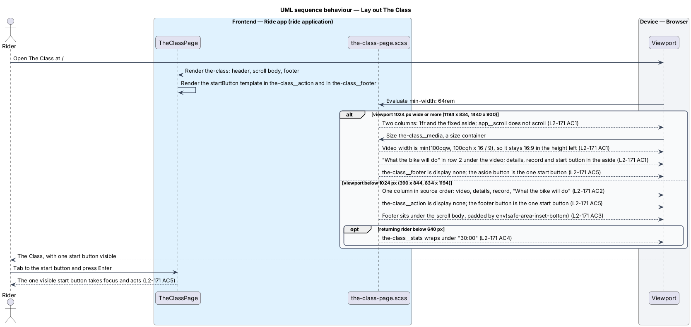
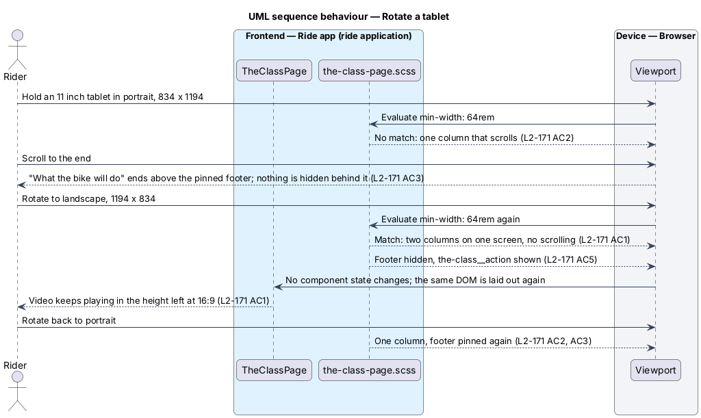

# Fit The Class to every form factor

## Overview

The Class is Telo Ride 1's home screen, at `/`: the class video, the title and length of 30 Minute
HIIT Cardio, the rider's record, a chart of what the bike will do, and one start button. The rider
sees it on a tablet or laptop beside the bike, or on a phone. This feature covers how that one
screen is laid out on each of those devices, as the design's canvas *The Class · Form Factors*
draws it at 1194 × 834, 1440 × 900, 834 × 1194 and 390 × 844.

The screen has two layouts and one set of content. The feature decides where each part sits; it
does not decide what the parts say.

- **form factor**: combination of viewport size and orientation a device presents
- **one-screen layout**: two-column layout from lg (1024 px) that fits the viewport without
  scrolling
- **one-column layout**: layout below lg in which the parts stack and the page scrolls
- **aside**: fixed-width right column of the one-screen layout, holding the class details, the
  record and the start button
- **pinned footer**: bar under the scrolling body of the one-column layout that holds the start
  button
- **record**: rider's ride count, best output and last output
- **safe area**: part of the display not covered by the device's home bar

Adjacent concerns belong to other features. The content of The Class, the start button's label
and what it does belong to [Show The Class](../../the-class/show-the-class/README.md). The record's
values belong to [Keep the record](../../class-done/keep-the-record/README.md). The page margin,
the breakpoints and target sizes belong to
[Fit every width, touch and keyboard](../fit-every-width-touch-and-keyboard/README.md). The header's
wordmark belongs to [Show the wordmark](../show-the-wordmark/README.md) and its Full screen button
to [Switch theme and full screen](../switch-theme-and-full-screen/README.md). The alerts a blocked
browser shows under the header belong to
[Check bike and browser support](../../bike/check-bike-and-browser-support/README.md).

## Description

The layout is the `the-class` block of the design system (`docs/design-system/assets/components.css`),
transcribed in `docs/mocks/pages/the-class/`. Each block below is marked as existing in the code
or new.

- **`TheClassPage`** (new, `wz-the-class-page`, `frontend/projects/ride/src/app/the-class/`): the
  page at `/`, loaded with `loadComponent`. It replaces Telo Ride's `ClassStartPage`
  (`class-start/`, at `/classes/:id`). Its template draws the block in the mocks' order: the
  header, then `.app__scroll` holding `main#main.the-class__body` with `.the-class__media`,
  `.the-class__info` and `.the-class__plan`, then `.the-class__footer`. That source order is the
  one-column order of L2-171 AC2: video, details, record, "What the bike will do".
- **`the-class-page.scss`** (new): the page's one encapsulated stylesheet, block `the-class`, with
  the BEM names of the mocks. It takes `.app` and `.app__scroll` from the `_app.scss` partial.
- **One-column rules** (new, the default below 64 rem): `.the-class__body` is a one-column grid
  padded by `--layout-margin`. `.app__scroll` scrolls. `.the-class__footer` is a flex sibling of
  `.app__scroll` inside `.app`, not a fixed-position layer, so the body ends above it and no
  content lies behind it (L2-171 AC3). Its bottom padding is
  `max(var(--space-3), env(safe-area-inset-bottom))`. `.the-class__action` is `display: none`.
- **One-screen rules** (new, `@media (min-width: 64rem)`): `.app__scroll` is `overflow: hidden`
  and `.the-class__body` is `height: 100%` with columns `minmax(0, 1fr)` and
  `--the-class-aside-width` (380 px; `--the-class-aside-width-xl`, 420 px, from 80 rem) and rows
  `minmax(0, 1fr) auto`. `.the-class__media` takes column 1, row 1; `.the-class__plan` takes
  column 1, row 2; `.the-class__info` spans both rows of column 2. `.the-class__action` shows at
  the foot of the aside (`margin-top: auto`) and `.the-class__footer` is `display: none`.
- **Video box** (new rule): `.the-class__video` has `aspect-ratio: 16 / 9` and full width below
  lg. From lg, `.the-class__media` is a size container (`container-type: size`) and the video's
  width is `min(100cqw, calc(100cqh * 16 / 9))`, so the box takes the height left and stays 16:9
  (L2-171 AC1). The player inside it is `ClassStartVideo` (exists, `wz-class-start-video`), which
  belongs to Show The Class.
- **Record row** (new rule): `.the-class__facts` is a wrapping flex row; `.the-class__stats` has
  `flex: 1 1 16rem`, so on a phone its three figures wrap under "30:00" and on a portrait tablet
  they sit beside it (L2-171 AC4). From lg the facts stack in the aside.
- **Start button** (`Button` exists, `wz-button`): the mocks place the button twice, in
  `.the-class__action` and in `.the-class__footer`. `TheClassPage` declares it once in an
  `ng-template` (`startButton`) and renders it in both places with `ngTemplateOutlet`. Exactly one
  of the two containers is displayed at any width; the other is `display: none`, which removes its
  button from the tab order and from the accessibility tree (L2-171 AC5).
- **`tokens.css`** (exists; stale): the app's copy lacks `--the-class-aside-width` and
  `--the-class-aside-width-xl`, which the design system defines. The change that builds the page
  copies the design system's file again.
- **`index.html`** (exists, `frontend/projects/ride/src/index.html`): its viewport meta reads
  `width=device-width, initial-scale=1` today. It shall add `viewport-fit=cover`; without it
  `env(safe-area-inset-bottom)` resolves to 0 and the pinned footer is not kept clear of the home
  bar.
- **`ClassPlan`** and **`ClassProfile`** (exist, `wz-class-plan`, `wz-class-profile`): "What the
  bike will do" and its chart. The layout sets the chart's height (`--space-16`, `--space-14`
  from lg, `--space-16` from xl); the content belongs to Show The Class.

Three points are called out. First, L2-171 AC1 speaks of a landscape viewport at lg or wider, and
the mocks' rule keys on width alone (`min-width: 64rem`). A portrait viewport 1024 px wide or
more therefore takes the one-screen layout; this design follows the mocks. Second, the one-screen
layout does not scroll, so a short landscape viewport can cut content off, against L2-139 AC1; the
minimum supported height is `<TO SUPPLY>` (the Form Factors canvas draws nothing shorter than
834 px). Third, the layouts of the states the mocks do not draw, the class that cannot be loaded
(L2-080 AC3) and the video that cannot play (L2-084 AC9), are `<TO SUPPLY>` (`L2.md`, *Mock gaps*).

## Requirements

The feature realizes the following level-2 (L2) requirement, which refines the level-1 (L1)
requirement cited.

| L2 ID | Refines (L1) | Requirement |
|-------|--------------|-------------|
| `L2-171` | `L1-023` | In a landscape viewport at lg or wider (an 11" tablet at 1194 × 834, a desktop at 1440 × 900), The Class shall fit on one screen with no scrolling: the video shall take the height left and stay 16:9, "What the bike will do" shall sit under it, and the class details, the record and the start button shall sit in a fixed column on the right. On a phone or a tablet in portrait (390 × 844, 834 × 1194), The Class shall be one column that scrolls, in the order video, details, record, "What the bike will do". In that one-column layout the start button shall stay pinned to the bottom of the screen, clear of the home bar (`env(safe-area-inset-bottom)`), and no content shall be hidden behind it at the end of the scroll. For a returning rider on a phone, the record's three figures shall wrap under "30:00" and shall not overlap it. In any layout, exactly one start button shall be visible and reachable by keyboard. |

## Diagrams

### System context

The rider opens The Class on any device; the static host serves the files. No other system takes
part in the layout.

### Containers

The Ride app lays the screen out in the browser. The host serves `index.html`, whose viewport meta
enables the safe-area inset, and the lazy chunk of The Class.

### Components

`TheClassPage` draws the block and its stylesheet places the parts. The video, the plan and the
button are presentation components from the components library; the stylesheet reads the aside
width and the page margin from `tokens.css`.

### Class structure

The stylesheet is composed of two rule sets, one below lg and one from lg. The page renders one
start-button template in two outlets, and each rule set displays exactly one of them.

### Behaviour: lay out The Class

One media query at 1024 px selects the layout. From lg the screen is two columns that do not
scroll (L2-171 AC1); below lg it is one column with the pinned footer (L2-171 AC2, AC3, AC4). In
both, one start button is displayed (L2-171 AC5).

### Behaviour: rotate a tablet

Rotating an 11" tablet crosses the lg breakpoint. The same DOM is laid out again; no component
state changes, so the video and the record are untouched.

