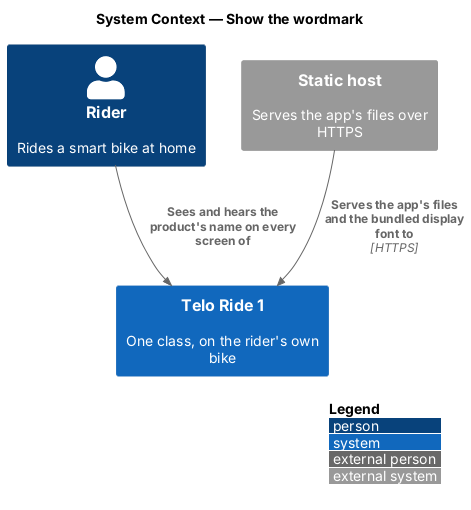
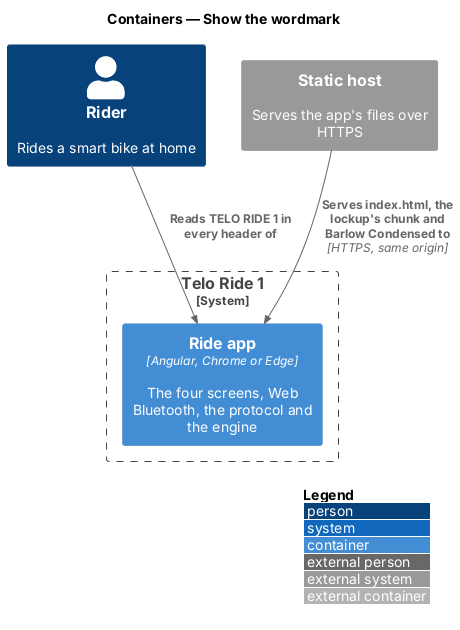
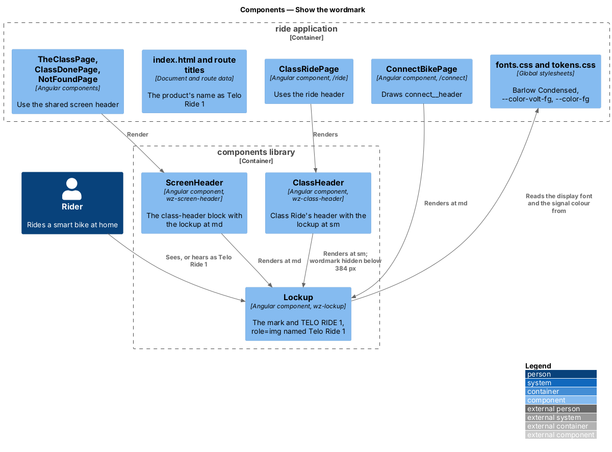
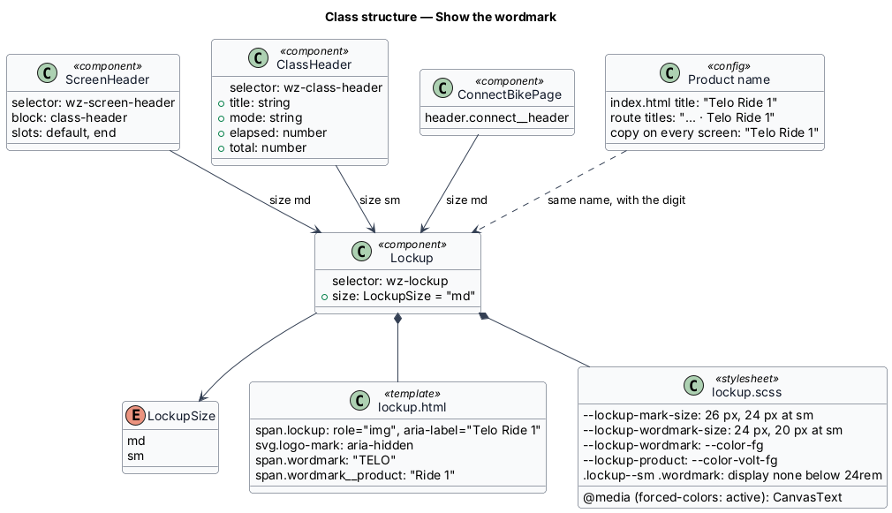
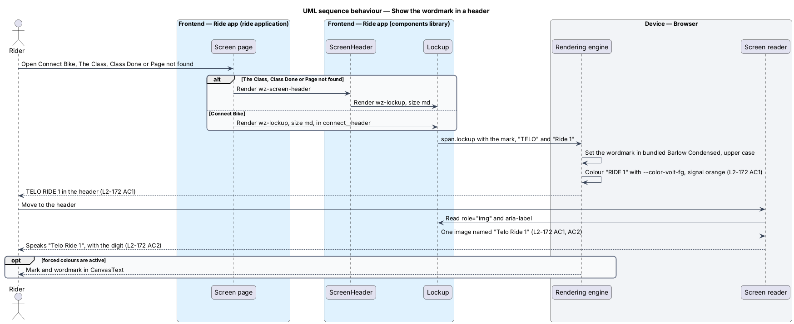
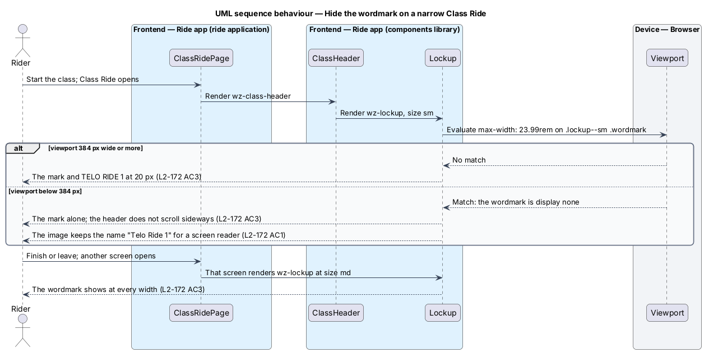

# Show the wordmark

## Overview

Telo Ride 1 belongs to the Telo family and is the focused edition of Telo Ride. Its name is the
one piece of branding the app carries: the wordmark **TELO RIDE 1** at the start of every
screen's header. This feature covers that wordmark, how it is named for a screen reader, the one
place it gives way to a narrow screen, and the rule that the product's name is always written
"Telo Ride 1", with the digit.

The wordmark is not a link. Telo Ride 1 has no menu and no home navigation beyond the links the
requirements name, so the wordmark is an image and nothing else.

- **mark**: Telo logo, an open ring with a crank and a hub
- **wordmark**: product's name set in the display typeface, "TELO" followed by "RIDE 1"
- **lockup**: mark and wordmark drawn together as one unit
- **signal orange**: Telo's accent colour, `#ff4521`, which the design calls volt
- **product name**: "Telo Ride 1" as written in text, titles and accessible names

Adjacent concerns belong to other features. The rest of each header belongs to the feature that
owns the screen: the bike link to [Show The Class](../../the-class/show-the-class/README.md), the
class name, clock, Pause and Leave to [Ride the class](../../class-ride/ride-the-class/README.md)
and [Pause, leave or finish the class](../../class-ride/pause-leave-or-finish-the-class/README.md),
and the class name on Class Done to [Show Class Done](../../class-done/show-class-done/README.md).
The Full screen button at the end of every header belongs to
[Switch theme and full screen](../switch-theme-and-full-screen/README.md). The theme that resolves
the wordmark's colours belongs there too. Fonts being served from the app's own origin belongs to
[Restrict third parties](../../security/restrict-third-parties/README.md). The copy of the
blocked-browser alerts belongs to
[Check bike and browser support](../../bike/check-bike-and-browser-support/README.md).

## Description

Each block below is marked as existing in the code or new. The mocks draw the lockup identically
in all 18 pages: `` holding the mark's
`svg`, then `TELORide 1`.

- **`Lockup`** (exists, `wz-lockup`, `frontend/projects/components/src/lockup/`): presentation
  component for the design system's `lockup` block, with the `logo-mark` and `wordmark` it draws.
  It has one input, `size`, of type `LockupSize` (`'md' | 'sm'`, default `'md'`). Two things change
  for Telo Ride 1. Its `aria-label` becomes "Telo Ride 1" (today "Telo Ride"), and its product
  text becomes "Ride 1" (today "Ride"). The wrapper keeps `role="img"`, so a screen reader meets
  one image with one name and does not read the letters inside it.
- **`lockup.scss`** (exists, unchanged): the block's one stylesheet. Component tokens set the mark
  to 26 px and the wordmark to `--font-size-2xl` (24 px); `.lockup--sm` sets 24 px and
  `--font-size-xl` (20 px). `.wordmark` is `--font-family-display` (Barlow Condensed) at
  `--font-weight-black`, italic and upper case, in `--color-fg`. `.wordmark__product` has a left
  margin of 0.18 em and reads `--color-volt-fg`: signal orange in the dark theme, the deeper
  signal that passes contrast on paper in the light theme. Under `forced-colors: active` every
  part is `CanvasText`.
- **Narrow rule** (exists): `.lockup--sm .wordmark` is `display: none` under
  `@media (max-width: 23.99rem)`, below 384 px. Only Class Ride uses the `sm` size, so only Class
  Ride loses the wordmark, and the mark stays (L2-172 AC3). The accessible name is on the
  wrapper, so it survives the hidden text.
- **`ScreenHeader`** (new, `wz-screen-header`, `frontend/projects/components/src/screen-header/`):
  presentation component for the header of The Class, Class Done and Page not found. It draws the
  mocks' `header.class-header`: `wz-lockup` at `md`, a default slot for the screen's own content
  (the bike link, the class name), and a `[slot=end]` slot for Full screen, pushed right by
  `.class-header__end`. Each slot is declared once. It injects nothing. It replaces Telo Ride's
  `AppHeader` family (`wz-app-header`, `wz-app-header-brand`, `wz-app-header-link` and the level
  and streak parts), whose brand is a link to Home and which carries the navigation Telo Ride 1
  leaves out.
- **`ClassHeader`** (exists, `wz-class-header`, `components/src/class-ride/class-header.ts`):
  Class Ride's header. It already renders `<wz-lockup size="sm" />` first, before the class name
  and the clock, and is unchanged by this feature.
- **`ConnectBikePage`** (exists, reshaped): the mocks give Connect Bike its own header element,
  `header.connect__header`, inside the page's `connect` block. The page's template has no header
  today; it gains one that renders `wz-lockup` at `md` and Full screen.
- **Fonts** (exist): `fonts.css` declares the bundled Barlow Condensed faces, served from the
  app's own `/fonts/` path (ADR 0005). `frontend/e2e/app-shell.spec.ts` already asserts that the
  wordmark is set in `barlow-condensed-800-italic.woff2` from the app itself and that the product
  text computes to `rgb(255, 69, 33)`; it is reshaped to open The Class and to expect the name
  "Telo Ride 1".
- **Product name** (changes): the name is written "Telo Ride" in the `<title>` of `index.html`,
  in every route `title` of `ride.routes.ts` ("Connect your bike · Telo Ride") and in Connect
  Bike's lead. Each shall read "Telo Ride 1". The document titles of the four screens are
  `<TO SUPPLY>`; `L2.md` and the mocks give none.

One string is open. The alert on The Class in a browser without Web Bluetooth reads "Open Telo
Ride in Chrome or Edge." in the mock and in L2-008 AC2, without the digit. L2-172 AC2 would make
it "Telo Ride 1", and the mock changes first (`L2.md` open question 5). Until then that string is
`<TO SUPPLY>`.

## Requirements

The feature realizes the following level-2 (L2) requirement, which refines the level-1 (L1)
requirement cited.

| L2 ID | Refines (L1) | Requirement |
|-------|--------------|-------------|
| `L2-172` | `L1-023` | Each screen's header shall carry the wordmark "TELO RIDE 1": the Telo lockup with "RIDE 1" in signal orange, named "Telo Ride 1" for a screen reader (`role="img"`). Wherever the product's name is written in the app, it shall be "Telo Ride 1" with the digit, never "One" or "I". On Class Ride below 384 px wide, the wordmark shall be hidden (L2-087 AC2); on every other screen and width it shall show. |

## Diagrams

### System context

The rider sees the wordmark on every screen. The static host serves the app and the display font
it is set in; nothing comes from a third party.

### Containers

The wordmark is drawn by the Ride app from files of its own origin. No storage is read.

### Components

`Lockup` is rendered from three places: `ScreenHeader` for The Class, Class Done and Page not
found, `ClassHeader` for Class Ride, and Connect Bike's own header. `index.html` and the route
titles carry the same name in text.

### Class structure

`Lockup` is composed of its template and stylesheet and has one input, `LockupSize`. The three
hosts differ only in the size they pass. The product name in titles and copy is modelled with the
`config` stereotype.

### Behaviour: show the wordmark in a header

The lockup renders the mark, "TELO" and "RIDE 1" in signal orange, and exposes one image named
"Telo Ride 1" to a screen reader (L2-172 AC1, AC2).

### Behaviour: hide the wordmark on a narrow Class Ride

On Class Ride below 384 px the wordmark is not drawn and the mark stays; the image keeps its name.
On every other screen and width the wordmark shows (L2-172 AC3).

