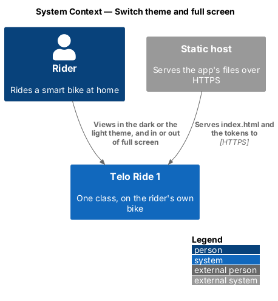
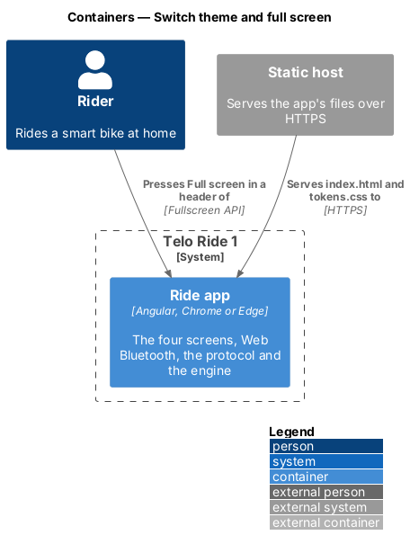
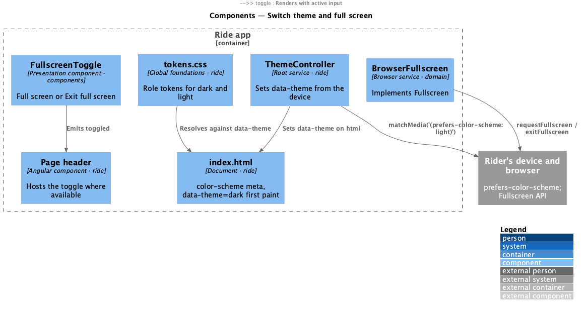
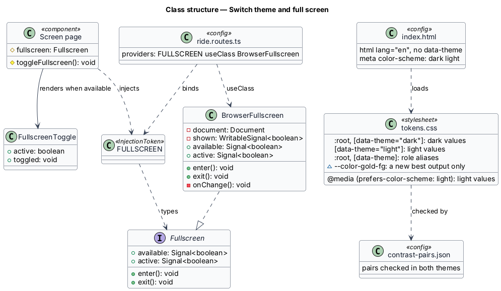
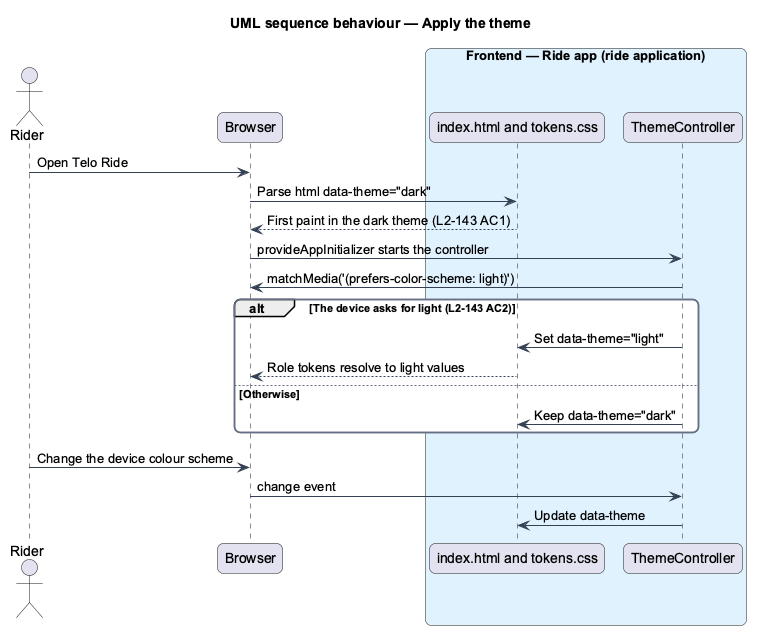
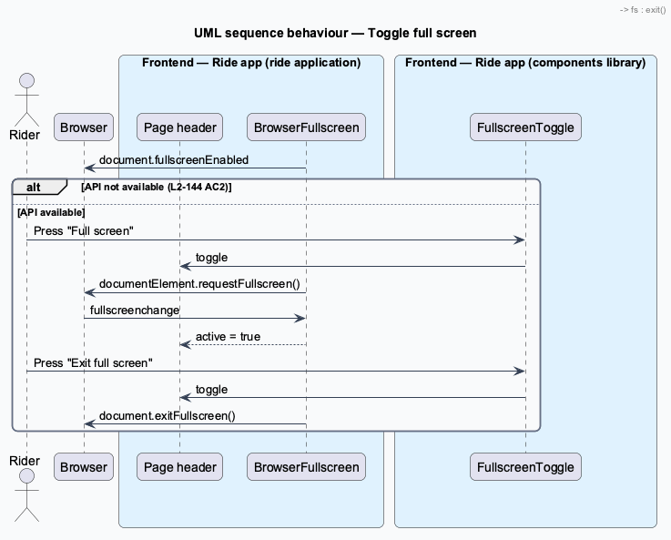

# Switch theme and full screen

## Overview

Telo Ride is dark by default: a dark screen beside the bike is easy to read in a dim room and
keeps the rider's attention on the numbers. A rider whose device asks for a light colour scheme
gets a light theme that meets the same contrast rules. A rider who mounts a tablet or casts a
laptop to a screen can also fill the whole display with the app.

- **theme** — set of colour values applied to the role tokens; Telo Ride has dark and light
- **role token** — colour custom property named for its use (ink, panel, raised, line, fg, muted, faint, volt, rest, heart, warn, gold)
- **colour-scheme preference** — the device setting exposed through the `prefers-color-scheme` media query
- **Fullscreen API** — browser API (`requestFullscreen`, `exitFullscreen`, `fullscreenchange`) that shows one element across the whole display

The feature belongs to the ui subsystem and is frontend-only. The theme has no rider control in
the app: it follows the device. The page header that hosts the full-screen button is designed in
`home/show-the-app-header` and the ride screens' own headers.

## Description

### Theme

- **`tokens.css`** — global foundation in the `ride` application. It declares the role tokens for
  light on `:root, [data-theme="light"]` and for dark on `[data-theme="dark"]`, and repeats the dark
  values under `@media (prefers-color-scheme: dark)`.
- **`index.html`** — carries `<meta name="color-scheme" content="dark light">`, a
  `<meta name="theme-color">` for each colour scheme, and `data-theme="dark"` on `<html>`, so the
  first paint is dark before scripts run.
- **`ThemeController`** — root service in the `ride` application, started from `app.config.ts`
  with `provideAppInitializer`. It reads
  `matchMedia('(prefers-color-scheme: light)')` and sets `data-theme` on `<html>` to `light` when
  it matches and `dark` otherwise. It listens for changes to the query.
- **Colour linting** — Stylelint runs on every `.scss` file with `color-no-hex` and a rule that
  forbids colour functions outside `tokens.css`, so colours come only from role tokens. Use of
  `--color-gold` outside XP, stars and unlock components is checked in review.

The `prefers-color-scheme` query has no "no preference" value: a device that expresses no choice
reports `light`. `L2-143` AC1 and AC2 therefore cannot both be met as written. This design treats
a `light` report as the device asking for light. The intended behaviour is `<TO SUPPLY>`. The
design-system note in `tokens.css` that every product page ships `data-theme="dark"` would, read
literally, rule out `L2-143` AC2.

### Full screen

- **`Fullscreen`** — contract in `api` (token `FULLSCREEN`) with `available`, `active` (signals),
  `enter()` and `exit()`.
- **`BrowserFullscreen`** — implementation in the `ride` application's `browser/` folder. It reads
  `document.fullscreenEnabled`, calls `document.documentElement.requestFullscreen()` and
  `document.exitFullscreen()`, and updates `active` from `fullscreenchange`. It removes the
  listener on destroy. Each route whose header shows the toggle binds it (the main shell's
  route first, in slice 13.1).
- **`FullscreenToggle`** — presentation component in `components` (`wz-fullscreen-toggle`). Inputs
  `active`; output `toggle`. It draws the design system's edge icon button (`icon-btn
  icon-btn--edge`, 36 px, taking touches across 44 px). Its accessible name is "Full screen" or
  "Exit full screen", and its icon changes with it. It sets no `aria-pressed`: a toggle whose
  name also changes would be announced twice ("Exit full screen, pressed"). The name change is
  what `L2-144` AC1 asks for.
- **Headers** — each page header renders `FullscreenToggle` inside `@if (fullscreen.available())`,
  so the button is absent where the API is missing.

## Requirements

| L2 ID | Refines (L1) | Requirement |
|-------|--------------|-------------|
| `L2-143` AC1 | `L1-023` | With no preference, the app shall open in the dark theme. |
| `L2-143` AC2 | `L1-023` | When the device asks for a light colour scheme, the app shall open in the light theme, with contrast meeting `L2-141` AC5. |
| `L2-143` AC3 | `L1-023` | Every colour shall come from a role token (ink, panel, raised, line, fg, muted, faint, volt, rest, heart, warn, gold) and never a raw value; gold shall be used only for XP, stars and unlocks. |
| `L2-144` AC1 | `L1-023` | Where the Fullscreen API is available, a page header shall offer "Full screen", which enters full screen; in full screen it shall read "Exit full screen" and leave it. |
| `L2-144` AC2 | `L1-023` | Where the Fullscreen API is not available, the button shall be absent. |

## Diagrams

### System context

The rider's device supplies a colour-scheme preference and the display that full screen fills.

### Containers

The Ride app alone applies the theme and drives full screen.

### Components

`ThemeController` sets `data-theme` from the colour-scheme query; `tokens.css` resolves the role
tokens. Headers host `FullscreenToggle`, which calls the `Fullscreen` contract.

### Class structure

`BrowserFullscreen` implements `Fullscreen`; `FullscreenToggle` depends on nothing but its inputs
and output.

### Behaviour — apply the theme

The first paint is dark; the controller switches to light when the device asks for it and follows
later changes (`L2-143` AC1, AC2).

### Behaviour — toggle full screen

The header shows the button only where the API exists; pressing it enters full screen and the
label changes (`L2-144` AC1, AC2).

