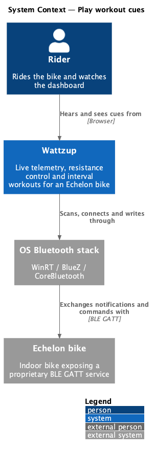
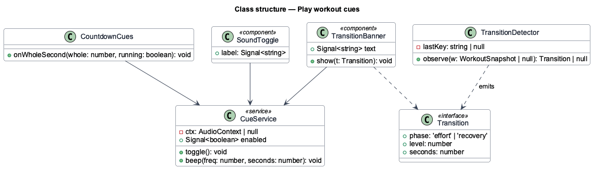
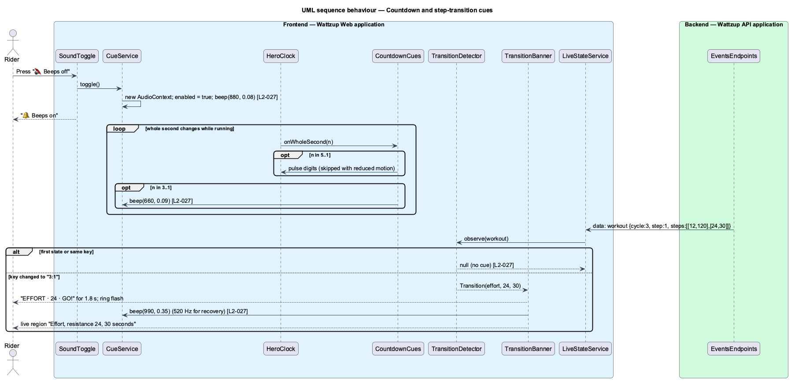

# Play workout cues

## Overview

A rider in a hard interval watches the screen only in glances. Cues mark the moments that matter: a step is about to end, or a new step has begun. Visual cues are a pulsing clock in the final 5 seconds, a large banner, and a flash of the ring at each transition. Optional audio cues are short tones, off by default, because browsers block sound until the user interacts with the page.

**transition** — change of the `cycle:step` key in the workout state after the first state has been seen

**banner** — large text overlay shown for about 1.8 s at a transition: `EFFORT · <level> · GO!` or `RECOVER · <level>`

**beeps** — tones synthesised with the Web Audio API: 880 Hz confirmation, 990 Hz effort start, 520 Hz recovery start, and 660 Hz countdown at 3, 2 and 1 seconds

The first state received never triggers a transition cue. Joining a workout mid-step is not a step change.

## Description

- **`CueService`** — root-provided Angular service.
  - `enabled` — signal, `false` at start.
  - `toggle()` — when off, creates an `AudioContext` (inside the click handler, so the browser allows it), sets `enabled`, and plays the 880 Hz, 0.08 s tone. When on, closes the context and clears `enabled`.
  - `beep(freq, seconds)` — sine oscillator with a gain envelope rising from 0.0001 to 0.3 in 10 ms and falling back to 0.0001 by `seconds`. It is a no-op when disabled (L2-027).
- **`TransitionDetector`** — pure class. `observe(workout)` returns `null` for the first key it sees and for unchanged keys. When the key changes, it returns `{ phase, level }` for the new step (L2-027).
- **`CountdownCues`** — called by `HeroClock` when the displayed whole second changes while running. At 5, 4, 3, 2 and 1 it triggers the digit pulse. At 3, 2 and 1 it calls `beep(660, 0.09)`.
- **`TransitionBanner`** — component that shows the banner text with a 1.8 s CSS animation, and requests a ring flash (`RingVisuals.flash = 1`). It also writes the transition text to a polite live region, for example `Effort, resistance 24, 30 seconds` (see `responsive-accessible-layout`).
- **`SoundToggle`** — header button showing `🔇 Beeps off` or `🔔 Beeps on`, with `aria-pressed` bound to `enabled`.

With `prefers-reduced-motion: reduce`, the digit pulse and the banner animation are not played. The banner text is still announced, and beeps remain under the rider's control.

## Requirements

| L2 ID | Refines (L1) | Requirement |
|-------|--------------|-------------|
| `L2-027` | `L1-007` | Step-transition and countdown cues. |

## Diagrams

### System context

The rider receives cues from Wattzup during a workout.

### Containers

All cues are produced in Wattzup Web from the workout state streamed by the Wattzup API.

### Components

`TransitionDetector` turns state into transition events. `TransitionBanner`, `CountdownCues` and `CueService` present them.

### Class structure

`CueService` is the only owner of the `AudioContext`. Detection logic is a pure class.

### Behaviour — enable beeps, countdown and step transition

The rider enables beeps. The final 3 seconds of a step tick at 660 Hz, then the next step announces itself with a banner, a flash and a phase tone (L2-027).

