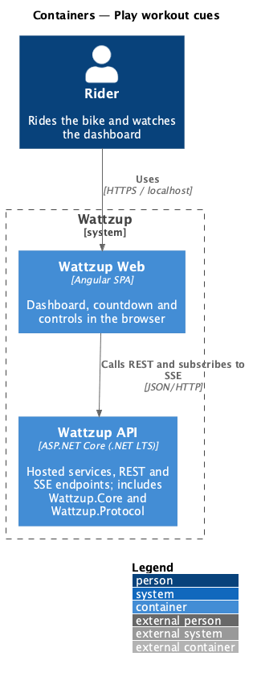
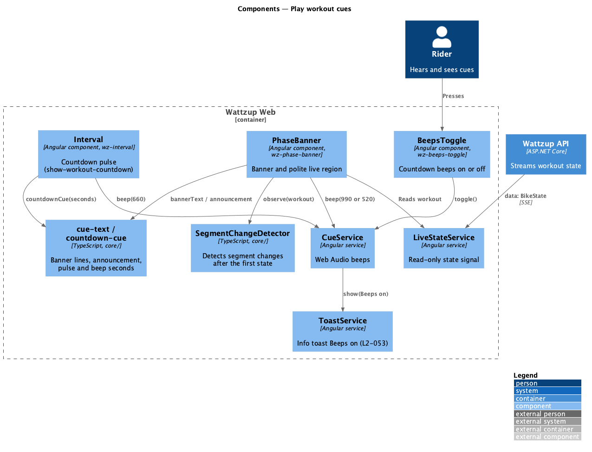

# Play workout cues

## Overview

A rider in a hard interval watches the screen only in glances. Cues mark the moments that matter: a segment is about to end, or a new segment has begun. The visual cues are a pulse of the interval card's time-left numerals in the final 5 seconds and a large banner at each segment change. The optional audio cues are short tones. They are off when the page loads, because browsers block sound until the user interacts with the page.

**segment change** — new value of `workout.segment` in the streamed state, after the first state has been seen

**phase banner** — large text overlay shown for about 1.8 s at a segment change, such as `WORK · 18 · GO!` or `RECOVER · 6`, with a smaller detail line

**beeps** — tones synthesised with the Web Audio API: 880 Hz confirmation, 990 Hz work start, 520 Hz start of any other segment, and 660 Hz countdown at 3, 2 and 1 seconds

The first state received never triggers a cue: joining a ride mid-segment, or reloading the page, is not a segment change (L2-027). The countdown itself is drawn by `show-workout-countdown`; this feature adds the pulse, the banner and the tones.

## Description

Pure helpers in `frontend/projects/wattzup/src/app/core/`, with unit tests:

- **`SegmentChangeDetector`** (`segment-change-detector.ts`) — `observe(workout)` remembers the key of the last state, where the key is `workout.segment`, or `null` with no workout.
  - It returns `null` for the first state it sees, whatever it holds (L2-027).
  - It returns `null` when the key has not changed, and when it changes to `null`.
  - Otherwise it returns a `SegmentChange` `{kind, level, duration, round, rounds, next}` for the new segment. A replaced ride that restarts at segment 0 is a change.
- **`cue-text.ts`** — `bannerText(change)` returns the two lines of the banner, as in the table below (L2-027). `announcement(change)` returns the polite live-region text, for example `Work, resistance 18, 40 seconds`, as in the `effort` mock.
- **`countdownCue(wholeSecondsLeft, running)`** (`countdown-cue.ts`) — returns `{pulse, beep}`: `pulse` is true at 5, 4, 3, 2 and 1; `beep` is true at 3, 2 and 1; both are false when not running (L2-027).

| New segment | Headline | Detail |
|---|---|---|
| `work` | `WORK · <level> · GO!` | `Round <r> of <n> · <m:ss>` |
| any other kind, not last | `<KIND> · <level>` | `<m:ss> · next: <Kind> at <level>` |
| any other kind, last segment | `<KIND> · <level>` | `<m:ss>` |

`<KIND>` is the upper-case kind label (`WARM-UP`, `RECOVER`, `COOL-DOWN`, `STEADY`), and `<m:ss>` is the segment's duration. On the last segment the detail line is `<m:ss> · last stretch` (L2-027).

Services and components:

- **`CueService`** (`frontend/projects/wattzup/src/app/core/cue.service.ts`, root-provided) — the only owner of the `AudioContext`.
  - `enabled` is a signal, `false` at page load.
  - `toggle()` runs inside the click handler, so the browser allows audio. When off, it creates the `AudioContext`, sets `enabled`, plays `beep(880, 0.08)`, and shows the info toast `Beeps on` / `You'll hear a tone at each interval change and in the last 3 seconds.` (L2-053). When on, it closes the context and clears `enabled`; no toast is shown.
  - `beep(freq, seconds)` plays a sine oscillator with a gain envelope rising from 0.0001 to 0.3 in 10 ms and falling back to 0.0001 by `seconds`. It does nothing when disabled.
- **`BeepsToggle`** (`frontend/projects/wattzup/src/app/dashboard/beeps-toggle/`, selector `wz-beeps-toggle`) — the app bar icon button. Its accessible name is `Countdown beeps off` or `Countdown beeps on`, with `aria-pressed` bound to `enabled`, so the state is not carried by the icon alone (L2-027). It keeps the mock's `btn btn--quiet btn--icon` classes.
- **`PhaseBanner`** (`frontend/projects/components/src/lib/phase-banner/`, selector `wz-phase-banner`, block `phase-banner`) — subscribes, through an `effect` on `LiveStateService.state()`, to `SegmentChangeDetector`. On a change it does the following:
  1. It shows the headline and, in `<small>`, the detail line for 1.8 s. The element is `aria-hidden`, as in the mocks. The modifier is `phase-banner--rest` for `rest`; `work` takes no modifier. `warmup` and `cooldown` are easy segments and take `phase-banner--rest`. `steady` is a flat plan's only segment, so it never causes a transition and needs no modifier.
  2. It writes `announcement(change)` to a visually hidden `role="status"` `aria-live="polite"` region.
  3. It calls `CueService.beep(990, 0.35)` for `work` and `beep(520, 0.35)` for any other kind (L2-027). The 520 Hz duration is not stated in L2-027 and follows the work tone.
- **Countdown pulse** — the `Interval` frame callback (`show-workout-countdown`) calls `countdownCue` when the whole seconds left change. It sets the `is-pulse` class on `interval__left` when `pulse` is true, as in the `countdown` mock, and calls `CueService.beep(660, 0.09)` when `beep` is true.

With `prefers-reduced-motion: reduce`, the pulse and the banner animation are not played. The banner shows without animation for 1.8 s, the announcement is still written, and beeps remain under the rider's control.

### Acceptance tests

Playwright (`frontend/e2e/`), with `/api/**` answered by the shared fixture, `/api/events` served by the SSE fixture, and time controlled by `page.clock`. Tones are checked through a test double of `AudioContext` installed by the fixture with `page.addInitScript`, which records each oscillator's frequency and duration.

- `e2e/pages/ride.page.ts` — the ride page object, which owns the beeps toggle, phase banner, live region and time-left locators.
- `e2e/workout-cues.spec.ts`:
  - `shows the work banner when a work segment starts` (L2-027 AC1)
  - `shows the recover banner with the next segment` (L2-027 AC1)
  - `plays 990 Hz for work and 520 Hz for other segments when beeps are on` (L2-027 AC2)
  - `pulses the numerals from 5 and beeps at 3, 2 and 1` (L2-027 AC3)
  - `starts with beeps off and turns them on with a tone and a toast` (L2-027 AC4)
  - `plays no banner or tone for the first state of a running ride` (L2-027 AC5)

Unit tests in `frontend/projects/wattzup/src/app/core/`: `segment-change-detector.spec.ts` (first state, unchanged, changed, to `null`, replaced ride), `cue-text.spec.ts` (one case per table row and per kind label), and `countdown-cue.spec.ts` (6 down to 0, running and not running).

## Requirements

| L2 ID | Refines (L1) | Requirement |
|-------|--------------|-------------|
| `L2-027` | `L1-007` | Segment-change and countdown cues. A segment change shows a banner and, with beeps on, plays a tone; the final 5 seconds pulse the countdown digits and the final 3 beep; beeps start off; the first state never cues. |

## Diagrams

### System context

The rider receives cues from Wattzup during a workout.

### Containers

All cues are produced in Wattzup Web from the workout state streamed by the Wattzup API.

### Components

`SegmentChangeDetector` turns streamed state into segment changes. `PhaseBanner`, the interval card's countdown pulse and `CueService` present them, and `BeepsToggle` turns the tones on and off.

### Class structure

`CueService` is the only owner of the `AudioContext`. Detection and text are pure helpers.

### Behaviour — enable beeps, countdown and segment change

The rider turns beeps on. The final seconds of a work segment pulse and beep, then the recover segment announces itself with a banner, a live-region message and a 520 Hz tone (L2-027).

