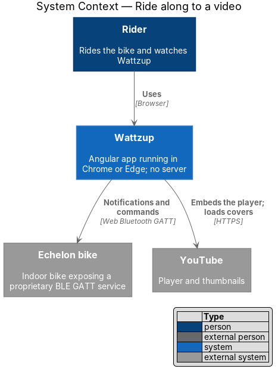
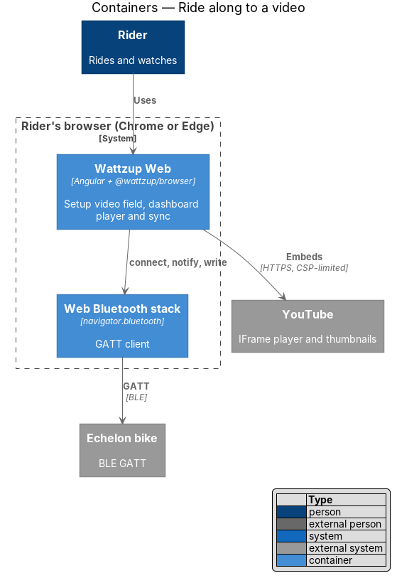
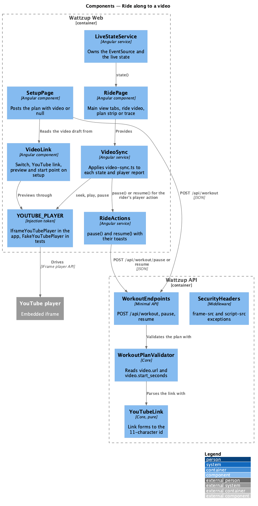
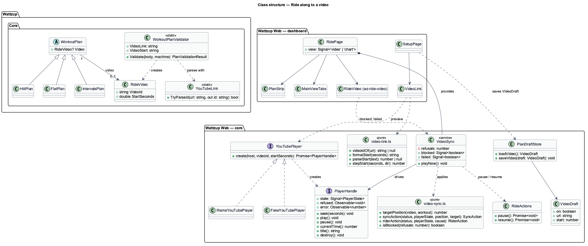
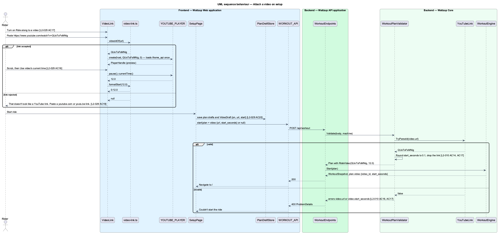
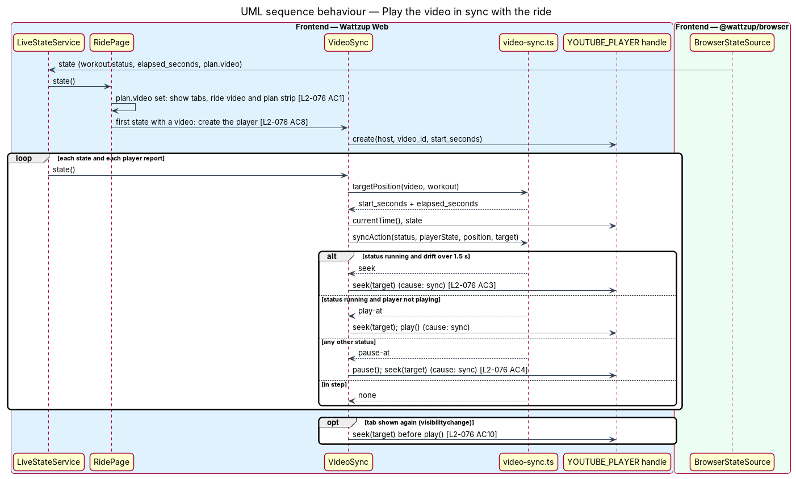
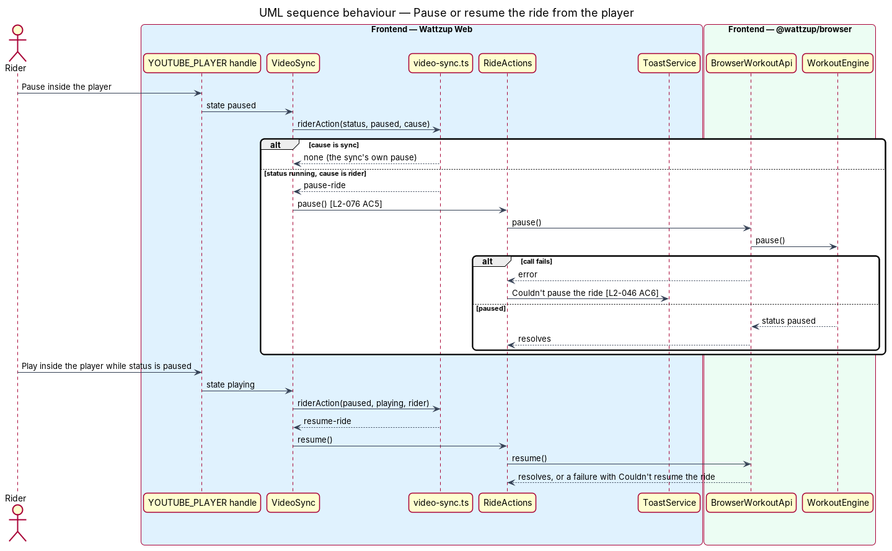
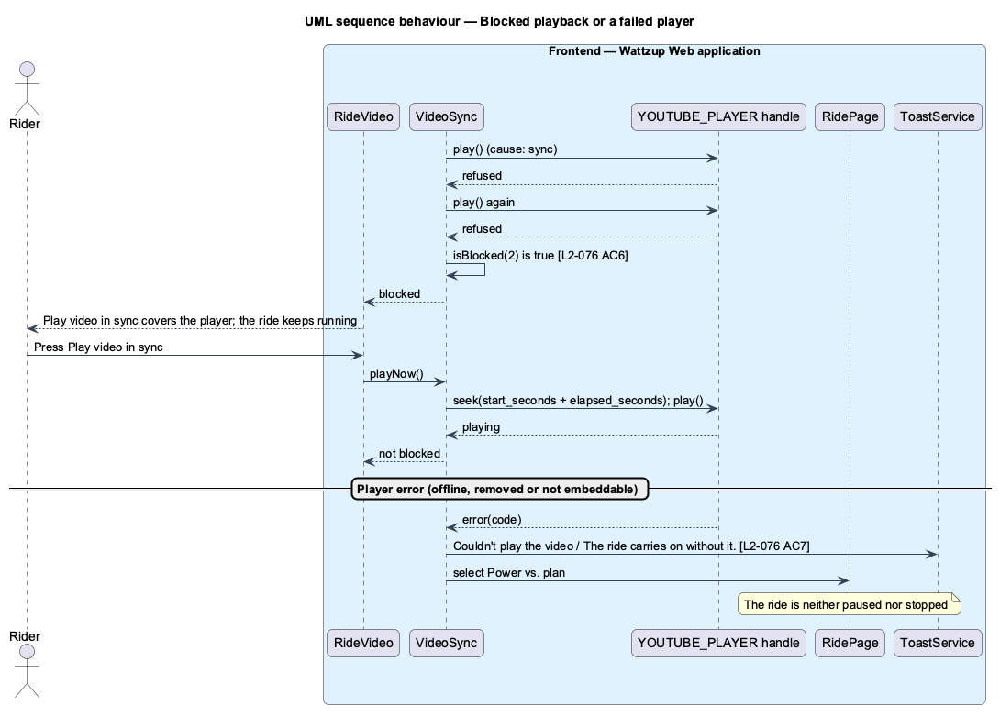

# Ride along to a video

## Overview

Riders often follow a training video, such as GCN Training's *30 Minute HIIT Cardio*, while they ride. This feature lets a plan carry a YouTube video that the dashboard plays beside the ride, in step with the ride clock (L2-076, ADR 0012). On the setup screen, the rider pastes a link and lines the video's intro up with the ride's 0:00. The backend validates the link, keeps only the video id and the start point, and reports both in the live state. Every dashboard open on the ride then plays the video at the same ride position.

**ride-along video** — YouTube video attached to a plan and played on the dashboard in step with the ride, carried as `plan.video` `{video_id, start_seconds}`

**start point** — position in the video, in seconds to 0.1 s, that lines up with the ride's 0:00, carried as `start_seconds`

**target position** — position the video shall show at a given moment, `start_seconds + elapsed_seconds`

**drift** — absolute difference between the player's reported position and the target position

**blocked playback** — two refused play attempts in a row, which the browser does when it will not autoplay a video with sound

The ride clock leads and the video follows. The video never pauses, delays or stops the ride. The one exception is a pause the rider makes inside the player, which counts as pressing Pause (L2-076 criterion 5). A video that cannot play leaves the ride running and falls back to the power trace (L2-076 criterion 7).

Until this feature, Wattzup loaded nothing from another origin (L2-036, ADR 0005). YouTube can only be played through its embedded player: an iframe served by YouTube and driven by YouTube's IFrame player API script. ADR 0012 admits exactly that player as the one third-party origin. The backend never fetches the link or contacts YouTube; only the browser does, and only when a plan has a video.

The feature extends three existing designs:
- `workouts/set-up-ride` gains the video switch and link below the plan (L2-029 criteria 17 to 20) and the preview's `Video` row (L2-059 criterion 6).
- `workouts/start-and-stop-workout` gains the `video` rows of the plan table (L2-010 criteria 14 to 17).
- `dashboard/show-live-metrics` gives up the main area's trace to the video while `Video` is the selected view (L2-026, L2-076 criteria 1 and 2).

`platform/secure-api` carries the two Content-Security-Policy exceptions (L2-036 criterion 4).

## Description

### Core (`Wattzup.Core`)

- **`RideVideo(string VideoId, double StartSeconds)`** (`Workouts/WorkoutPlan.cs`, new) — the validated video of a plan. `WorkoutPlan` gains `RideVideo? Video`, so `HiitPlan`, `FlatPlan` and `IntervalsPlan` all carry it. It serialises as `{"video_id": …, "start_seconds": …}`, and as `null` when the plan has no video (L2-010 criteria 14 and 15). `PlanExpander`, `WorkoutSummary` and `WorkoutEngine` ignore it, so a video changes neither the segments nor the summary nor the ride.
- **`RideVideoLink(string Url, double StartSeconds)`** (`Wattzup.Api/Endpoints/WorkoutEndpoints.cs`, new) — the video as `POST /api/workout` takes it. The request and the answer share `WorkoutPlan`, so `StartWorkout` publishes the request's shape as its own schema, and the frontend's `StartPlan` (`core/api-types.ts`) is the generated plan with `video` as a `RideVideoLink`.
- **`YouTubeLink.TryParseId(string url, out string id)`** (`Workouts/YouTubeLink.cs`, new, pure) — accepts the forms of the L2-010 plan table and returns the 11-character id:
  - `youtube.com/watch?v=<id>`, `youtu.be/<id>`, `youtube.com/shorts/<id>` and `youtube.com/embed/<id>`;
  - with or without `https://`, `www.` or `m.`;
  - `<id>` is exactly 11 characters of `A–Z a–z 0–9 _ -`, and other query parameters such as `t=40` are ignored.

  It rejects every other host and scheme (`https://vimeo.com/76979871`, `javascript:alert(1)`), a malformed id (`watch?v=short`) and a link over 2048 characters (L2-010 criterion 16). It matches with ordinal comparisons and no network access.
- **`WorkoutPlanValidator`** (`Workouts/WorkoutPlanValidator.cs`) — reads the optional `video` of every plan kind on either machine:
  - absent or `null` gives `Video` = `null` (L2-010 criterion 15);
  - a `url` that `YouTubeLink` rejects is named `video.url` with `VideoLink` = `That doesn't look like a YouTube link.` (L2-010 criterion 16);
  - a `start_seconds` below 0, above 43200 or not a number is named `video.start_seconds` with `VideoStart` = `Start point must be 0:00 to 12:00:00.`; a valid value is rounded to 0.1 (L2-010 criterion 17);
  - the submitted link is dropped once its id is read. Only `VideoId` and `StartSeconds` reach the plan, the state and the status snapshot.

### API (`Wattzup.Api`)

- **`WorkoutEndpoints`** — unchanged. `POST /api/workout` validates through `WorkoutPlanValidator` and answers 400 ProblemDetails naming `video.url` or `video.start_seconds` with the messages above.
- **`ContractSchemaTransformer`** (`OpenApi/`) — describes `plan.video` as a nullable object with `video_id` (string) and `start_seconds` (number). The frontend's `src/app/api/schema.d.ts` is regenerated from it in the same change.
- **`SecurityHeaders`** (`Security/SecurityHeaders.cs`) — the Content-Security-Policy gains exactly `frame-src https://www.youtube-nocookie.com` and `https://www.youtube.com` in `script-src`. `connect-src`, `style-src`, `font-src` and `img-src` stay as they are (L2-036 criterion 4, ADR 0012).

### Frontend (`frontend/src/app/`)

**Player contract.**
- **`YouTubePlayer`** (`core/youtube-player.ts`, new) — the contract every player use goes through, behind the injection token `YOUTUBE_PLAYER`:
  - `create(host, videoId, startSeconds): Promise<PlayerHandle>`;
  - `PlayerHandle`: `seek(seconds)`, `play()`, `pause()`, `currentTime()`, `title()`, `destroy()`;
  - signals or events `state` (`unstarted`, `playing`, `paused`, `buffering`, `ended`), `refused` and `error`.
- **`IframeYouTubePlayer`** (`core/iframe-youtube-player.ts`, new) — the real implementation, provided in `app.config.ts`:
  - loads `https://www.youtube.com/iframe_api` once, through a `<script>` element added on first use, so the initial bundle is unchanged;
  - builds the iframe source itself as `https://www.youtube-nocookie.com/embed/<video_id>` from `video_id`, never from a submitted link, and titles the iframe `Ride-along video` (L2-076 criterion 8);
  - reports a play call whose `playing` state does not follow as `refused`, and YouTube error codes as `error`.
- **`FakeYouTubePlayer`** (`e2e/fixtures/` and `core/testing/`, new) — the double used by unit tests and Playwright; it reports states and times on demand. No automated test loads YouTube (ADR 0012).

**Sync rules.**
- **`video-sync.ts`** (`core/`, new, pure) — the rules of L2-076 as functions of the workout and the player's report:
  - `targetPosition(video, workout)` returns `start_seconds + elapsed_seconds`;
  - `syncAction(status, playerState, position, target)` returns `play-at`, `pause-at`, `seek` or `none`. While `running` it returns `seek` when drift exceeds 1.5 s and `play-at` when the player is not playing (criterion 3). For every other status it returns `pause-at` (criterion 4);
  - `riderAction(status, playerState, cause)` returns `pause-ride` when the rider pauses inside the player while `running`, `resume-ride` when the rider plays inside it while `paused`, else `none` (criterion 5). Changes the sync itself makes are marked `cause: 'sync'` and never count as the rider's;
  - `isBlocked(refusals)` is true at 2 refusals in a row (criterion 6);
  - on `visibilitychange` to visible, the next action is `seek` to the target before any `play` (criterion 10).
- **`VideoSync`** (`core/video-sync.service.ts`, new, component-provided) — applies `syncAction` on each state from `LiveStateService.state` and on each player report. It calls `RideActions.pause()` or `RideActions.resume()` for `riderAction`, so failures show the toasts of L2-046 (criterion 5). On `error` it shows the danger toast `Couldn't play the video` / `The ride carries on without it.` through `ToastService` and selects `Power vs. plan` (criterion 7). `playNow()`, called by `Play video in sync`, seeks to the target, plays and clears the refusal count (criterion 6). Every dashboard computes the same target from the same state, so 2 dashboards on one ride agree within 1.5 s (criterion 9).

**Dashboard components.** These follow `docs/mocks/pages/ride/video.html` and `video-blocked.html`.
- **`MainViewTabs`** (`dashboard/main-view-tabs/`, `wz-main-view-tabs`, new) — the `view-switch` tab list labelled `Main view`, with `Video` and `Power vs. plan`. It uses a roving `tabindex`; the arrow keys move between the tabs and `aria-selected` marks the chosen one (criterion 11). The caption reads `In sync · pauses with the ride`. `RidePage` holds the choice in a signal, keyed by the workout, so it lasts until the workout ends (criterion 2). Under 576 px the tab list and caption wrap (criterion 12).
- **`RideVideo`** (`dashboard/ride-video/`, `wz-ride-video`, new) — the `video-frame video-frame--fill` tab panel that hosts the player. It stays mounted, hidden, while `Power vs. plan` is selected, so the player keeps following the ride (criterion 2). With blocked playback it covers the player with `video-frame__scrim`, a button reading `Play video in sync`, at least 44 × 44 px with a visible focus ring. One press seeks to the target and plays (criteria 6 and 11). It keeps 16:9 at full width under 1024 px (criterion 12).
- **`PlanStrip`** (`dashboard/plan-strip/`, `wz-plan-strip`, new) — the `profile profile--strip` under the video. It draws the segments from `plan-expansion.ts`, with a playhead at `elapsed_seconds` and the label `Ride progress: <elapsed> of <total>` (criterion 1).
- **`RidePage`** — with `workout.plan.video` set, it shows `wz-main-view-tabs`, then `wz-ride-video` and `wz-plan-strip` while `Video` is selected, or `wz-ride-trace` while `Power vs. plan` is selected. With `video` `null` it shows `wz-ride-trace` alone, as L2-026 (criterion 1). It provides `VideoSync` and creates the player only when the workout has a video (criterion 8).

**Setup components.** These follow `docs/mocks/pages/setup/video.html` and `video-invalid.html`.
- **`video-link.ts`** (`core/`, new, pure) — mirrors `YouTubeLink` for the form: `videoIdOf(url)` returns the id or `null`, with the same rows. Its time helpers:
  - `formatStart(seconds)` writes `m:ss.s`, for example `0:12.0`;
  - `parseStart(text)` reads `m:ss.s`, `ss.s` or `ss`;
  - `stepStart(seconds, dir)` moves the start point by 0.5 s and never below 0:00.0 (L2-029 criterion 18).
- **`VideoLink`** (`dashboard/video-link/`, `wz-video-link`, new) — below the plan, in every mode on either machine (L2-029 criterion 17):
  - a `toggles--video` switch `Ride along to a video` / `Plays in sync on the dashboard`, off on first use;
  - with the switch on, the field `YouTube link` (`type="url"`);
  - for a link that `videoIdOf` accepts, the `video-sync` block: a preview through `YOUTUBE_PLAYER`, the stepper `Ride 0:00 starts at` (`Half a second earlier` / `Half a second later`), `Use video's current time`, which pauses the preview and copies its time, and `Check`, which plays the preview from the start point. The help text is `Scrub the preview past the intro to the moment the warm-up begins, then use that time. The video skips to it when you start, and pauses and resumes with the ride.` (criterion 18);
  - for a non-empty link that `videoIdOf` rejects, the field error `That doesn't look like a YouTube link. Paste a youtube.com or youtu.be link.` with `aria-invalid`, and neither the preview nor the start point. The error does not block Start ride (criterion 19).

  The preview's title and time come from the player. The backend never sees the title.
- **`SetupPage`** — adds `video` to the plan it posts: `{url, start_seconds}` for a valid link with the switch on, otherwise `null` (L2-029 criteria 17, 19 and 20).
- **`PlanDraftStore`** — keeps `{on, url, start}` under `wattzup.videoDraft`, one draft shared by every mode and both machines. It is saved with the plan drafts on Start ride and restored on reload (L2-029 criterion 20). Unreadable data yields the switch off.
- **`ride-preview.ts`** — adds the row `Video` `Synced from <m:ss.s>` after Time under load while the switch is on with a valid link; otherwise the row is absent (L2-059 criterion 6).

### Screen states

| Mock | State |
|---|---|
| `pages/setup/video` | Intervals with the video on: the GCN link, a paused preview, `Ride 0:00 starts at` `0:12.0`, and `Video` `Synced from 0:12.0` in the preview |
| `pages/setup/video-invalid` | The video on with a Vimeo link: the field error, no preview, no start point and no `Video` row; Start ride still starts the ride |
| `pages/ride/video` | Mid-ride, work round 3 of 8 at 11:42 of 30:00: the `Video` tab selected, the video playing at 11:54.0, the plan strip below |
| `pages/ride/video-blocked` | Mid-ride with blocked playback: `Play video in sync` covers the player and the ride keeps running |

### Acceptance tests

`Wattzup.Api.AcceptanceTests` run the host through `WebApplicationFactory` with `SimulatedBikeTransport`. `RideVideoTests`:
- `Given_a_plan_with_a_YouTube_watch_link_then_the_workout_reports_its_video_id_and_start_point` (L2-010 AC14)
- `Given_a_plan_with_no_video_then_plan_video_is_null` (L2-010 AC15)
- `Given_a_Vimeo_link_then_the_answer_is_400_naming_video_url` (L2-010 AC16)
- `Given_a_start_point_above_12_hours_then_the_answer_is_400_naming_video_start_seconds` (L2-010 AC17)
- `Every_response_allows_only_the_YouTube_player_origins_beyond_self` (L2-036 AC4)

`Wattzup.Core.Tests` hold the tables, one case per row:
- `YouTubeLinkTests`: the 5 accepted forms of L2-010 criterion 14, each with and without `https://`, `www.` and `m.`; and each rejection of criterion 16, among them `https://vimeo.com/76979871`, `https://www.youtube.com/watch?v=short`, `javascript:alert(1)` and a 2049-character link.
- `WorkoutPlanValidatorTests`: the `start_seconds` rows -0.1, 0, 43200, 43200.1, `"12"` and 12.34 (which rounds to 12.3).

Playwright (`frontend/e2e/`, Chromium only) replaces `YOUTUBE_PLAYER` with `FakeYouTubePlayer`. Page objects `e2e/pages/ride.page.ts` and `e2e/pages/setup.page.ts` own the selectors. `e2e/ride-video.spec.ts`:
- `shows the Video and Power vs. plan tabs with the player and the plan strip` (L2-076 AC1)
- `shows the trace alone when the plan has no video` (L2-076 AC1)
- `keeps the player following the ride behind Power vs. plan until the workout ends` (L2-076 AC2)
- `plays at start plus elapsed and seeks back after drift over 1.5 s` (L2-076 AC3)
- `pauses the video at the target for each status other than running` (L2-076 AC4)
- `pauses and resumes the ride from the player` (L2-076 AC5)
- `covers the player with Play video in sync after 2 refusals` (L2-076 AC6)
- `shows Couldn't play the video and selects Power vs. plan on a player error` (L2-076 AC7)
- `builds the nocookie embed from video_id and titles it Ride-along video` (L2-076 AC8)
- `seeks to the target before playing when the tab is shown again` (L2-076 AC10)
- `moves between the tabs with the arrow keys` (L2-076 AC11)

`e2e/setup-video.spec.ts`:
- `shows the video switch off on first use and the link field when on` (L2-029 AC17)
- `previews a valid link and steps the start point by half a second` (L2-029 AC18)
- `names a link that is not YouTube and still starts without a video` (L2-029 AC19)
- `posts the video with the plan and restores it after a reload` (L2-029 AC20)
- `adds Video Synced from 0:12.0 to the preview` (L2-059 AC6)

The responsive criterion (L2-076 AC12) is covered by the responsive sweep, which runs only when a person asks.

Unit tests in `src/app/core/`:
- `video-sync.spec.ts`: each status of criterion 4; drift of 1.4 s and 1.6 s; the rider's pause and play under each status; one and 2 refusals; a sync-caused pause that is not the rider's.
- `video-link.spec.ts`: the same rows as `YouTubeLinkTests`; `formatStart` and `parseStart` round trips; `stepStart` at 0:00.0 and 0:00.4.

Two dashboards agreeing within 1.5 s (L2-076 criterion 9) follows from both computing `targetPosition` from the same state, which the unit tests prove. Embedded playback on a real browser with YouTube is checked by a person.

### Open questions

- **Tab label on the treadmill.** L2-076 names the second tab `Power vs. plan`, and the tab keeps that name on both machines, although on the treadmill it shows the speed trace (`treadmill/treadmill-dashboard-and-setup`). Renaming it needs a requirement first.
- **Draft scope.** One video draft serves every mode and both machines; L2-029 criterion 20 says only "with the plan drafts".
- **Start point beyond the video's length.** A start point past the video's end gives a player `ended` state from the first second. It is a normal state, not an error under L2-076 criterion 7: the ride carries on and the video stays ended.
- **Ride position before the first state.** Before the first state arrives, the playhead and the target are unknown. The design creates the player only once a state with a video is seen.

## Requirements

| L2 ID | Refines (L1) | Requirement |
|-------|--------------|-------------|
| `L2-076` | `L1-007` | Video ride-along. With a video in the plan (L2-010), the dashboard plays it in step with the ride. The ride clock leads; the video follows and never holds the ride up. |
| `L2-010` | `L1-004` | Workout plan definition and validation. A workout is defined by a plan of one of three kinds, submitted as JSON with snake_case fields; criteria 14 to 17 add the optional `video` `{url, start_seconds}`, of which the backend keeps only the video id and the start point and never fetches the link. |
| `L2-014` | `L1-005` | State model contract. `workout.plan` carries `video` `{video_id, start_seconds}` for a ride-along video, else `null` (ADR 0012). |
| `L2-029` | `L1-007` | Ride setup screen. The `/setup` screen must let the rider build a plan and start it; criteria 17 to 20 add the `Ride along to a video` switch, the `YouTube link` field, the preview and the start point. |
| `L2-059` | `L1-007` | Ride preview on setup. Criterion 6: given the ride-along video is on with a valid link, then the summary adds `Video` `Synced from <m:ss.s>` after Time under load; otherwise the row is not shown. |
| `L2-036` | `L1-009` | Input validation and hardening. Criterion 4: a Content-Security-Policy that allows only same-origin scripts, styles and connections, with two exceptions for the ride-along video (ADR 0012): `frame-src https://www.youtube-nocookie.com` and `script-src https://www.youtube.com` (the IFrame player API). No other origin is allowed. |
| `L2-046` | `L1-004` | Pause and resume. Criterion 6: given a pause or resume request fails, then a danger toast `Couldn't pause the ride` or `Couldn't resume the ride` / `The Wattzup server didn't answer. Try again.` shows; a pause or play inside the player goes through the same requests (L2-076 criterion 5). |
| `L2-026` | `L1-007` | Power vs. plan trace. The dashboard must draw the ride's estimated power against the plan's target power; with a video it is the `Power vs. plan` tab (L2-076 criteria 1 and 2). |

## Diagrams

### System context

The rider sets up and rides with Wattzup. With a video in the plan, the rider's browser also plays that video from YouTube; Wattzup's backend never contacts YouTube.

### Containers

Wattzup Web posts the plan with its video to the Wattzup API and reads `plan.video` back from the event stream. The YouTube player, an iframe and its IFrame player API script, runs in the browser beside Wattzup Web and is the one third-party origin the Content-Security-Policy allows.

### Components

On the backend, `WorkoutPlanValidator` reads the link through `YouTubeLink` and keeps a `RideVideo`, and `SecurityHeaders` writes the two CSP exceptions. On the frontend, `VideoLink` builds the video on setup, and `VideoSync` keeps the player behind `YOUTUBE_PLAYER` on the target position while `RidePage` arranges the tabs, the video and the plan strip.

### Class structure

`RideVideo` hangs off every `WorkoutPlan`. On the frontend, the pure helpers `video-sync.ts` and `video-link.ts` hold the rules, and every component reaches the player only through the `YouTubePlayer` contract, which `IframeYouTubePlayer` implements and the tests replace.

### Behaviour — attach a video on setup

The rider turns the switch on and pastes a link. The form previews a link it accepts and sets the start point. Start ride posts the plan with `video` `{url, start_seconds}`, and the backend validates it and reports `plan.video` `{video_id, start_seconds}` (L2-029 criteria 17 to 20, L2-010 criteria 14 to 17).

### Behaviour — play in sync with the ride

Each state message gives a new target position. While the workout is `running`, the player plays at the target and seeks back when drift exceeds 1.5 s. Every other status pauses it at the target. A tab shown again seeks before it plays (L2-076 criteria 3, 4 and 10).

### Behaviour — pause the ride from the player

A pause inside the player while the workout is `running` sends `POST /api/workout/pause`; a play inside it while `paused` sends `POST /api/workout/resume`. Pauses the sync itself makes are not the rider's and send nothing (L2-076 criterion 5, L2-046).

### Behaviour — blocked playback or a failed player

After 2 refused play attempts in a row, `Play video in sync` covers the player, and one press seeks and plays. A player error shows `Couldn't play the video` and selects `Power vs. plan`. In both cases the ride carries on (L2-076 criteria 6 and 7).

