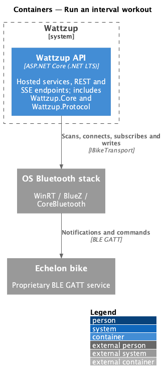
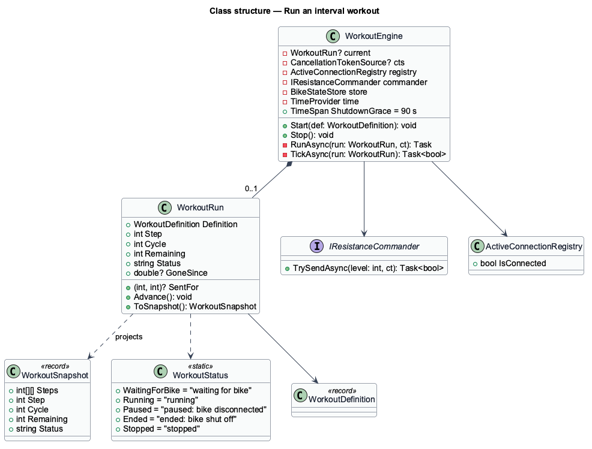

# Run an interval workout

## Overview

Once a workout is started, the backend runs it by itself. Each second it counts down the current step. At the end of a step it moves to the next step, and after the last step it loops back to the first. It sets the bike's resistance to each step's level and corrects the bike if the bike drifts from that level. The engine runs in the backend rather than the browser, so a workout continues when the dashboard is closed or reloaded.

**cycle** — one pass through all steps; numbered from 1 and incremented each time the engine wraps from the last step to step 0

**tick** — one 1-second iteration of the engine loop

**shutdown grace** — 90 s period after which a workout whose bike has stayed disconnected is ended

The engine pauses when the bike is not connected. If the bike has never sent data, the workout is `waiting for bike`. If it sent data and then went away, the workout is `paused: bike disconnected`. If the bike stays away beyond the shutdown grace, the engine treats the bike as switched off and ends the workout.

## Description

- **`WorkoutEngine`** (`Wattzup.Core`) — singleton that owns at most one `WorkoutRun`. `Start(definition)` cancels the current run's `CancellationTokenSource`, creates a new run, and starts `RunAsync` on the thread pool. `Stop()` cancels the run and sets `status = stopped`.
- **`WorkoutRun`** — mutable run state: `Definition`, `Step`, `Cycle`, `Remaining`, `Status`, `SentFor` (the `(cycle, step)` pair whose level was last sent) and `GoneSince`. `ToSnapshot()` produces the `WorkoutSnapshot` stored in `BikeState.workout`.
- **`WorkoutStatus`** — string constants `waiting for bike`, `running`, `paused: bike disconnected`, `ended: bike shut off` and `stopped`. These are kept verbatim from the prototype because the UI displays them.
- **`WorkoutEngine.RunAsync`** — a `PeriodicTimer` at 1 s drives the tick. Each tick does the following:
  1. **Not connected** (`ActiveConnectionRegistry.IsConnected` is false). The tick sets `GoneSince` if it is unset and clears `SentFor`. If data was ever received and `now − GoneSince > 90 s`, it sets `ended: bike shut off`, broadcasts, and exits. Otherwise it sets the waiting or paused status and broadcasts, and `Remaining` does not change (L2-013).
  2. **Connected.** The tick clears `GoneSince`. It sends the level through `IResistanceCommander` when `SentFor != (Cycle, Step)`, which covers a new step, a new cycle and a reconnect. It also sends when `resistance != level` and `Remaining % 5 == 0`. A failed send sets `error = "set resistance failed: <message>"` and the run continues (L2-012).
  3. The tick sets `status = running`, broadcasts, then decrements `Remaining`. At 0 it advances `Step`. On wrap to 0 it increments `Cycle`, then loads the new step's seconds (L2-011).
- **`IResistanceCommander`** — shared with `set-resistance`. A successful send also updates `target_resistance`.
- **`IClock`** — injected so tests run the 90 s grace and multi-cycle scenarios on virtual time (`FakeTimeProvider`).

The engine writes `BikeState.workout` only through `BikeStateStore.Update`, so each change produces one broadcast. Run state is touched only from the engine's own loop, which keeps the type single-threaded.

## Requirements

| L2 ID | Refines (L1) | Requirement |
|-------|--------------|-------------|
| `L2-011` | `L1-004` | Workout execution. The engine must count down each step one second at a time, move to the next step when the count reaches 0, and loop back to step 0 forever, increasing `cycle` each time it wraps. |
| `L2-012` | `L1-004` | Automatic resistance during workouts. The engine must send the step's level when a step starts (per cycle), and resend it every 5 seconds while the bike's reported resistance differs from it. |
| `L2-013` | `L1-004` | Workout pause, shutdown and replacement. |

## Diagrams

### System context

The engine commands the bike's resistance on a schedule, with no rider action after start.

### Containers

The engine runs inside the Wattzup API container and writes to the bike over BLE.

### Components

`WorkoutEngine` reads connection status from `ActiveConnectionRegistry`, commands levels through `IResistanceCommander`, and publishes progress to `BikeStateStore`.

### Class structure

`WorkoutEngine` composes a single `WorkoutRun`. The immutable `WorkoutSnapshot` is the run's public projection inside `BikeState`.

### Behaviour — one tick

Each tick handles the 3 cases: disconnected (pause or end), connected with a send due, and connected with nothing to send. It then counts down and advances (L2-011, L2-012, L2-013).

### State machine — workout status

The workout status moves between waiting, running and paused, and ends at `ended: bike shut off` or `stopped`.

