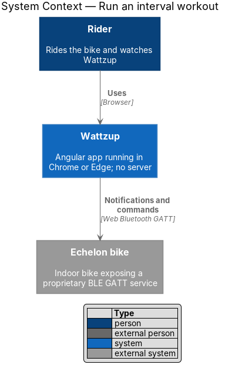

# Run an interval workout

## Overview

Once a workout is started, Wattzup runs it by itself. The rider's plan is turned into an ordered list of segments that covers the whole ride from 0:00 to its total time. Each second the engine advances the ride clock, moves to the next segment when the current one runs out, and sets the bike's resistance to the current segment's level. The ride ends when the clock reaches the total. The engine runs in the page, in `@wattzup/browser`, so a workout continues while the rider moves between Wattzup's screens; closing or reloading the page ends it and saves it as L2-092 criterion 5 describes (see `live-state/run-rides`).

**plan** — the rider's choice of workout: `hiit` (rounds of work and recover with an optional warm-up and cool-down), `intervals` (a warm-up, ordered sets and a cool-down) or `flat` (one level for a number of minutes); validated by `start-and-stop-workout` (L2-010)

**segment** — stretch of the ride at one level, `{kind, start, duration, level, cadence, round}`; `kind` is `warmup`, `work`, `rest`, `cooldown` or `steady`, `start` is its offset in seconds from the start of the ride, and `cadence` is the rider's cadence aim in rpm

**plan expansion** — deterministic function from a plan to its segments (L2-045)

**summary** — one-line label of a plan, such as `HIIT · 8 × 40s / 20s` or `Flat · Level 12 · 30 min` (L2-060)

**tick** — one look at the monotonic clock by the engine loop, every 250 ms, which steps the run once for each whole running second due (see `live-state/run-rides`)

**ride clock** — `elapsed_seconds`, counted from 0 to `total_seconds` while the workout is `running`

**shut-off grace** — 90 s period after which a started ride whose bike has stayed disconnected is ended

**mode** — `plan` when the engine drives the resistance, `manual` after the rider overrides it (L2-047)

The ride clock moves only while the workout is `running`. A workout started before the bike connects is `waiting for bike` and starts at 0:00 when the bike connects. A started ride whose bike goes away is `paused: bike disconnected`. If the bike stays away beyond the shut-off grace, the engine treats the bike as switched off and ends the ride. The rider can also pause and resume (`start-and-stop-workout`, L2-046). Starting a new workout replaces the active one.

The interval card, countdown and phase are drawn by `show-workout-countdown`; banners and beeps by `play-workout-cues`. This feature has no screen of its own.

## Description

All modules live in `@wattzup/browser`'s `lib/engine/`. The contract that calls them, `WORKOUT_API`, is in `start-and-stop-workout`.

- **`WorkoutPlan`** — the contract's union of three kinds, discriminated by `kind`, with snake_case fields: `hiit` `{rounds, work_seconds, rest_seconds, work_level, rest_level, warmup, cooldown}`, `intervals` `{warmup, sets, cooldown}` (a stretch is `{seconds, level, cadence}`, a set `{rounds, work_seconds, work_level, work_cadence, rest_seconds, rest_level, rest_cadence}`) and `flat` `{level, minutes, cadence}`. Only `validatePlan` creates one (see `start-and-stop-workout`).
- **`Segment`** — `{kind, start, duration, level, cadence, round}`; `kind` is `warmup`, `work`, `rest`, `cooldown` or `steady`.
- **`expand(plan)`** (`plan-expander.ts`) — pure function returning the segments (L2-045):
  - A `flat` plan yields one `steady` segment: `start` 0, `duration` = `minutes × 60`, `level`, `cadence` = the plan's cadence goal, `round` `null`.
  - A `hiit` plan with `warmup` starts with a `warmup` segment of 180 s at level `max(1, rest_level + 2)` with cadence aim 80.
  - Each round r from 1 to `rounds` adds a `work` segment (`work_seconds`, `work_level`, cadence aim 100, round r), then a `rest` segment (`rest_seconds`, `rest_level`, cadence aim 72, round r).
  - With `cooldown`, the last round has no `rest` segment, and a `cooldown` segment of 120 s at level `max(1, rest_level)` with cadence aim 70 ends the plan.
  - An `intervals` plan yields its `warmup` segment (when not `null`), then for each set and each of its rounds a `work` segment (`work_seconds`, `work_level`, `work_cadence`) and, when `rest_seconds` > 0, a `rest` segment (`rest_seconds`, `rest_level`, `rest_cadence`), then its `cooldown` segment (when not `null`). `round` counts the efforts across all sets from 1; a `rest` carries the round of the effort before it (L2-045 criteria 7 and 8). The *Descending recoveries* plan yields 17 segments and 1800 s.
  - Each `start` is the running sum of the durations before it. The plan 8 × 40 s / 20 s, work 18, recover 6, warm-up and cool-down yields 17 segments and 760 s.
- **`summaryFor(plan)`** (`workout-summary.ts`) — pure function (L2-060). A `hiit` plan with `work_seconds` under 60 reads `HIIT · <rounds> × <work>s / <rest>s`. With 60 s or more it reads `HIIT · <rounds> × <m:ss> / <m:ss>`. A `flat` plan reads `Flat · Level <level> · <minutes> min`. An `intervals` plan reads `Intervals · <efforts> efforts · <m:ss total>` (`1 effort` for one), e.g. `Intervals · 8 efforts · 30:00`.
- **`WorkoutStatus`** — the contract's string union `waiting for bike`, `running`, `paused`, `paused: bike disconnected`, `ended`, `ended: bike shut off` and `stopped`. The UI displays these values, so they are part of the state contract (L2-014). `ended`, `ended: bike shut off` and `stopped` are terminal; a workout in any other status is *active*.
- **`WorkoutRun`** (inside `workout-engine.ts`) — mutable run state, touched only by the engine loop:
  - `plan`, `origin` (the class, when started from one), `segments`, `summary`, `totalSeconds` (sum of durations)
  - `segment`, `remaining`, `elapsed`, `status`, `endedReason`
  - `mode` and `planLevel` (the current segment's level)
  - `hasStarted` (the ride clock has moved at least once), `pausedByRider`
  - `sentForSegment` (segment index whose level was last sent, or `null`), `lastSentLevel`
  - `disconnectedSince` (monotonic ms, or `null`), `anchor` (the monotonic time at which `elapsed` was 0)
  - `totals`, `samples` and `sessionId`
  - `toSnapshot()` returns the `WorkoutSnapshot` stored in `BikeState.workout`.
- **`WorkoutSnapshot`** — the contract type of `workout` (L2-014): `{plan, summary, segments, segment, remaining, elapsed_seconds, total_seconds, mode, plan_level, status, ended_reason, session_id}`.
- **`WorkoutEngine`** — provided once by `provideBrowserContracts()`; owns at most one `WorkoutRun`. Its public methods (`startWorkout(plan, origin)`, `stop()`, `pause()`, `resume()`, `backToPlan()`, and `setManual(level)` used by `BIKE_API.setResistance`) queue a command on one promise queue and resolve with its result. The loop looks at the `Clock` every 250 ms and queues a tick the same way. Commands and ticks therefore run one at a time, and nothing else touches `WorkoutRun`.
- **Start and replace** (L2-011, L2-013):
  1. A start command discards the current run, if any; replacing a run does not broadcast `stopped`.
  2. It expands the plan, builds a new run at `segment` 0, `elapsed_seconds` 0, `remaining` = segment 0's duration and `mode` `plan`, and resets the ride totals (L2-049).
  3. If the bike is connected, the status is `running` and the engine drives the resistance at once (see *Drive* below). Otherwise the status is `waiting for bike`.
  4. It publishes the snapshot and resolves with it; `WORKOUT_API.start` answers it.
- **Tick** — runs only while the run is active. Each tick does the following, in order (a running tick steps once per whole second due on the monotonic clock, so a late tick catches up; see `live-state/run-rides`):
  1. **Not connected** (`BikeLink` has no GATT link). The tick clears `sentForSegment`. If the ride has not started, the status stays `waiting for bike`. Otherwise it sets `disconnectedSince` if it is unset and sets the status to `paused: bike disconnected`. When `now − disconnectedSince > 90 s`, it sets the status to `ended: bike shut off` and `ended_reason` to `bike shut off`, and the run stops ticking (L2-013). The ride clock does not move.
  2. **Connected, not yet running.** The tick clears `disconnectedSince`. If `pausedByRider` is set, the status is `paused` and nothing is sent (L2-046). Otherwise the status becomes `running` and the tick drives the resistance, but the ride clock does not move on this tick. A waiting ride therefore starts at 0:00, and a reconnected ride resumes from the same `segment` and `remaining` (L2-013).
  3. **Running.** For each second due, the tick counts: `elapsed += 1` and `remaining −= 1`, and it adds the second to the ride totals, the power trace and the session samples (L2-049, L2-050, L2-081). When `remaining` reaches 0 on a segment that is not the last, `segment += 1` and `remaining` becomes the new segment's duration (L2-011). A `hiit` run in `manual` mode returns to `plan` mode at that point (L2-047). When `elapsed` reaches `totalSeconds`, the status is `ended`, `ended_reason` stays `null`, and the bike is left at the last segment's level. Otherwise, after the last second due, the tick drives the resistance once.
  4. The tick publishes the snapshot through `BikeStateStore.update`.
- **Drive** — sends the plan level through `ResistanceCommander` with source `plan` (L2-012). In `manual` mode it sends no plan level; it resends the manual level by the 5-second rule instead (L2-012 criterion 6).
  - When `sentForSegment` differs from `segment`, it sends the segment's level once. This covers a new segment, a new ride, a reconnect and a resume.
  - When the bike's `resistance` differs from `lastSentLevel` and `remaining % 5 == 0`, it sends the level again.
  - When the bike reports `lastSentLevel`, nothing more is sent for that segment.
  - After any attempt, `sentForSegment` and `lastSentLevel` are updated, so a failed send is retried by the 5-second rule rather than every second.
  - A failed send sets `error` to `set resistance failed: <message>`; the commander records the command as `failed` (L2-048), and the workout keeps running.
- **Pause, resume, back-to-plan and stop** — handled on the same loop; their contract behaviour is described in `start-and-stop-workout`. While `paused` with the bike connected, `disconnectedSince` stays `null`, so the shut-off grace does not run (L2-046). A stop sets the status to `stopped` and leaves the bike at its current level (L2-013).
- **`ResistanceCommander`** — shared with `set-resistance`. `send(level, 'plan', rideSeconds)` writes the command, updates `target_resistance` and logs the command (L2-048).
- **`Clock`** (`CLOCK`) — injected. Tests pass `FakeClock` and advance it, so the 90 s grace and a full 12:40 ride run on virtual time.

The run lives in the page. Every 10 running seconds the engine writes the ride journal, so a closed or reloaded page saves the ride as a session on the next load (L2-092 criterion 5, `live-state/run-rides`).

### Tests

`workout-engine.spec.ts` (`@wattzup/browser`) runs the engine with `FakeClock` and a fake `BikeLink` into which Bluetooth faults (a dropped connection, a bike that ignores a level) are injected, one case per criterion:

- starting a workout publishes segment 0 of the expanded plan (L2-011 criterion 1)
- each running second advances elapsed and remaining (L2-011 criterion 2)
- a segment that runs out moves to the next with its full duration (L2-011 criterion 3)
- reaching the total ends the ride at the last level (L2-011 criterion 4)
- a new segment sends its level once with source `plan` (L2-012 criteria 1 and 3)
- a bike that drifts is corrected on multiples of 5 seconds (L2-012 criterion 2)
- a failed send sets `error` and the ride keeps running (L2-012 criterion 4)
- manual mode suppresses plan levels (L2-012 criterion 6)
- a workout started without the bike waits and starts at 0:00 (L2-013 criterion 1)
- a disconnect pauses, and a reconnect resumes and resends (L2-013 criteria 2 and 4; L2-012 criterion 5)
- 90 seconds disconnected ends the ride with `bike shut off` (L2-013 criterion 3)
- starting again replaces the active ride at 0:00 (L2-013 criterion 5)
- stop leaves the bike at its current level (L2-013 criterion 6)
- a 60 s gap crossing 2 segment ends lands in the right segment with 1 command (L2-092 criterion 3)

The tables have a case per row:

- `workout-rules.spec.ts` — `expand`: one case per L2-045 criterion (flat; warm-up; rounds; cool-down drops the last rest; the 8 × 40 s / 20 s plan: 17 segments and 760 s; starts are running sums; the `intervals` rules and the *Descending recoveries* plan), plus a `hiit` plan with neither warm-up nor cool-down; `summaryFor`: one case per L2-060 criterion, plus the 59 s and 60 s boundary. The setup preview's helper repeats the expansion rows (`set-up-ride`).
- Playwright specs drive a ride through the fake `navigator.bluetooth`: an automatic resistance write at a segment change, the countdown, and a disconnect and reconnect.

## Requirements

| L2 ID | Refines (L1) | Requirement |
|-------|--------------|-------------|
| `L2-011` | `L1-004` | Workout execution. The engine must advance the ride one second at a time while the workout is `running`, tracking `elapsed_seconds` from 0 to `total_seconds` and the current `segment` and its `remaining` seconds. |
| `L2-012` | `L1-004` | Automatic resistance during workouts. While `mode` is `plan`, the engine must set the bike to the current segment's level. |
| `L2-013` | `L1-004` | Waiting, disconnect, shutdown and replacement. The 90-second shut-off rule is kept from the prototype. |
| `L2-045` | `L1-004` | Plan expansion into segments. Wattzup must expand an accepted plan into an ordered list of segments `{kind, start, duration, level, cadence, round}`, where `start` is the second offset from the start of the ride and `round` is `null` outside work and recover segments. |
| `L2-060` | `L1-004` | Workout summary label. A `hiit` plan reads `HIIT · <rounds> × <work>s / <rest>s` (work under 60 s) or `HIIT · <rounds> × <m:ss> / <m:ss>`; a `flat` plan reads `Flat · Level <level> · <minutes> min`. |

## Diagrams

### System context

The engine commands the bike's resistance on a schedule, with no rider action after start.

### Containers

The engine runs inside the Wattzup app in the rider's browser and writes to the bike over Web Bluetooth.

### Components

`WorkoutEngine` expands the plan with `expand`, reads the connection from `BikeLink`, commands levels through `ResistanceCommander`, and publishes progress to `BikeStateStore`. `Clock` drives the tick.

### Class structure

`WorkoutEngine` composes at most one `WorkoutRun`, which holds the expanded `Segment` list. `WorkoutSnapshot` is the run's public projection inside `BikeState`.

### Behaviour — one tick

Each tick handles 3 cases: the bike is not connected (wait, pause or shut off), the bike is connected but the ride is not yet running (start or resume without counting), and the ride is running (count, advance, drive). It then publishes (L2-011, L2-012, L2-013).

### Behaviour — disconnect, reconnect and shut-off

A disconnect freezes the ride clock. A reconnect within 90 s resumes from the same point and sends the segment's level again; beyond 90 s the ride ends with `bike shut off` (L2-013, L2-012).

### State machine — workout status

The status moves between `waiting for bike`, `running`, `paused` and `paused: bike disconnected`, and ends at `ended`, `ended: bike shut off` or `stopped`. A new start from any status replaces the run.

