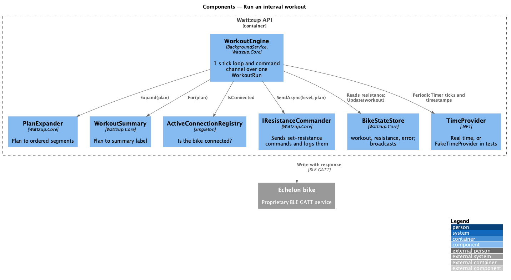
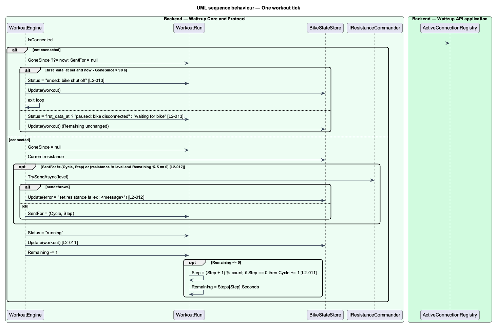
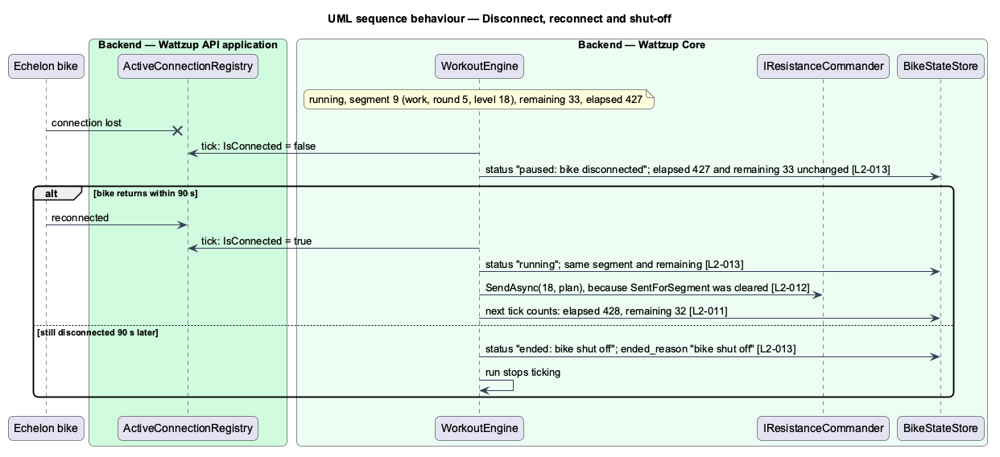
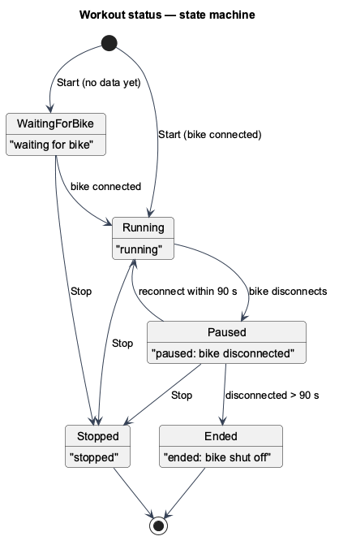

# Run an interval workout

## Overview

Once a workout is started, the backend runs it by itself. The rider's plan is turned into an ordered list of segments that covers the whole ride from 0:00 to its total time. Each second the engine advances the ride clock, moves to the next segment when the current one runs out, and sets the bike's resistance to the current segment's level. The ride ends when the clock reaches the total. The engine runs in the backend rather than the browser, so a workout continues when the dashboard is closed or reloaded.

**plan** — the rider's choice of workout, either `hiit` (rounds of work and recover with an optional warm-up and cool-down) or `flat` (one level for a number of minutes); validated by `start-and-stop-workout` (L2-010)

**segment** — stretch of the ride at one level, `{kind, start, duration, level, cadence, round}`; `kind` is `warmup`, `work`, `rest`, `cooldown` or `steady`, `start` is its offset in seconds from the start of the ride, and `cadence` is the rider's cadence aim in rpm

**plan expansion** — deterministic function from a plan to its segments (L2-045)

**summary** — one-line label of a plan, such as `HIIT · 8 × 40s / 20s` or `Flat · Level 12 · 30 min` (L2-060)

**tick** — one 1-second iteration of the engine loop, driven by `TimeProvider`

**ride clock** — `elapsed_seconds`, counted from 0 to `total_seconds` while the workout is `running`

**shut-off grace** — 90 s period after which a started ride whose bike has stayed disconnected is ended

**mode** — `plan` when the engine drives the resistance, `manual` after the rider overrides it (L2-047)

The ride clock moves only while the workout is `running`. A workout started before the bike connects is `waiting for bike` and starts at 0:00 when the bike connects. A started ride whose bike goes away is `paused: bike disconnected`. If the bike stays away beyond the shut-off grace, the engine treats the bike as switched off and ends the ride. The rider can also pause and resume (`start-and-stop-workout`, L2-046). Starting a new workout replaces the active one.

The interval card, countdown and phase are drawn by `show-workout-countdown`; banners and beeps by `play-workout-cues`. This feature is backend only.

## Description

All types live in `Wattzup.Core`. The endpoints that call them are in `start-and-stop-workout`.

- **`WorkoutPlan`** — abstract record with two subtypes, `HiitPlan(Rounds, WorkSeconds, RestSeconds, WorkLevel, RestLevel, Warmup, Cooldown)` and `FlatPlan(Level, Minutes, Cadence)`. It is serialised with the `kind` discriminator and snake_case names. Only `WorkoutPlanValidator` creates one (see `start-and-stop-workout`).
- **`Segment`** — immutable record `(SegmentKind Kind, int Start, int Duration, int Level, int Cadence, int? Round)`. `SegmentKind` serialises as `warmup`, `work`, `rest`, `cooldown` and `steady`.
- **`PlanExpander.Expand(plan)`** — pure static function returning `IReadOnlyList<Segment>` (L2-045):
  - A `flat` plan yields one `steady` segment: `start` 0, `duration` = `minutes × 60`, `level`, `cadence` = the plan's cadence goal, `round` `null`.
  - A `hiit` plan with `warmup` starts with a `warmup` segment of 180 s at level `max(1, rest_level + 2)` with cadence aim 80.
  - Each round r from 1 to `rounds` adds a `work` segment (`work_seconds`, `work_level`, cadence aim 98, round r), then a `rest` segment (`rest_seconds`, `rest_level`, cadence aim 72, round r).
  - With `cooldown`, the last round has no `rest` segment, and a `cooldown` segment of 120 s at level `max(1, rest_level)` with cadence aim 70 ends the plan.
  - Each `start` is the running sum of the durations before it. The plan 8 × 40 s / 20 s, work 18, recover 6, warm-up and cool-down yields 17 segments and 760 s.
- **`WorkoutSummary.For(plan)`** — pure static function (L2-060). A `hiit` plan with `work_seconds` under 60 reads `HIIT · <rounds> × <work>s / <rest>s`. With 60 s or more it reads `HIIT · <rounds> × <m:ss> / <m:ss>`. A `flat` plan reads `Flat · Level <level> · <minutes> min`.
- **`WorkoutStatus`** — string constants `waiting for bike`, `running`, `paused`, `paused: bike disconnected`, `ended`, `ended: bike shut off` and `stopped`. The UI displays these values, so they are part of the state contract (L2-014). `ended`, `ended: bike shut off` and `stopped` are terminal; a workout in any other status is *active*.
- **`WorkoutRun`** — mutable run state, touched only by the engine loop:
  - `Plan`, `Segments`, `Summary`, `TotalSeconds` (sum of durations)
  - `Segment`, `Remaining`, `Elapsed`, `Status`, `EndedReason`
  - `Mode` and `PlanLevel` (the current segment's level)
  - `HasStarted` (the ride clock has moved at least once), `PausedByRider`
  - `SentForSegment` (segment index whose level was last sent, or `null`), `LastSentLevel`
  - `DisconnectedSince` (`DateTimeOffset?`)
  - `ToSnapshot()` returns the `WorkoutSnapshot` stored in `BikeState.workout`.
- **`WorkoutSnapshot`** — immutable record serialised as `workout` (L2-014): `{plan, summary, segments, segment, remaining, elapsed_seconds, total_seconds, mode, plan_level, status, ended_reason}`.
- **`WorkoutEngine`** — singleton `BackgroundService` that owns at most one `WorkoutRun`. Its public methods (`StartAsync(plan)`, `StopAsync()`, `PauseAsync()`, `ResumeAsync()`, `BackToPlanAsync()`, and the manual-override entry used by `POST /api/resistance`) post a command to a bounded `Channel<WorkoutCommand>` and await its reply. `ExecuteAsync` is one loop that awaits either the next command or the next tick of a `PeriodicTimer(1 s, TimeProvider)`. Commands and ticks therefore run one at a time on the loop, and no lock guards `WorkoutRun`.
- **Start and replace** (L2-011, L2-013):
  1. A start command discards the current run, if any; replacing a run does not broadcast `stopped`.
  2. It expands the plan, builds a new run at `segment` 0, `elapsed_seconds` 0, `remaining` = segment 0's duration and `mode` `plan`, and resets the ride totals (L2-049).
  3. If the bike is connected, the status is `running` and the engine drives the resistance at once (see *Drive* below). Otherwise the status is `waiting for bike`.
  4. It publishes the snapshot and replies with it; the endpoint returns it as `{"started": <workout>}`.
- **Tick** — runs only while the run is active. Each tick does the following, in order:
  1. **Not connected** (`ActiveConnectionRegistry.IsConnected` is false). The tick clears `SentForSegment`. If the ride has not started, the status stays `waiting for bike`. Otherwise it sets `DisconnectedSince` if it is unset and sets the status to `paused: bike disconnected`. When `now − DisconnectedSince > 90 s`, it sets the status to `ended: bike shut off` and `ended_reason` to `bike shut off`, and the run stops ticking (L2-013). The ride clock does not move.
  2. **Connected, not yet running.** The tick clears `DisconnectedSince`. If `PausedByRider` is set, the status is `paused` and nothing is sent (L2-046). Otherwise the status becomes `running` and the tick drives the resistance, but the ride clock does not move on this tick. A waiting ride therefore starts at 0:00, and a reconnected ride resumes from the same `segment` and `remaining` (L2-013).
  3. **Running.** The tick counts: `Elapsed += 1` and `Remaining −= 1`, and it adds the second to the ride totals and the power trace (L2-049, L2-050). When `Remaining` reaches 0 on a segment that is not the last, `Segment += 1` and `Remaining` becomes the new segment's duration (L2-011). A `hiit` run in `manual` mode returns to `plan` mode at that point (L2-047). When `Elapsed` reaches `TotalSeconds`, the status is `ended`, `ended_reason` stays `null`, and the bike is left at the last segment's level. Otherwise the tick drives the resistance.
  4. The tick publishes the snapshot through `BikeStateStore.Update`, which broadcasts it.
- **Drive** — sends the plan level through `IResistanceCommander` with source `plan` (L2-012). It sends nothing in `manual` mode.
  - When `SentForSegment` differs from `Segment`, it sends the segment's level once. This covers a new segment, a new ride, a reconnect and a resume.
  - When the bike's `resistance` differs from `LastSentLevel` and `Remaining % 5 == 0`, it sends the level again.
  - When the bike reports `LastSentLevel`, nothing more is sent for that segment.
  - After any attempt, `SentForSegment` and `LastSentLevel` are updated, so a failed send is retried by the 5-second rule rather than every second.
  - A failed send sets `error` to `set resistance failed: <message>`; the commander records the command as `failed` (L2-048), and the workout keeps running.
- **Pause, resume, back-to-plan and stop** — handled on the same loop; their endpoint behaviour is described in `start-and-stop-workout`. While `paused` with the bike connected, `DisconnectedSince` stays `null`, so the shut-off grace does not run (L2-046). A stop sets the status to `stopped` and leaves the bike at its current level (L2-013).
- **`IResistanceCommander`** — shared with `set-resistance`. `SendAsync(level, CommandSource.Plan, ct)` writes the command, updates `target_resistance` and logs the command (L2-048).
- **`TimeProvider`** — injected. Tests pass `FakeTimeProvider` and advance it second by second, so the 90 s grace and a full 12:40 ride run on virtual time.

On host shutdown the loop observes the stopping token and exits within the 5 s timeout; the run is not persisted (ADR 0004).

### Acceptance tests

Each test runs `Wattzup.Api.AcceptanceTests` through `WebApplicationFactory` with `SimulatedBikeTransport` and `FakeTimeProvider`. It starts a ride with `POST /api/workout`, advances the clock, and awaits the expected SSE message from `/api/events` with a timeout that fails naming the last message received. Bluetooth faults (dropped connection, a bike that ignores a level) are injected through the simulated transport.

- `Starting_a_workout_publishes_segment_0_of_the_expanded_plan` (L2-011 AC1)
- `Each_running_second_advances_elapsed_and_remaining` (L2-011 AC2)
- `A_segment_that_runs_out_moves_to_the_next_with_its_full_duration` (L2-011 AC3)
- `Reaching_the_total_ends_the_ride_at_the_last_level` (L2-011 AC4)
- `A_new_segment_sends_its_level_once_with_source_plan` (L2-012 AC1, AC3)
- `A_bike_that_drifts_is_corrected_on_multiples_of_5_seconds` (L2-012 AC2)
- `A_failed_send_sets_error_and_the_ride_keeps_running` (L2-012 AC4)
- `Manual_mode_suppresses_plan_levels` (L2-012 AC6)
- `A_workout_started_without_the_bike_waits_and_starts_at_0_00` (L2-013 AC1)
- `A_disconnect_pauses_and_a_reconnect_resumes_and_resends` (L2-013 AC2, AC4; L2-012 AC5)
- `Ninety_seconds_disconnected_ends_the_ride_with_bike_shut_off` (L2-013 AC3)
- `Starting_again_replaces_the_active_ride_at_0_00` (L2-013 AC5)
- `Stop_leaves_the_bike_at_its_current_level` (L2-013 AC6)
- `The_workout_carries_its_summary` (L2-060, one representative path)

`Wattzup.Core.Tests` holds the tables, one case per row:

- `PlanExpanderTests` — one case per L2-045 criterion (flat; warm-up; rounds; cool-down drops the last rest; the 8 × 40 s / 20 s plan: 17 segments and 760 s; starts are running sums), plus a `hiit` plan with neither warm-up nor cool-down. The same rows are repeated in the frontend helper's tests (`set-up-ride`).
- `WorkoutSummaryTests` — one case per L2-060 criterion, plus the 59 s and 60 s boundary.

## Requirements

| L2 ID | Refines (L1) | Requirement |
|-------|--------------|-------------|
| `L2-011` | `L1-004` | Workout execution. The engine must advance the ride one second at a time while the workout is `running`, tracking `elapsed_seconds` from 0 to `total_seconds` and the current `segment` and its `remaining` seconds. |
| `L2-012` | `L1-004` | Automatic resistance during workouts. While `mode` is `plan`, the engine must set the bike to the current segment's level. |
| `L2-013` | `L1-004` | Waiting, disconnect, shutdown and replacement. The 90-second shut-off rule is kept from the prototype. |
| `L2-045` | `L1-004` | Plan expansion into segments. The backend must expand an accepted plan into an ordered list of segments `{kind, start, duration, level, cadence, round}`, where `start` is the second offset from the start of the ride and `round` is `null` outside work and recover segments. |
| `L2-060` | `L1-004` | Workout summary label. A `hiit` plan reads `HIIT · <rounds> × <work>s / <rest>s` (work under 60 s) or `HIIT · <rounds> × <m:ss> / <m:ss>`; a `flat` plan reads `Flat · Level <level> · <minutes> min`. |

## Diagrams

### System context

The engine commands the bike's resistance on a schedule, with no rider action after start.

### Containers

The engine runs inside the Wattzup API container and writes to the bike over BLE.

### Components

`WorkoutEngine` expands the plan with `PlanExpander`, reads connection status from `ActiveConnectionRegistry`, commands levels through `IResistanceCommander`, and publishes progress to `BikeStateStore`. `TimeProvider` drives the tick.

### Class structure

`WorkoutEngine` composes at most one `WorkoutRun`, which holds the expanded `Segment` list. The immutable `WorkoutSnapshot` is the run's public projection inside `BikeState`.

### Behaviour — one tick

Each tick handles 3 cases: the bike is not connected (wait, pause or shut off), the bike is connected but the ride is not yet running (start or resume without counting), and the ride is running (count, advance, drive). It then publishes (L2-011, L2-012, L2-013).

### Behaviour — disconnect, reconnect and shut-off

A disconnect freezes the ride clock. A reconnect within 90 s resumes from the same point and sends the segment's level again; beyond 90 s the ride ends with `bike shut off` (L2-013, L2-012).

### State machine — workout status

The status moves between `waiting for bike`, `running`, `paused` and `paused: bike disconnected`, and ends at `ended`, `ended: bike shut off` or `stopped`. A new start from any status replaces the run.

