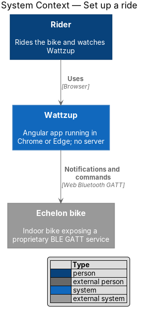
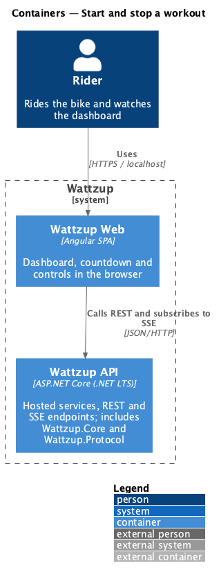
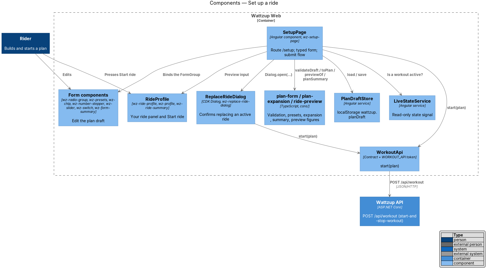
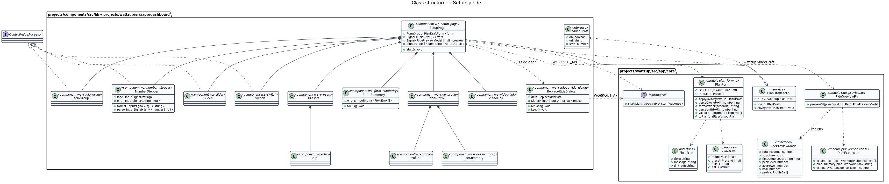
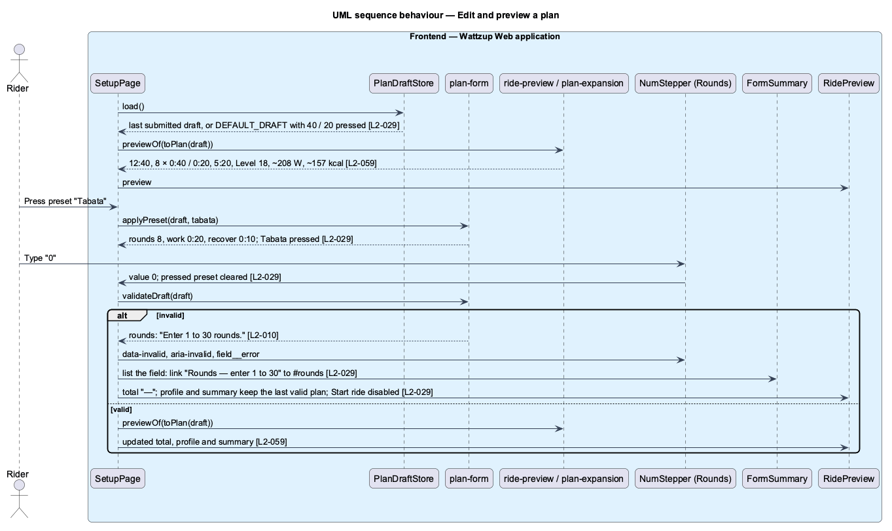
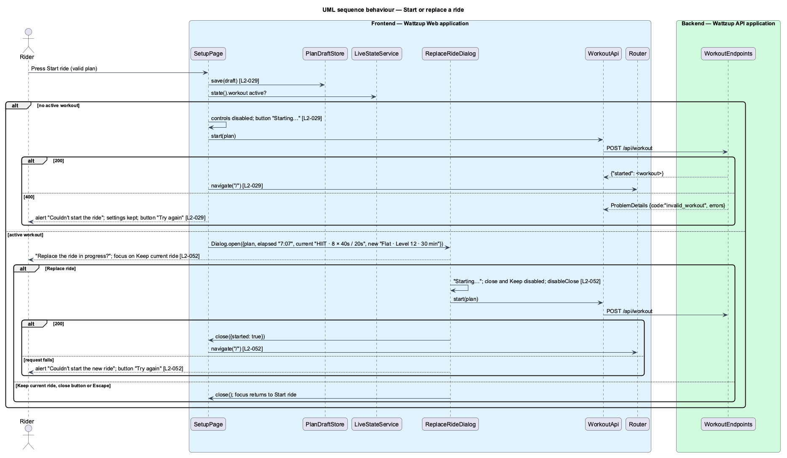

# Set up a ride

## Overview

Before a ride the rider opens the setup screen at `/setup`, picks HIIT intervals, configurable interval sets or one flat level, adjusts the plan, and presses Start ride. Beside the form, the *Your ride* panel previews the plan as it is edited: its total time, a resistance profile of its segments, and a summary with the expected average power and energy. When a ride is already in progress, Start ride first asks the rider to confirm that the new ride replaces it. The screen follows the Magic Patterns *Training Setup* frame, reproduced in `docs/mocks/pages/setup/` and `docs/mocks/dialogs/replace-ride/`.

**plan draft** — the form's working copy of a plan, in the units the rider edits (`0:40`, `30 min`, `85 rpm`); turned into a `WorkoutPlan` (L2-010) only when it is valid

**preset** — named set of Rounds, Work and Recover values for a HIIT plan: Tabata 8 × 0:20 / 0:10, 40 / 20 8 × 0:40 / 0:20, Minute on 10 × 1:00 / 1:00, Long climbs 4 × 4:00 / 2:00

**ride preview** — values derived from the plan draft by the same plan expansion as the backend (L2-045): total time, profile, structure, time under load, peak resistance, expected average power and expected energy

**time under load** — rounds × work seconds of a HIIT plan; the sum of every effort's work seconds of an intervals plan

**set** — one entry of an `intervals` plan: `rounds` efforts of `work_seconds` at `work_level` and `work_cadence`, each followed by a recover of `rest_seconds` at `rest_level` and `rest_cadence` (none when `rest_seconds` is 0)

**Descending recoveries** — the intervals preset and first-use default: warm-up 5:00 at level 8 and 80 rpm; 8 × 0:30 efforts at level 28 and 100 rpm in sets of 1, 2, 2, 2 and 1 with recovers of 3:00, 2:30, 2:00, 1:30 and none at level 8 and 72 rpm; cool-down 6:00 at level 6 and 70 rpm; 30:00 in total

**replace-ride dialog** — confirmation shown when Start ride is pressed while a workout is active

**default plan** — HIIT, 18 rounds, work 0:40 at level 26, recover 0:20 at level 18, warm-up (level 20) and cool-down (level 18) on; 22:40 in total

The backend side of starting a ride, the validation of the plan and the `invalid_workout` answer belong to `start-and-stop-workout`. The setup screen repeats the validation in the browser so the rider sees each problem before submitting, with the same messages.

## Description

### Pure helpers

Each helper lives in `frontend/src/app/core/`, has its unit tests beside it, and has no Angular dependency.

- **`plan-expansion.ts`** — the frontend's single implementation of the plan rules (L2-059):
  - `expandPlan(plan)` returns the segments by the rules of L2-045, mirroring `PlanExpander` in `Wattzup.Core`.
  - `planSummary(plan)` returns the summary label by the rules of L2-060, mirroring `WorkoutSummary`.
  - `estimateWatts(cadence, level)` returns `max(0, round(cadence × (0.55 + level × 0.155)))` (ADR 0003).
- **`ride-preview.ts`** — `previewOf(plan)` returns the *Your ride* values (L2-059):
  - `totalSeconds` is the sum of the segment durations; the default plan gives `22:40`.
  - `structure` is `<rounds> × <work> / <rest>` in `m:ss` for HIIT (`18 × 0:40 / 0:20`), and `Level <n> throughout` for flat.
  - `timeUnderLoad` is rounds × work as `m:ss` (`5:20`) for HIIT, and `null` for flat, so the row is not shown.
  - `peakLevel` is the highest segment level, shown `Level <max>`.
  - `avgPower` is `round(Σ estimateWatts(cadence, level) × duration ÷ total)` over the segments, shown `~<n> W`. The default plan gives `~362 W`; flat level 12 at 85 rpm gives `~205 W`.
  - `kcal` is `round(avgPower × total ÷ 1000 ÷ 0.24 ÷ 4.184)`, shown `~<n> kcal`. The default plan gives `~490 kcal`; the flat plan gives `~367 kcal`.
  - `profile` is one bar per segment in a `0 0 <total> 32` view box, as drawn in the mocks. With `inset = 0.002 × total`, each bar has `x = start + inset`, `width = duration − 2 × inset`, `height = level` and `y = 32 − level`. Its tone is `is-work` for `work` and `steady`, `is-rest` for `rest`, and `is-easy` for `warmup` and `cooldown`.
- **`plan-form.ts`** — the plan draft's rules (L2-029):
  - `DEFAULT_DRAFT` is the default plan with no preset pressed (18 rounds matches no preset). Flat defaults are level 12, 30 minutes and cadence 85.
  - `PRESETS` holds the 4 presets. `applyPreset(draft, id)` fills Rounds, Work and Recover and marks the preset pressed. Editing any of those 3 fields clears the pressed preset.
  - `parseClock('0:40')` returns 40 and `formatClock(40)` returns `0:40`. `parseUnit('30 min')` and `parseUnit('85 rpm')` read the number before the unit. Text that does not parse is invalid.
  - `validateDraft(draft)` returns, for each failing field of the current mode, its message, which is the text of L2-010 (for example `Enter 1 to 30 rounds.` and `Recover must be at least 0:05.`), and its summary link text. The mocks give the link text `Rounds — enter 1 to 30` and `Recover — at least 0:05`; the link text for every field is listed in L2-029, criterion 4.
  - `toPlan(draft)` returns the `WorkoutPlan` (generated type from `src/app/api/`) for a valid draft.
- **`PlanDraftStore`** (`plan-draft.store.ts`, root-provided) — reads and writes the last submitted draft under the `localStorage` key `wattzup.planDraft`, inside `try/catch`. Missing, unreadable or invalid data yields `DEFAULT_DRAFT` (L2-029).

The backend and frontend expansions are written once per side and tested against the same rows: the L2-045 and L2-060 criteria and the default and flat preview figures of L2-059 (ADR 0002).

### Components

Each component is standalone, `OnPush`, and split into `name.ts`, `name.html` and `name.scss`, under `frontend/src/app/dashboard/`, the components folder of the AGENTS.md tree. Each component owns the BEM blocks in its row of the table below, and no block has two owners. The mocks' classes are kept, and the mocks' inline `style` attributes move into the owning stylesheet. Shared blocks (`btn`, `alert`, `legend`, `swatch`, `numeral`, `field__error`, `skeleton`, `app-bar`, `lockup`) belong to the design system and are not restyled here.

| Component | Selector | Blocks | Role |
|---|---|---|---|
| `SetupPage` | `wz-setup-page` | `setup-layout`, `setup-main`, `field-grid` | Route `/setup`, lazy-loaded. App bar with the Close link to `/`, the form, the preview, and the submit flow |
| `ModeCards` | `wz-mode-cards` | `mode-cards`, `mode-card` | `fieldset` radio group, *HIIT intervals*, *Intervals* or *Flat resistance*; a two-way `mode` model |
| `Presets` | `wz-presets` | `presets` | `role="group"` named `Presets`, holding one `wz-chip` per preset |
| `Chip` | `wz-chip` | `chip` | Toggle button with `aria-pressed` |
| `NumStepper` | `wz-num-stepper` | `num-stepper` | Label, `Less <label>` and `More <label>` buttons, and a numeric text input; `value` input with `valueChange` and `step` outputs |
| `LevelSlider` | `wz-level-slider` | `level-slider` | Range 1–32 with `<output>` `<n> / 32`; modifiers `--rest` and `--large` |
| `Toggles` | `wz-toggles` | `toggles`, `toggle-row`, `switch` | Warm-up (`3 min, easy`) and Cool-down (`2 min, easy`) as `role="switch"` checkboxes |
| `FormSummary` | `wz-form-summary` | `form-summary` | Danger alert `<n> things to fix before you start` with one link per invalid field |
| `RidePreview` | `wz-ride-preview` | `setup-aside`, `ride-total` | The *Your ride* panel, the legend and the Start ride button |
| `Profile` | `wz-profile` | `profile`, `profile-axis` | SVG profile with `role="img"` and `aria-label="Resistance profile: <structure>"`; axis `0:00` to the total |
| `RideSummary` | `wz-ride-summary` | `summary` | `dl` of Structure, Time under load, Peak resistance, Expected avg power and Expected energy |
| `ReplaceRideDialog` | `wz-replace-ride-dialog` | none of its own | CDK Dialog content inside the design system's dialog frame |

`SetupPage` holds the drafts in signals (`draft`, and `intervals` for the Intervals mode) and derives the errors, the plan and the preview with `computed` from the pure helpers. The components hold no rule of their own. The `Less` and `More` buttons step Rounds by 1, Work and Recover by 5 s, Duration by 5 min and Cadence goal by 5 rpm, and the level sliders step by 1 (L2-029, criterion 9).

### Screen states

The screen follows the six setup mocks (L2-029, L2-059):

- **`loading`** — shown until the first live state arrives, because Start ride needs to know whether a workout is active. The form is replaced by skeletons with `aria-busy="true"`, and Start ride is disabled.
- **`default`** — the restored draft, or the default plan. For HIIT it shows the presets, the Rounds, Work and Recover steppers, the Work resistance and Recover resistance sliders, and the Warm-up and Cool-down switches.
- **`flat`** — Flat chosen. The screen shows the large Resistance level slider, the Duration and Cadence goal steppers and the hint `You can still nudge the level mid-ride from the dashboard.` The legend lists Steady.
- **`invalid`** — at least one field fails `validateDraft`:
  - The field has `data-invalid` and `aria-invalid="true"`, and its `aria-describedby` points to the `field__error` message.
  - `FormSummary` lists the fields.
  - The total reads `—`, with `aria-label="Total ride time —"`. The profile and summary keep the last valid plan, as in the mock.
  - Start ride is disabled and described by `Fix the <n> fields marked in red to start.`
  - Pressing Enter in a field moves focus to the summary, and each link focuses its field. With one field the summary reads `1 thing to fix before you start`.
- **`submitting`** — after Start ride. Every control is disabled or read-only, and the button reads `Starting…` with `aria-busy="true"`.
- **`error`** — `POST /api/workout` answered 400. An alert titled `Couldn't start the ride` shows above the form and says the settings are kept, and the button reads `Try again`. The alert body lists the messages from the ProblemDetails `errors` map. The `error` mock still quotes the prototype's steps message, which no longer exists (L2-010); the mock should be updated to an `errors`-map message. Any other failure reads `Couldn't start the ride` / `The Wattzup server didn't answer. Your settings are kept.` (L2-029). A 401 goes to `/unlock` (L2-055).

### Start flow

1. Start ride saves the draft through `PlanDraftStore`, so a reload restores the last submitted plan (L2-029).
2. If `LiveStateService.state().workout` is active (L2-014 statuses other than `ended`, `ended: bike shut off` and `stopped`), the page opens the replace-ride dialog. Otherwise it calls `WORKOUT_API.start(toPlan(draft))`.
3. On `200` the router navigates to `/`.

### Replace-ride dialog

`ReplaceRideDialog` is opened with the CDK `Dialog` service, never as a hand-rolled modal (L2-052). It follows the `default`, `busy` and `failed` mocks:

- The page passes `{plan, elapsed, currentSummary, newSummary}`. `elapsed` is `formatDuration(workout.elapsed_seconds)`, `currentSummary` is `workout.summary`, and `newSummary` is `planSummary(plan)`.
- The title is `Replace the ride in progress?`. The description is `You're <elapsed> into <current summary>. Starting <new summary> ends it and begins the new ride at 0:00.`, wired with `ariaLabelledBy` and `ariaDescribedBy`.
- `autoFocus` targets `Keep current ride`. `restoreFocus` returns focus to Start ride when the dialog closes.
- `Replace ride` calls `WORKOUT_API.start(plan)`. While the request runs, the button reads `Starting…` with `aria-busy="true"`, and the close button and `Keep current ride` are disabled. `disableClose` also blocks Escape and backdrop clicks during the request.
- On success the dialog closes with `{started: true}`, and the page navigates to `/`.
- On failure the dialog body shows the alert `Couldn't start the new ride` / `The server didn't answer. Your current ride is still running and your new settings are kept.` The primary button reads `Try again`.
- Escape, the close button and `Keep current ride` close the dialog without a request.

### Acceptance tests

Playwright (`frontend/e2e/`), with every `/api/**` request answered by the shared fixture and `/api/events` served by the SSE fixture. The responses for `POST /api/workout` (200 and 400) are recorded against the backend running with `--simulate`.

- Page objects: `e2e/pages/setup.page.ts` (mode cards, presets, steppers, sliders, switches, form summary, preview, Start ride, Close) and `e2e/pages/replace-ride.dialog.ts` (title, description, Keep current ride, Replace ride, close, alert).
- `e2e/setup.spec.ts`:
  - `shows the default plan with no preset pressed` (L2-029 AC1)
  - `fills rounds, work and recover from a preset, and clears it on edit` (L2-029 AC2)
  - `shows flat fields with their defaults` (L2-029 AC3)
  - `names an out-of-range field, lists it, disables Start and blanks the total` (L2-029 AC4)
  - `posts the plan, shows Starting… and goes to the dashboard` (L2-029 AC5)
  - `shows Couldn't start the ride on a 400 and keeps the settings` (L2-029 AC6)
  - `restores the last submitted plan after a reload` (L2-029 AC7)
  - `Close returns to the dashboard without a request` (L2-029 AC8)
  - `previews the default plan: 22:40, 18 × 0:40 / 0:20, 12:00, Level 26, ~362 W, ~490 kcal` (L2-059 AC1, AC2)
  - `previews a flat plan without time under load` (L2-059 AC3)
- `e2e/replace-ride.spec.ts`:
  - `asks before replacing an active ride, with focus on Keep current ride` (L2-052 AC1)
  - `replaces the ride and goes to the dashboard` (L2-052 AC2)
  - `keeps the current ride and the new settings when the request fails` (L2-052 AC3)
  - `Escape closes the dialog and returns focus to Start ride` (L2-052)

Unit tests in `src/app/core/`:

- `plan-expansion.spec.ts` — the same rows as `PlanExpanderTests` and `WorkoutSummaryTests` in `Wattzup.Core.Tests` (L2-059 AC4).
- `ride-preview.spec.ts` — the default and flat figures, and the profile geometry of a warm-up, a work, a rest and a cool-down bar.
- `plan-form.spec.ts` — one case per L2-010 range row, each preset, preset clearing, and clock and unit parsing.
- `plan-draft.store.spec.ts` — restore, missing key, storage that throws, and invalid stored data.

### Intervals plans

The *Intervals* mode builds an `intervals` plan (L2-010, L2-029 criteria 10 to 16), as drawn in `docs/mocks/pages/setup/intervals.html`, `intervals-invalid.html` and `docs/mocks/dialogs/edit-set/`.

- **`intervals-form.ts`** (pure helper, beside `plan-form.ts`) holds `IntervalsDraft` = `{preset, warmup: StretchDraft, cooldown: StretchDraft, sets: SetDraft[]}`, where a `StretchDraft` is `{on, seconds, level, cadence}` and a `SetDraft` is `{rounds, work_seconds, work_level, work_cadence, rest_seconds, rest_level, rest_cadence}` in numbers. It provides:
  - `INTERVAL_PRESETS` (`descending`, `even`) and `DEFAULT_INTERVALS` (the *Descending recoveries* plan with that preset pressed);
  - `addSet`, `removeSet`, `moveSet(i, -1 | 1)` and `replaceSet(i, set)`, each clearing the pressed preset;
  - `validateSet(set)` and `validateStretch(kind, stretch)` for the dialogs, returning the messages of L2-010 criterion 12 per field;
  - `validateIntervals(draft)` for the plan rules of L2-010 criterion 13, with the summary links `Sets — at most 30 efforts` and `Sets — at most 180 minutes`;
  - `toIntervalsPlan(draft)`, which writes `null` for a stretch that is off.
- **`plan-expansion.ts`** expands `intervals` as L2-045 criteria 7 and 8 and summarises it as L2-060 criterion 4; **`ride-preview.ts`** gives Structure `<sets> sets · <efforts> efforts` and time under load as L2-059 criterion 5. Both are tested against the same rows as `PlanExpanderTests` and `WorkoutSummaryTests`.
- **`PlanDraftStore`** keeps the draft under `wattzup.intervalsDraft`; unreadable or invalid data yields `DEFAULT_INTERVALS`.
- **Components** (all under `frontend/src/app/dashboard/`):

| Component | Selector | Blocks | Role |
|---|---|---|---|
| `SetList` | `wz-set-list` | `set-list`, `set-row` | The Warm-up row, one row per set and the Cool-down row as an ordered list; per row `Edit`, and per set `Move up`, `Move down` and `Remove`, named `Edit set <i>`, `Move set <i> up`, `Move set <i> down` and `Remove set <i>`; `Add set` below. It emits the action; the page applies it |
| `EditSetDialog` | `wz-edit-set-dialog` | `edit-set` | CDK Dialog content in `wz-dialog-shell` (`size: 'md'`): the steppers and sliders of L2-029 criterion 13, reusing `wz-num-stepper` and `wz-level-slider`; closes with the new `SetDraft` or `undefined` |
| `EditStretchDialog` | `wz-edit-stretch-dialog` | `edit-stretch` | The same for the warm-up and cool-down (L2-029 criterion 14) |

`DialogLauncher` gains `openEditSet({index, set, adding})` and `openEditStretch({kind, stretch})`, each returning a `Promise` of the saved value. Both use the launcher's `panelClass`, `ariaLabelledBy` and `restoreFocus`, so focus goes back to the button that opened them. The warm-up and cool-down switches sit on the rows themselves; turning one off keeps its values for when it is turned on again.

Rounds across sets are numbered from 1, so the dashboard's `Round r of n` (L2-025, L2-027) takes n from the number of `work` segments (`segment-labels.ts`, `segment-change-detector.ts`) for every plan kind.

Playwright (`e2e/setup.spec.ts`, describe `Intervals plan`), with the page object `e2e/pages/edit-set.dialog.ts` and the set-list locators in `setup.page.ts`:

- `shows the Descending recoveries plan on first use: 30:00, 5 sets · 8 efforts` (L2-029 AC10, AC11; L2-059 AC5)
- `edits a set in a dialog and returns focus to its Edit button` (L2-029 AC12, AC13)
- `edits the warm-up length` (L2-029 AC14)
- `adds, moves and removes sets` (L2-029 AC12)
- `disables Save for a set out of range` (L2-029 AC15)
- `posts the intervals plan and goes to the dashboard` (L2-029 AC5)
- `restores the last submitted intervals plan after a reload` (L2-029 AC16)

### Machine and treadmill

The setup screen no longer chooses the machine; the machine page at `/machine` does (L2-073, `treadmill/choose-machine`). While treadmill support is off (L2-075, ADR 0011), `treadmill_enabled` is `false`, the `Switch to …` link is not rendered, and the screen is the bike's. The treadmill form is designed in `treadmill/treadmill-dashboard-and-setup`. In short:

- On both machines the header shows `wz-status-line` with `<device_label>`, a `Switch to treadmill` link (`Switch to bike` on the treadmill) that calls `RideActions.switchMachine` and so ends a running workout through the end dialog before opening `/machine`, and `Close` (`app-bar__close`) (L2-072 criterion 1). `MachineChoice` (`wz-machine-choice`) is removed.
- With `machine` `bike`, everything above is unchanged, including the `localStorage` key `wattzup.planDraft`. A started bike plan is also recorded by `MachineHistoryStore.recordStart` as the bike's last session (L2-072 criterion 10).
- With `machine` `treadmill`, the screen reads `Set up your run`, the form shows presets and the `Work`, `Recover` or `Hold` effort rows from `treadmill-plan-form.ts`, the draft is kept under `wattzup.treadmillPlanDraft`, and the *Your run* panel shows speed and incline profiles with expected distance, climb and energy from `treadmillPreviewOf`.
- The start flow and the replace dialog are shared. On the treadmill the dialog reads `Replace the run in progress?` and adds `Wattzup stops the belt first, then counts down 3 seconds before starting it again.` (L2-071 criterion 15).

## Requirements

| L2 ID | Refines (L1) | Requirement |
|-------|--------------|-------------|
| `L2-029` | `L1-007` | Ride setup screen. The `/setup` screen must let the rider build a plan and start it. |
| `L2-052` | `L1-007` | Replace-ride dialog. Given an active workout, when Start ride is pressed on `/setup`, then a dialog `Replace the ride in progress?` opens; `Replace ride` sends `POST /api/workout` and on success takes the rider to `/`; a failure keeps the current ride and the new settings. |
| `L2-010` | `L1-004` | Workout plan definition and validation, including the `intervals` kind. |
| `L2-059` | `L1-007` | Ride preview on setup. The `Your ride` panel shows the total time, a resistance profile of the plan's segments and a summary, computed by the same plan expansion as the backend (L2-045). |

## Diagrams

### System context

The rider sets up a ride in Wattzup, which then drives the bike's resistance.

### Containers

Wattzup Web builds and previews the plan in the browser and submits it to the Wattzup API.

### Components

`SetupPage` composes the form and preview components. The rules live in the pure helpers `plan-form`, `plan-expansion` and `ride-preview`. The page reads `LiveStateService` to decide whether to open `ReplaceRideDialog`, and both start the ride through `WORKOUT_API`.

### Class structure

The form components take inputs and emit edits; the page holds the drafts in signals. The preview is a pure function of the plan, built on the same expansion the backend uses.

### Behaviour — edit and preview

Each edit re-validates the draft. A valid draft re-expands the plan and updates the preview. An invalid draft marks its fields, lists them in the summary, disables Start ride and blanks the total (L2-029, L2-059).

### Behaviour — start or replace a ride

With no active workout, Start ride posts the plan directly. With an active workout, the replace-ride dialog asks first and posts the plan itself. Either path navigates to `/` on success and keeps the settings on failure (L2-029, L2-052).

