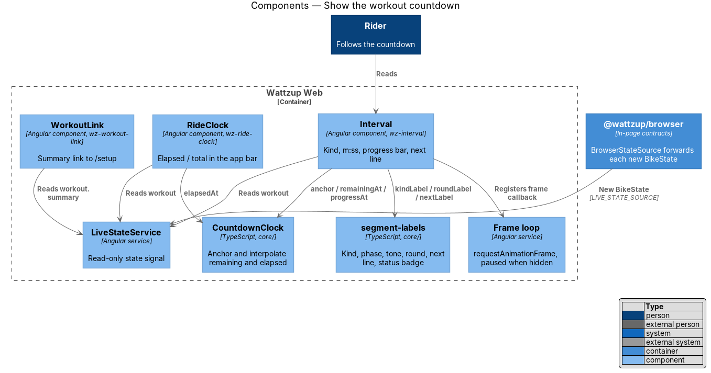
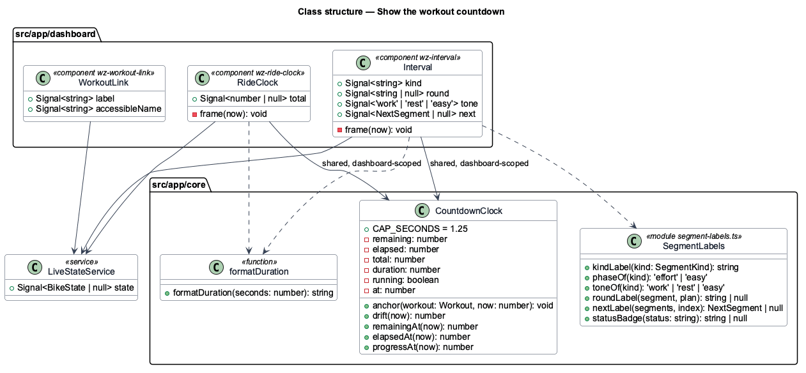
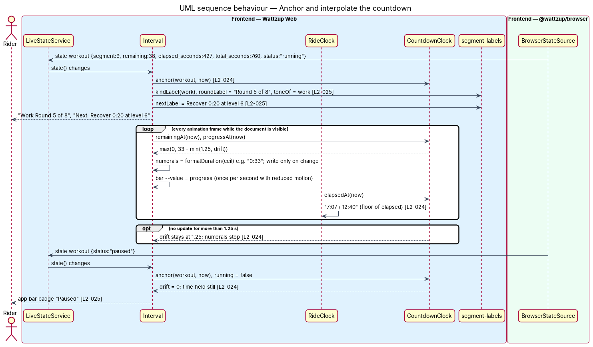

# Show the workout countdown

## Overview

During a ride the dashboard's interval card tells the rider what the current segment is and how long it has left. It shows the segment's kind and round, the time left as large numerals, a thin progress bar, and a line naming the next segment. The app bar shows the ride clock as elapsed time against the plan's total, the plan's summary, and a badge when the workout is not running. The workout engine publishes `remaining` and `elapsed_seconds` as whole numbers once per second. The dashboard interpolates between those updates, so the numerals and the bar move without waiting for the next message.

**segment kind** — `warmup`, `work`, `rest`, `cooldown` or `steady`, from the plan expansion (L2-045)

**phase** — classification of a segment by its kind: *effort* for `work` and `steady`, *easy* for `warmup`, `rest` and `cooldown` (L2-025, ADR 0002)

**tone** — colour role of a segment, which follows the mocks' modifiers: `work` for `work` and `steady`, `rest` for `rest`, `easy` for `warmup` and `cooldown`

**anchor** — the last published values of `remaining` and `elapsed_seconds`, with the local `performance.now()` time they arrived and whether the workout was `running`

**interpolation cap** — 1.25 s, the furthest the display may run ahead of the last anchor

This feature is display only. Segment-change banners and beeps belong to `play-workout-cues`, the power trace to the dashboard (L2-026, L2-028), and the no-workout and overlay states to the dashboard (L2-058). The workout itself runs in `run-interval-workout`.

## Description

Pure helpers in `frontend/projects/wattzup/src/app/core/`, each with unit tests and no Angular dependency:

- **`CountdownClock`** (`countdown-clock.ts`) — holds one anchor.
  - `anchor(workout, now)` stores `remaining`, `elapsed_seconds`, `total_seconds`, the current segment's `duration` and `running = status === 'running'`. It is called for every streamed state.
  - `drift(now)` is `min(1.25, (now − at) / 1000)` while running and 0 otherwise (L2-024).
  - `remainingAt(now)` is `max(0, remaining − drift(now))`.
  - `elapsedAt(now)` is `min(total, elapsed + drift(now))`.
  - `progressAt(now)` is `(duration − remainingAt(now)) ÷ duration`. With `remaining` 10 on a 40 s segment, 0.5 s after the anchor it is (40 − 9.5) ÷ 40.
- **`formatDuration(seconds)`** (`format-duration.ts`) — returns `m:ss` below one hour and `h:mm:ss` from one hour (`125` → `2:05`, `3800` → `1:03:20`). The countdown rounds the time left up and the ride clock rounds elapsed time down, so the two change on the same frame.
- **`segment-labels.ts`** — pure functions over a segment and the plan:
  - `kindLabel(kind)` returns `Warm-up`, `Work`, `Recover`, `Cool-down` or `Steady`.
  - `phaseOf(kind)` returns `effort` or `easy`; `toneOf(kind)` returns `work`, `rest` or `easy`.
  - `roundLabel(segment, plan)` returns `Round <r> of <rounds>` for `work` and `rest`, and `null` for the other kinds (L2-025).
  - `nextLabel(segments, index)` returns `{kind, duration, level}` for the next segment, rendered `Next: <Kind> <m:ss> at level <n>`, or `null` on the last segment, rendered `Last stretch`.
  - `statusBadge(status)` returns `Paused` for `paused` and `null` for `running`. The other statuses read `Waiting for bike`, `Bike disconnected`, `Ended` (`ended` and `stopped`) and `Bike shut off` (L2-025). The overlays of L2-058 show alongside them.

Components (presentation components in `frontend/projects/components/src/lib/`, the rest in `frontend/projects/wattzup/src/app/dashboard/` (ADR 0013; mapping in `platform/host-and-structure`)), each standalone, `OnPush`, with `name.ts`, `name.html` and `name.scss`:

- **`Interval`** (`interval/`, selector `wz-interval`, block `interval`) — the interval card. It keeps the mock's elements and classes:
  - `interval__kind` holds the `swatch swatch--<tone>` marker, the kind label and, in `<small>`, the round (L2-025).
  - `interval__left` holds the time-left numerals with `role="timer"`, `aria-live="off"` and `aria-label="<m:ss> left in this interval"`, so a screen reader can read it on demand but it is not announced every second (L2-024).
  - The `progress progress--thin progress--<tone>` bar has `role="progressbar"`, `aria-label="Interval progress"` and `aria-valuenow` in whole percent.
  - `interval__next` holds the next line or `Last stretch`.
  - Tone is carried by text as well as colour: the kind label always names the segment.
- **`RideClock`** (`ride-clock/`, selector `wz-ride-clock`, block `ride-clock`) — `<elapsed> / <total>` with `aria-label="Elapsed <elapsed> of <total>"`, for example `7:07 / 12:40` or `1:03:20 / 1:15:00` (L2-024). With no workout it shows `0:00` and no total, as in the `empty` mock.
- **`WorkoutLink`** (`workout-link/`, selector `wz-workout-link`) — the app bar link to `/setup`. Its label is `workout.summary` and its accessible name is `Edit workout: 
` (L2-025). With no workout its label is `Set up a ride` (L2-058).
- **Status badge** — the app bar renders `statusBadge(status)`, when not `null`, with the shared badge in its warning tone, before the ride clock (L2-025, L2-046).

Frame updates:

- `Interval` and `RideClock` re-anchor their shared `CountdownClock` from an `effect` on `LiveStateService.state()`. The clock lives in a dashboard-scoped provider, so both read the same anchor.
- A `requestAnimationFrame` callback, registered with the shared frame loop and run outside change detection, reads `remainingAt`, `elapsedAt` and `progressAt`. It writes the numerals, the labels and `aria-valuenow` only when the formatted text changes. It sets the bar's `--value` custom property through `HTMLElement.style.setProperty`, never through a template `style` attribute.
- The frame loop stops while the document is hidden (L2-038). With `prefers-reduced-motion: reduce`, the bar moves once per whole second instead of every frame.
- When `status` is not `running`, `drift` is 0, so the numerals and the ride clock hold still (L2-024).

Tone colours are read from the design tokens by role (`work`, `rest`, `easy`), never as hex values.

### Acceptance tests

Playwright (`frontend/e2e/`), with the fake `navigator.bluetooth` fixture driving the bike and the workout running in the page. Time is controlled with Playwright's clock (`page.clock`), never with waits.

- `e2e/pages/ride.page.ts` — the ride page object, which owns the interval card, ride clock, status badge and workout link locators.
- `e2e/interval-countdown.spec.ts`:
  - `shows the time left as m:ss` — `remaining` 125 shows `2:05` (L2-024 AC1)
  - `stops interpolating 1.25 s after the last update` (L2-024 AC3)
  - `holds the countdown still while paused` (L2-024 AC4)
  - `shows elapsed and total in the app bar, with hours when needed` (L2-024 AC5)
  - `exposes the countdown as a timer that is not live` (L2-024 AC6)
  - `names the work round with the effort tone` — `Work` `Round 5 of 8` (L2-025 AC1)
  - `names recover, warm-up, cool-down and steady segments` (L2-025 AC2)
  - `shows the next segment, and Last stretch on the final one` (L2-025 AC3)
  - `shows the Paused badge when paused` (L2-025 AC4)
  - `labels the workout link with the summary` (L2-025 AC5)

Unit tests in `frontend/projects/wattzup/src/app/core/`:

- `countdown-clock.spec.ts` — the L2-024 AC2 progress example, the 1.25 s cap, no drift when not running, never below 0, elapsed capped at the total.
- `format-duration.spec.ts` — `0:05`, `2:05`, `59:59`, `1:00:00`, `1:03:20`.
- `segment-labels.spec.ts` — one case per segment kind for label, phase, tone and round, plus the next-line and `Last stretch` cases.

## Requirements

| L2 ID | Refines (L1) | Requirement |
|-------|--------------|-------------|
| `L2-024` | `L1-007` | Interval countdown. The interval card must show the current segment's time left as `m:ss` (or `h:mm:ss`), counted down locally between the once-per-second state updates. |
| `L2-025` | `L1-007` | Phase display. Work and steady segments are effort; warm-up, recover and cool-down are easy. |

## Diagrams

### System context

The rider follows the workout that Wattzup runs.

### Containers

Wattzup Web renders the countdown from workout state that the Wattzup API streams once per tick.

### Components

`Interval`, `RideClock` and `WorkoutLink` read `LiveStateService.state`. `Interval` and `RideClock` share one `CountdownClock`, and the labels come from the pure `segment-labels` helpers.

### Class structure

The time and label logic (`CountdownClock`, `formatDuration`, `segment-labels`) is framework-free. The components hold no rule of their own.

### Behaviour — anchor and interpolate

Each state update re-anchors the clock and refreshes the labels. Every animation frame derives the numerals, the progress bar and the ride clock from the anchor, capped at 1.25 s and held still when not running (L2-024, L2-025).

