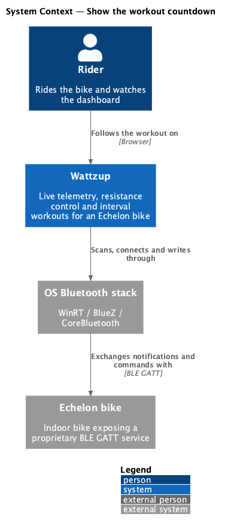
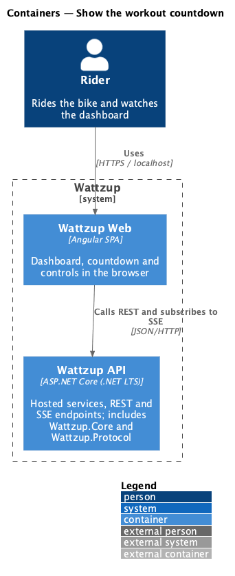
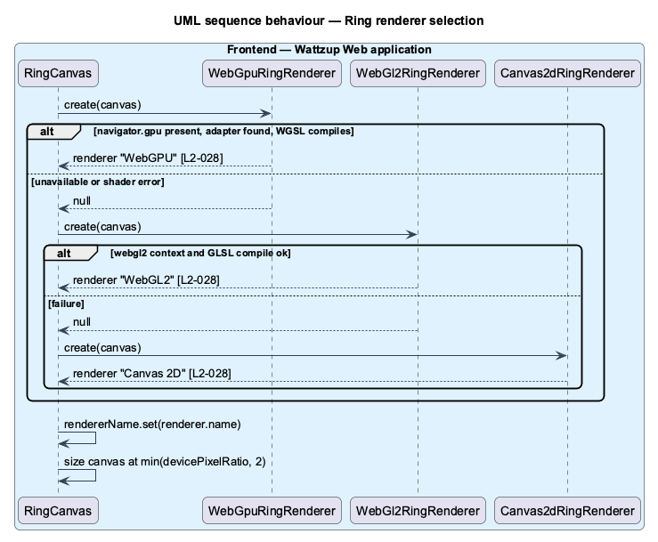

# Show the workout countdown

## Overview

The centre of the dashboard is a large countdown clock inside an animated progress ring. It shows how long remains in the current workout step and whether the step is an effort or a recovery. A timeline under the ring shows every step of the workout and how far through the cycle the rider is. The backend sends the remaining time as a whole number once per second. The browser interpolates between those updates, so the ring and digits move smoothly instead of jumping.

**phase** — classification of a step by level. A level of 20 or more is *effort* (orange `#ff5a36`); a level below 20 is *recovery* (blue `#3d9bff`)

**anchor** — the last server value of `remaining`, together with the local `performance.now()` time it arrived

**renderer** — drawing back end for the ring: WebGPU, WebGL2 or Canvas 2D, chosen in that order of preference

This feature is display only. Step-transition banners and beeps belong to `play-workout-cues`, and the workout itself runs in `run-interval-workout`.

## Description

- **`CountdownModel`** — plain TypeScript class, unit-tested without Angular. `anchor(remaining, running, stepSeconds)` stores the anchor whenever `remaining` or `running` changes. `shown(now)` returns `max(0, remaining − min(1.25, (now − at)/1000))` while running, and `remaining` otherwise. `fraction(now)` returns `shown / stepSeconds` (L2-024).
- **`formatClock(s)`** — returns `m:ss` from the ceiling of `s` (`125` → `2:05`).
- **`HeroClock`** — standalone component. It renders the phase label, the `m:ss` digits, the "Next" line and the non-running status chip. Before any state arrives it shows `Waiting` and `--:--`. With no workout it shows `No workout`. It updates the digits from a `requestAnimationFrame` loop run outside the Angular zone, writing to the DOM only when the whole second changes.
- **`PhaseInfo`** — pure helper. `phaseOf(level)` returns `effort` or `recovery`. `nextLabel([level, seconds])` returns `Next 30 s at 24`, or `Next 2 min at 12` when seconds ≥ 60. `phaseLabel(level)` returns `Effort · Resistance 24` or `Recovery · Resistance 12` (L2-025).
- **`ThemeService`** — sets the CSS custom property `--phase` on `:root` to the phase colour, so cards and buttons follow the phase.
- **`StepTimeline`** — renders one segment per step, with `flex` equal to the step's share of the cycle duration and a colour taken from its phase. The current segment fills to `1 − fraction` and is highlighted; earlier segments are full and later ones empty. Each segment's accessible name is `<seconds>s at <level>`. The segments are rebuilt when the step count changes, and the cycle label reads `Cycle <n>` (L2-025, L2-026).
- **`RingCanvas`** — owns the `<canvas>` (marked `aria-hidden`) and a `RingRenderer`. On init it tries `WebGpuRingRenderer`. If WebGPU is missing or shader compilation reports an error, it falls back to `WebGl2RingRenderer`, then `Canvas2dRingRenderer`. The chosen `name` is shown in the renderer label (L2-028).
- **`RingRenderer`** — interface `{ name; draw(time, vis): void }`. The WGSL and GLSL fragment shaders from the prototype are kept as assets.
- **`RingVisuals`** — per-frame eased values. `frac` is the remaining fraction. `color` eases toward the phase colour by 6 % per frame, or instantly with reduced motion. `pulse` ramps over the final 10 s. `energy` follows `min(1, cadence / 100)`. `flash` decays by a factor of 0.94 per frame. The device pixel ratio is capped at 2 (L2-028).

The animation loop stops while the document is hidden and resumes on `visibilitychange` (see `observability-and-resources`).

## Requirements

| L2 ID | Refines (L1) | Requirement |
|-------|--------------|-------------|
| `L2-024` | `L1-007` | Countdown clock. The hero must show the remaining step time as `m:ss`, smoothly interpolated between the once-per-second server updates. |
| `L2-025` | `L1-007` | Phase display. A step with level ≥ 20 is an **effort** step (orange `#ff5a36`); a level below 20 is a **recovery** step (blue `#3d9bff`). |
| `L2-026` | `L1-007` | Step timeline. |
| `L2-028` | `L1-007` | Animated progress ring with renderer fallback. The hero ring must render with WebGPU, falling back to WebGL2, then Canvas 2D, and show the active renderer name. |

## Diagrams

### System context

The rider follows the workout schedule that Wattzup runs.

### Containers

Wattzup Web renders the countdown from workout state that the Wattzup API streams once per tick.

### Components

`HeroClock`, `StepTimeline` and `RingCanvas` all read `LiveStateService.state` and share one `CountdownModel` through the dashboard.

### Class structure

The time logic (`CountdownModel`, `PhaseInfo`) is framework-free. The 3 renderers realise one `RingRenderer` interface.

### Behaviour — anchor and interpolate

Each server update re-anchors the model. Every animation frame derives the digits, ring fraction and timeline fill from the anchor (L2-024, L2-026).

### Behaviour — renderer selection

The ring tries WebGPU, then WebGL2, then Canvas 2D, and labels the one in use (L2-028).

