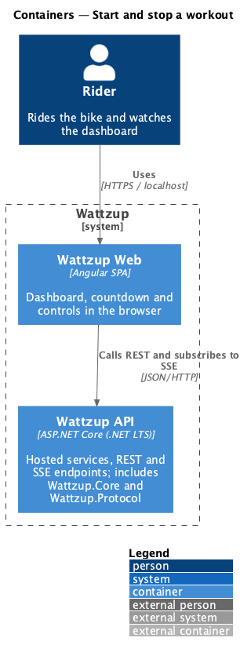
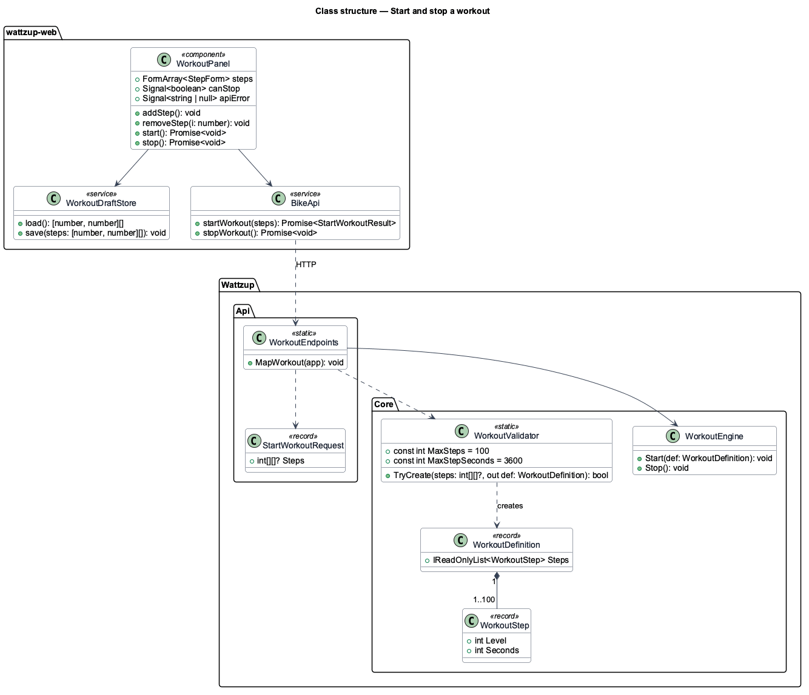

# Start and stop a workout

## Overview

An interval workout alternates between harder and easier resistance levels on a fixed schedule, for example 2 minutes at level 12, then 30 seconds at level 24, repeated. In the prototype, a workout could only be started with a hand-written HTTP request. This feature adds a workout panel to the dashboard where the rider lists the steps, starts the workout and stops it. The backend validates every definition before it accepts it.

**step** — pair `[level, seconds]`: resistance level 1–32 held for a positive number of seconds

**workout definition** — non-empty ordered list of steps, at most 100 steps, each step at most 3600 s

**workout draft** — the steps as last submitted from this browser, kept in local storage so the panel is pre-filled after a reload

Starting a workout replaces any workout already running. Execution belongs to `run-interval-workout`, and the countdown display belongs to `show-workout-countdown`.

## Description

Frontend (`wattzup-web`):

- **`WorkoutPanel`** — standalone component with a typed reactive `FormArray` of step rows. Each row has a `level` control (integer, 1–32) and a `seconds` control (integer, 1–3600). Add and remove buttons edit the list (maximum 100 rows). Invalid fields show an inline error naming the allowed range, and Start stays disabled while the form is invalid (L2-029).
- **`WorkoutPanel.start()`** — posts the steps through `BikeApi.startWorkout` and saves them through `WorkoutDraftStore`. A 400 response shows its `error` text beside the panel.
- **`WorkoutPanel.stop()`** — enabled while `state().workout?.status` is `running`, `waiting for bike` or `paused: bike disconnected`. It calls `BikeApi.stopWorkout`.
- **`WorkoutDraftStore`** — reads and writes the key `wattzup.workoutDraft` in `localStorage` inside `try/catch`. Unreadable or invalid data yields the default `[[12,120],[24,30]]`.
- **`BikeApi.startWorkout(steps)` / `stopWorkout()`** — `POST /api/workout` and `POST /api/workout/stop`.

Backend:

- **`WorkoutEndpoints`** — maps both routes (L2-017). Start binds `StartWorkoutRequest { int[][]? Steps }` and validates it with `WorkoutValidator`. On failure it returns `400 {"error":"steps must be [[level 1-32, seconds>0], ...]"}`. On success it calls `WorkoutEngine.Start(definition)` and returns `200 {"started": steps}`. Stop calls `WorkoutEngine.Stop()` and always returns `200 {"stopped":true}`.
- **`WorkoutValidator`** — pure. It rejects a null or empty list, more than 100 steps, any step that is not exactly 2 integers, level outside 1–32, and seconds outside 1–3600 (L2-010). Non-integer JSON numbers fail model binding and produce the same 400.
- **`WorkoutDefinition`** / **`WorkoutStep(int Level, int Seconds)`** — immutable records produced only by the validator.
- **`WorkoutEngine.Start` / `Stop`** — see `run-interval-workout`. `Start` cancels any running workout before it starts the new one at step 0, cycle 1. `Stop` sets `status = stopped` and broadcasts. When no workout exists, `workout` stays `null`.

## Requirements

| L2 ID | Refines (L1) | Requirement |
|-------|--------------|-------------|
| `L2-010` | `L1-004` | Workout definition and validation. A workout is a non-empty ordered list of steps. Each step is `[level, seconds]` with level 1–32 and seconds > 0. |
| `L2-017` | `L1-005` | Workout endpoints. `POST /api/workout` with body `{"steps":[[level,seconds],...]}` and `POST /api/workout/stop`. |
| `L2-029` | `L1-007` | Starting and stopping workouts from the UI. The UI must let the rider build a list of steps and start or stop the workout. |

## Diagrams

### System context

The rider defines and controls workouts through Wattzup.

### Containers

Wattzup Web submits the definition to the Wattzup API, which validates it and starts the engine.

### Components

`WorkoutPanel` builds the request and keeps a draft. `WorkoutEndpoints` validates through `WorkoutValidator` and controls `WorkoutEngine`.

### Class structure

Only `WorkoutValidator` creates `WorkoutDefinition`, so the engine never sees an invalid workout.

### Behaviour — start a workout

The panel blocks invalid input locally. The endpoint validates again (L2-010) and replaces any running workout (L2-017).

### Behaviour — stop a workout

Stop always succeeds. It ends ticking and marks the workout `stopped`.

