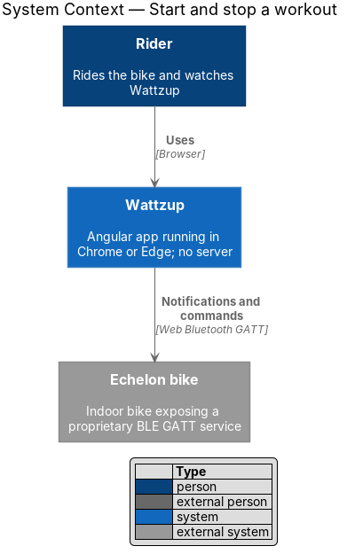
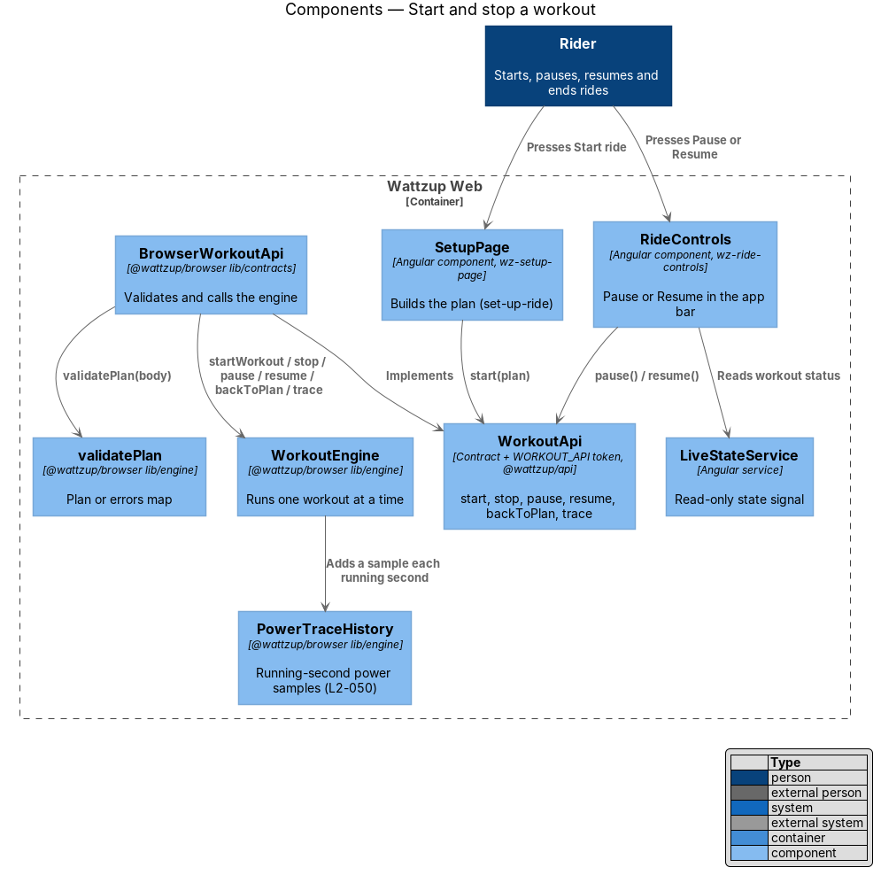
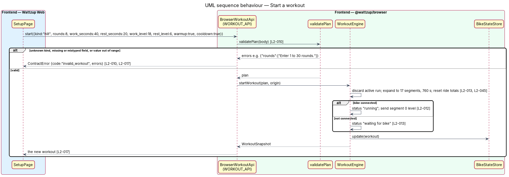
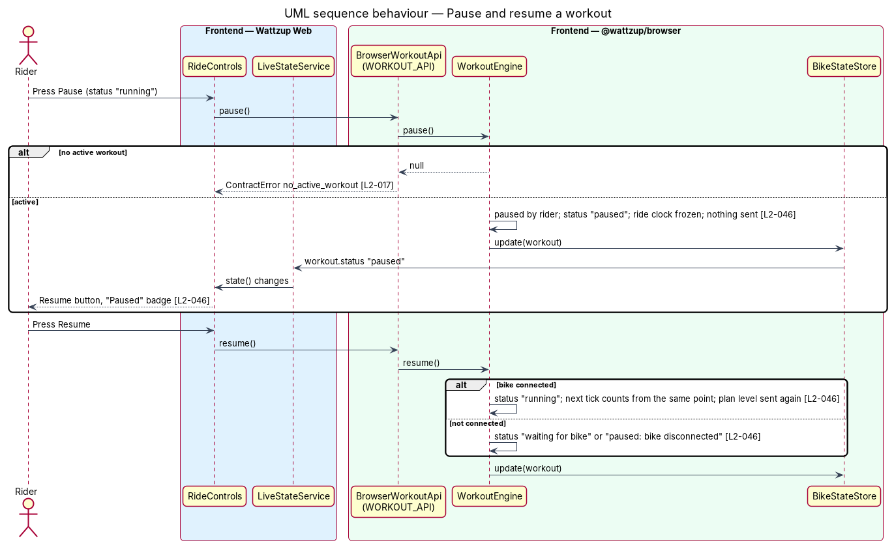
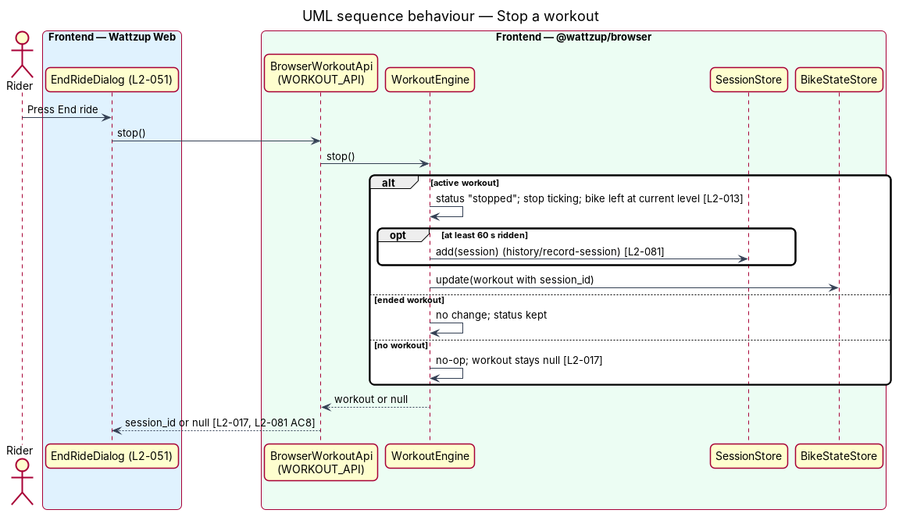

# Start and stop a workout

## Overview

A workout is a finite plan that Wattzup runs once, from 0:00 to its total time, setting the bike's resistance for each segment. This feature is the control surface for that plan: the `WORKOUT_API` contract that accepts a plan, starts it, pauses and resumes it, hands control back to the plan after a manual override, stops it, and returns the ride's power history. It also covers the dashboard's Pause and Resume button. Every plan is validated before it is accepted, and each rejected field carries the same message the setup screen shows.

**plan** — object of kind `hiit`, `intervals` or `flat`, with snake_case fields (L2-010; the `intervals` fields are in its table):

| Kind | Field | Allowed values |
|---|---|---|
| `hiit` | `rounds` | integer 1–30 |
| | `work_seconds`, `rest_seconds` | integer 5–3600 |
| | `work_level`, `rest_level` | integer 1–32 |
| | `warmup`, `cooldown` | boolean |
| `flat` | `level` | integer 1–32 |
| | `minutes` | integer 1–180 |
| | `cadence` | integer 40–150 |

**errors map** — object from field name to an array of messages, carried by a `ContractError` with `code` `invalid_workout`

**active workout** — workout whose status is `waiting for bike`, `running`, `paused` or `paused: bike disconnected`

**paused by the rider** — status `paused`, set by `WORKOUT_API.pause()`; distinct from `paused: bike disconnected`, which the engine sets on its own

Execution belongs to `run-interval-workout`. The setup screen that builds the plan and its replace-ride dialog belong to `set-up-ride`. The End button and its confirmation dialog belong to the dashboard (L2-051); this feature supplies the `stop()` call they make.

## Description

Contract (`@wattzup/api`) and its implementation (`@wattzup/browser`):

- **`WorkoutApi`** (`projects/api/src/lib/workout-api.ts`, token `WORKOUT_API`) — `start(plan)` (the plan may carry `class_id`), `stop()` (resolves to the `session_id` or `null`), `pause()`, `resume()`, `backToPlan()` and `trace()` (L2-017). The types (`StartPlan`, `WorkoutSnapshot`, `PowerTrace`) come from `projects/api/src/contract/schema.d.ts`. `app.config.ts` binds the token to `BrowserWorkoutApi`, and components inject the token.
- **`BrowserWorkoutApi`** (`lib/contracts/`) — validates, calls one engine method, and holds no rule.
  - `start(plan)` passes the plan through JSON, as stored drafts and imports reach it, and gives it to `validatePlan`. On failure it rejects with a `ContractError` `invalid_workout` and the errors map. An optional `class_id` beside the plan shall name a class in the catalogue (`BrowserClassApi.find`), or the rejection is `invalid_workout` with the field `class_id`; a known class's id and title go to the engine as a `RideOrigin`, and the session keeps them (L2-081 criterion 7). On success it awaits `WorkoutEngine.startWorkout(plan, origin)` and resolves with the new workout, whether or not the bike is connected (L2-017 criterion 1).
  - `stop()` awaits `WorkoutEngine.stop()` and always resolves with the saved session's id, or `null` when none was saved: no workout or a ride under a minute (L2-081 criterion 8, `history/record-session`). With no workout, `workout` stays `null`. A workout that has already ended keeps its status.
  - `pause()`, `resume()` and `backToPlan()` await the matching engine method. With no active workout they reject with a `ContractError` `no_active_workout` (L2-017 criterion 5).
  - `trace()` resolves `{samples:[[ride_seconds, power], ...]}` from the power trace history (L2-050). With no workout, `samples` is `[]`.
- **`validatePlan(body)`** (`lib/engine/workout-plan-validator.ts`) — pure function returning `{plan, errors}`. It is the only creator of a validated plan (L2-010). It checks the fields in this order:
  1. `kind` is `hiit`, `intervals` or `flat`; otherwise `kind` is named with `Choose HIIT, Intervals or Flat.` and no further field is checked.
  2. Each field of that kind is present and of the right type: an integer number (no fraction) or a boolean. A missing or mistyped field is named; its message is `Enter a whole number.` for a number and `Choose on or off.` for a switch (L2-010).
  3. Each integer is in range, with the messages of L2-010 shown in the table below; an `intervals` plan's fields are named by their path and checked as L2-010 criteria 12 and 13.

The validator reports every failing field, not only the first.

| Field | Rule | Message |
|---|---|---|
| `rounds` | 1–30 | `Enter 1 to 30 rounds.` |
| `work_seconds` | at least 5 | `Work must be at least 0:05.` |
| `rest_seconds` | at least 5 | `Recover must be at least 0:05.` |
| `work_seconds`, `rest_seconds` | at most 3600 | `Work must be at most 60:00.` / `Recover must be at most 60:00.` |
| `work_level`, `rest_level`, `level` | 1–32 | `Level must be 1 to 32.` |
| `minutes` | 1–180 | `Enter 1 to 180 minutes.` |
| `cadence` | 40–150 | `Cadence goal must be 40 to 150 rpm.` |

- **`WorkoutEngine`** — `startWorkout`, `stop`, `pause`, `resume` and `backToPlan` queue a command on the engine loop and await its reply (see `run-interval-workout`). The commands behave as follows:
  - **Start** replaces any active workout and begins the new one at segment 0, `elapsed_seconds` 0, with fresh ride totals (L2-013).
  - **Stop** sets `status` to `stopped`, stops ticking, leaves the bike at its current level, saves the ride as a session when it ran at least a minute (`history/record-session`), and publishes the state with `workout.session_id` (L2-013, L2-081).
  - **Pause** sets the rider-pause flag. With the bike connected, `status` becomes `paused` at once, the ride clock stops, and nothing is sent (L2-046). Pausing an already paused workout changes nothing.
  - **Resume** clears the flag and the segment's sent marker, so the plan level is sent again. The status becomes `running` if the bike is connected, otherwise `waiting for bike` (ride not started) or `paused: bike disconnected` (L2-046).
  - **Back-to-plan** sets `mode` to `plan` and sends `plan_level` at once (L2-047).
  - Each answers `null` when no workout was active, which `BrowserWorkoutApi` turns into `no_active_workout`.
- While a workout is `paused` and the bike stays connected, the engine keeps no disconnect time, so the 90-second shut-off clock does not run (L2-046).

App:

- **`RideControls`** (`frontend/projects/wattzup/src/app/dashboard/ride-controls/`, selector `wz-ride-controls`, block `ride-controls`) — the app bar's Pause or Resume button. It keeps the mock's `btn` and `btn__label` classes and follows the ride page's `default`, `paused` and `ended` mocks (`docs/mocks/pages/ride/`). It reads `LiveStateService.state()` and shows the states in the table below (L2-046). Pressing the button calls `WORKOUT_API.pause()` or `resume()`. The button does not change its own label: the label follows the next state. A failed call shows a danger toast (L2-053): `Couldn't pause the ride` or `Couldn't resume the ride` / `Something went wrong. Try again.` (L2-046).

| Workout | Button | Enabled |
|---|---|---|
| `running`, `waiting for bike`, `paused: bike disconnected` | Pause | yes |
| `paused` | Resume, beside the `Paused` badge (`show-workout-countdown`) | yes |
| `ended`, `ended: bike shut off`, `stopped`, none, or no state yet | Pause | no |

### Ride-along video in the plan

Every plan kind accepts an optional `video` `{url, start_seconds}` (L2-010 criteria 14 to 17, ADR 0012). `validatePlan` reads the link through `parseYouTubeId` (`lib/engine/youtube-link.ts`), keeps only the 11-character id and the start point rounded to 0.1, and drops the link. The validated plan carries `video` `{video_id, start_seconds}`, or `null` without a video. A rejected link is named `video.url` with `That doesn't look like a YouTube link.`; a start point outside 0 to 43200 is named `video.start_seconds` with `Start point must be 0:00 to 12:00:00.` A video changes neither the segments nor the summary nor the ride. Wattzup never fetches the link. The parser and its table tests are described in `workouts/ride-along-video`.

### Tests

Unit tests (`@wattzup/browser`, with `FakeClock` and a fake `BikeLink`):

- `workout-plan-validator.spec.ts` — one case per row of the validation table, each L2-010 criterion 7 case (unknown kind, missing field, fractional number, non-boolean switch), the `intervals` path rules, and a body with several failing fields.
- `workout-engine.spec.ts` — a plan starts while the bike is not connected; stop marks the workout `stopped`; stop with no workout answers `null`; pause, resume and back-to-plan without a workout answer `null`; pause freezes the ride clock and resume continues from the same point; resume while disconnected gives `paused: bike disconnected`; a paused ride with the bike connected is not shut off after 90 seconds; trace with no workout is empty.

Playwright (`frontend/e2e/`), with the fake `navigator.bluetooth`:

- `e2e/pages/ride.page.ts` — the ride page object, which owns the Pause, Resume and End locators.
- `e2e/ride-controls.spec.ts`:
  - `shows Pause while running and Resume with the Paused badge when paused` (L2-046 criterion 4)
  - `pressing Pause pauses the ride` (L2-046 criterion 1)
  - `disables Pause and Resume once the ride has ended or stopped` (L2-046 criterion 5)

## Requirements

| L2 ID | Refines (L1) | Requirement |
|-------|--------------|-------------|
| `L2-010` | `L1-004` | Workout plan definition and validation. A workout is defined by a plan of kind `hiit`, `intervals` or `flat` with snake_case fields; any rejection is a `ContractError` with `code` = `invalid_workout` and an `errors` map from field name to messages. |
| `L2-081` | `L1-015` | Session record. Criteria 7 and 8: `WORKOUT_API.start` takes an optional `class_id`, and `WORKOUT_API.stop()` answers the saved session's id or `null`. |
| `L2-017` | `L1-005` | Workout contract. `WORKOUT_API` offers `start(plan)`, `stop()`, `pause()`, `resume()`, `backToPlan()` and `trace()`; `pause`, `resume` and `backToPlan` with no active workout are refused with `no_active_workout`. |
| `L2-046` | `L1-004` | Pause and resume. A `running` workout pauses on `WORKOUT_API.pause()` and continues from the same point on `resume()`; the dashboard shows Pause or Resume accordingly. |

## Diagrams

### System context

The rider starts, pauses, resumes and stops workouts through Wattzup, which drives the bike.

### Containers

Everything runs in the Wattzup app in the rider's browser: the screens call the workout contract, whose implementation validates plans and controls the engine.

### Components

`RideControls` and the setup screen call `WORKOUT_API`. `BrowserWorkoutApi` validates through `validatePlan` and controls `WorkoutEngine`.

### Class structure

Only `validatePlan` creates a validated plan, so the engine never sees an invalid one. The app depends on the `WorkoutApi` contract, not on its implementation.

### Behaviour — start a workout

`BrowserWorkoutApi` validates the plan (L2-010). A rejection names every failing field with `code` = `invalid_workout`. An accepted plan replaces any active workout and answers with the new workout (L2-017).

### Behaviour — pause and resume

Pause and resume are refused with `no_active_workout` when no workout is active. Otherwise the engine freezes or continues the ride clock, and the button's label follows the published status (L2-046).

### Behaviour — stop a workout

Stop always succeeds. It ends ticking, marks an active workout `stopped`, and leaves the bike at its current level (L2-013, L2-017).

