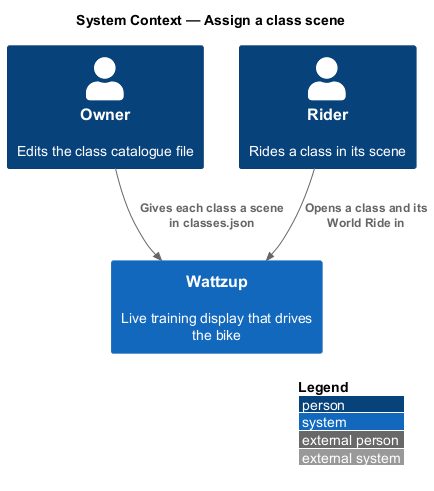
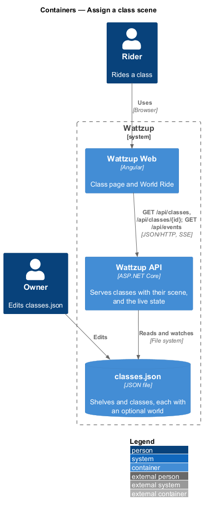
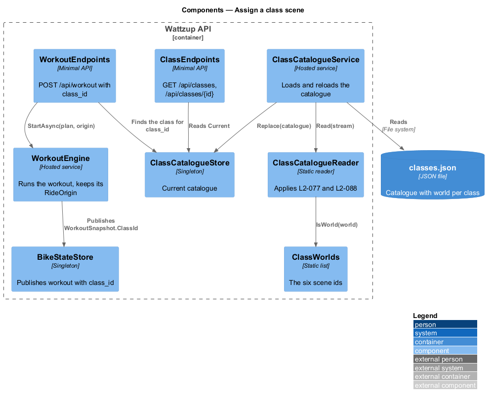
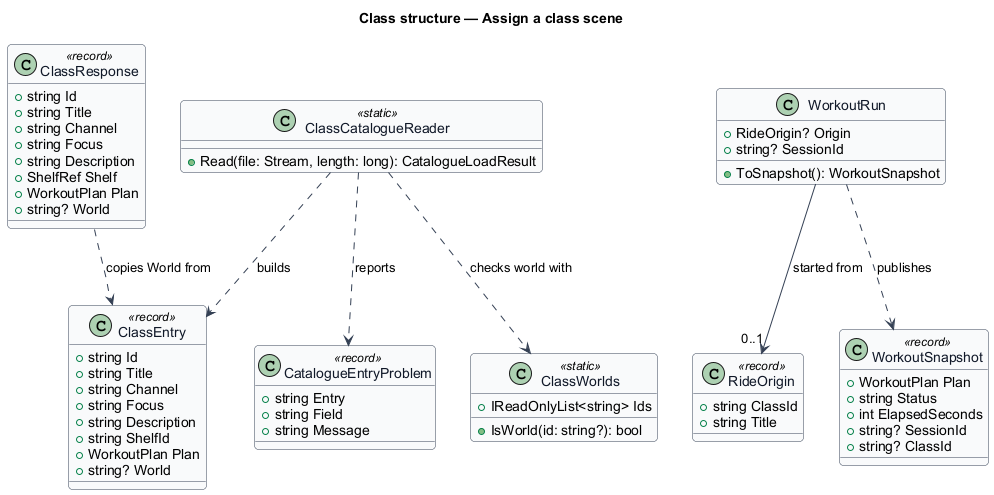
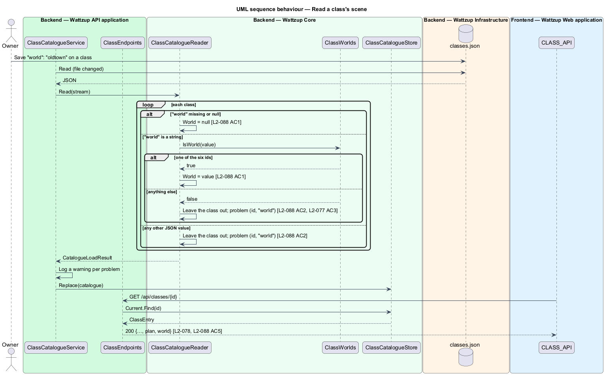
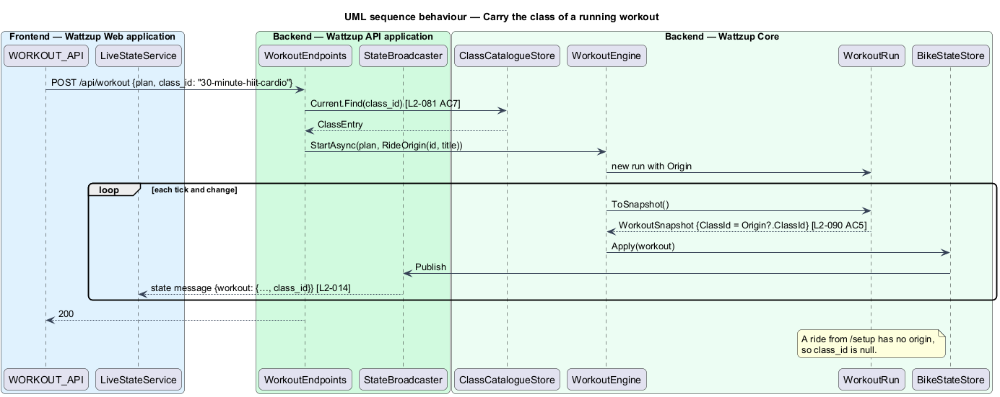

# Assign a class scene

## Overview

World Ride (L1-017) is a way to ride a class inside a 3D world built for that class. This feature is the backend half of that link. Each class in the catalogue names its scene, and the API carries the scene, and the class a running workout came from, to the frontend (L2-100, L2-102 criterion 5).

**scene** — one of the worlds built into the frontend (L2-101), named by its id: `docklands`, `granite`, `oldtown`, `prairie`, `dolomites`, `coast`, `caribana`, `westminster`, `centralpark`, `southbeach`, `ghent`, `blackpool`, `suburbia`, `nottinghill`, `knicks`, `vegas`, `route66` or `amsterdam`

**class scene** — the scene a class names in the catalogue file through its optional `world` field, or `null` when it names none

**ride origin** — the class a workout was started from, kept by the workout engine as `RideOrigin` (`history/record-session`)

The scene is catalogue data, not code (ADR 0014). The owner gives a class a scene by editing `classes.json`, and the catalogue reloads within 2 s (L2-077 criterion 7). The backend knows the six ids, so it can reject a misspelt one. It knows nothing else about a scene: the look, the road gradients and the effort names live in the frontend (`world-ride/draw-class-scene`).

The shipped `classes.json` gives each of the six classes of the mocks a different scene, so every mock class rides in a world of its own. Every other class, including the GCN Training classes, has `world` `null` and has no World Ride (L2-100 criterion 4).

The feature changes two contracts:
- the class served by `GET /api/classes` and `GET /api/classes/{id}` gains `world` (L2-078, L2-100 criterion 5);
- `workout` in the live state gains `class_id` (L2-014, L2-102 criterion 5), so World Ride can tell which class is running.

Both fields are always written, never omitted. Both changes regenerate the OpenAPI document and the frontend types (`projects/api/src/generated/`) in the same change.

## Description

### Backend (`backend/src/`)

**`Wattzup.Core/Classes/`**
- **`ClassWorlds`** (new, static): the six scene ids in the order of L2-101, `IReadOnlyList<string> Ids`, and `bool IsWorld(string? id)`. It holds no other fact about a scene.
- **`ClassEntry`** (changed): gains `string? World` after `Plan`.
- **`ClassCatalogueReader`** (changed): reads `world` after `plan` in `ReadClass`. A missing `world` or a JSON `null` gives `World` `null`. A string that `ClassWorlds.IsWorld` accepts is kept. Any other value (an unknown id, a number, an object, the wrong case) returns `CatalogueEntryProblem(name, "world", "A world is one of the built-in scene ids.")`. The class is then left out, and the others are kept with a warning, as L2-077 criterion 3 states (L2-100 criteria 1 and 2). Two classes may name the same scene: the reader does not check `world` for repeats (criterion 3).

**`Wattzup.Core/Workouts/`**
- **`WorkoutSnapshot`** (changed): gains `string? ClassId`. `WorkoutRun.ToSnapshot` sets it from `Origin?.ClassId`. It is `null` for a ride from `/setup` (L2-102 criterion 5). It keeps its value after the ride ends or stops, as `SessionId` does.

**`Wattzup.Core/State/WattzupJson`**: no change. The snake_case policy writes `ClassId` as `class_id`, and nulls are written (L2-014).

**`Wattzup.Api/Endpoints/ClassEndpoints`** (changed):
- `ClassResponse` gains `string? World`. `ToResponse(entry, shelf)` copies `entry.World`.
- The OpenAPI document describes `world` as a nullable string enum of `ClassWorlds.Ids` through a schema transformer in `Wattzup.Api/OpenApi/` (L2-100 criterion 5).

**`Wattzup.Api/classes.json`** (changed): the six classes gain `world` as L2-100 criterion 4 lists. No other class changes.

| Class id | `world` |
|---|---|
| `20-minute-power-intervals` | `docklands` |
| `20-min-threshold-builder` | `granite` |
| `30-minute-hiit-cardio` | `oldtown` |
| `30-min-tempo-paceline` | `prairie` |
| `60-min-dolomites-endurance` | `dolomites` |
| `60-min-coastal-endurance-surges` | `coast` |
| `intense-interval-blast` | `caribana` |
| `time-is-of-the-essence` | `westminster` |
| `15-minute-cardio-hiit` | `centralpark` |
| `calorie-burning-workout` | `southbeach` |
| `level-up-your-cadence` | `ghent` |
| `in-and-out-shake-it-all-about` | `blackpool` |
| `15-minute-cardio-workout-at-home` | `suburbia` |
| `quick-hiit-workout` | `nottinghill` |
| `sprintavals` | `knicks` |
| `quick-hiit-sprint-workout` | `vegas` |
| `high-power-tempo-with-short-sprints` | `route66` |
| `beginner-training-session` | `amsterdam` |

`POST /api/workout` does not change. It already takes `class_id` beside the plan and passes a `RideOrigin` to `WorkoutEngine.StartAsync` (L2-081 criterion 7).

### Frontend (`frontend/projects/api/`)

- **`src/generated/`**: regenerated from `/openapi/v1.json`. `ClassResponse.world` is `'docklands' | 'granite' | 'oldtown' | 'prairie' | 'dolomites' | 'coast' | null`. `WorkoutSnapshot.class_id` is `string | null`.
- **`src/lib/api-types.ts`**: re-exports the generated scene id type as `WorldId`. No type is written by hand.
- **`e2e/fixtures/recorded/`**: the class recordings are made again against the backend running with `--simulate`, so the stubbed answers carry `world` and `workout.class_id`.

### Acceptance tests

`Wattzup.Api.AcceptanceTests`, against `WattzupApiFactory` with a catalogue written to a per-test temporary directory:
- `ClassCatalogueTests`:
  - `A class with a world is served with it` (L2-100 AC1)
  - `A class without a world is served with world null` (L2-100 AC1)
  - `A class with an unknown world is left out with a warning naming world` (L2-100 AC2)
  - `Two classes may name the same world` (L2-100 AC3)
  - `The shipped catalogue gives the six mock classes six different worlds` (L2-100 AC4)
- `OpenApiTests`: `The class schema has world as a nullable enum of the six scenes` (L2-100 AC5).
- `WorkoutEndpointTests`:
  - `A workout started with class_id carries it in the live state` (L2-102 AC5)
  - `A workout started without class_id carries class_id null` (L2-102 AC5)

`Wattzup.Core.Tests/ClassCatalogueReaderTests` gets one case per value of `world`: missing, `null`, each of the six ids, an unknown id, `"OldTown"`, a number and an object.

### Open questions

- **Scene ids in the backend.** The backend lists the six ids so that it can reject a misspelt one (L2-100 criterion 2). Adding a seventh scene therefore changes `ClassWorlds` as well as the frontend.

## Requirements

| L2 ID | Refines (L1) | Requirement |
|-------|--------------|-------------|
| `L2-100` | `L1-017` | Class scene in the catalogue. Each class may name the scene it is ridden in through the optional `world` field of `classes.json`: `null`, or one of `docklands`, `granite`, `oldtown`, `prairie`, `dolomites`, `coast`. An unknown value leaves the class out with a warning. The shipped catalogue gives the six mock classes six different scenes. |
| `L2-102` | `L1-017` | Opening World Ride. Criterion 5: the live state's `workout.class_id` carries the `class_id` the workout was started with, or `null` (L2-014). |
| `L2-077` | `L1-014` | Class catalogue. A class that breaks a field rule is left out, the others are kept, and a warning names the class and the field. |
| `L2-078` | `L1-005` | Class endpoints. A class is served as `{id, title, channel, focus, description, shelf, plan}`, now with `world`. |
| `L2-014` | `L1-005` | State model contract. Field names are snake_case and nulls are written, never omitted. |

## Diagrams

### System context

The owner edits the catalogue file, and the rider's browser reads it through Wattzup. No other system takes part.

### Containers

The Wattzup API reads `classes.json` from disk and serves each class with its scene. Wattzup Web reads the classes, and the live state's `workout.class_id`, over HTTP and the event stream.

### Components

`ClassCatalogueReader` checks `world` against `ClassWorlds` and builds each `ClassEntry`. `ClassEndpoints` serves `world`. The `WorkoutEngine` copies the ride origin's class id into the `WorkoutSnapshot` that the state store publishes.

### Class structure

`ClassEntry` and `ClassResponse` each gain `World`, and `WorkoutSnapshot` gains `ClassId`, taken from the run's `RideOrigin`.

### Behaviour — read a class's scene

The reader keeps a known scene id, keeps `null` for a missing field, and leaves out a class with any other value (L2-100 criteria 1 and 2).

### Behaviour — carry the class of a running workout

A workout started with `class_id` keeps its origin, and every state message carries `workout.class_id` (L2-102 criterion 5).

