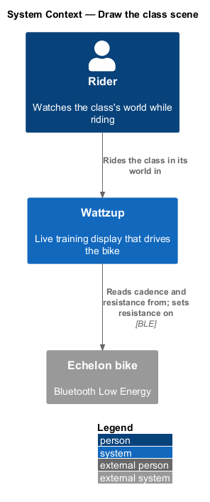
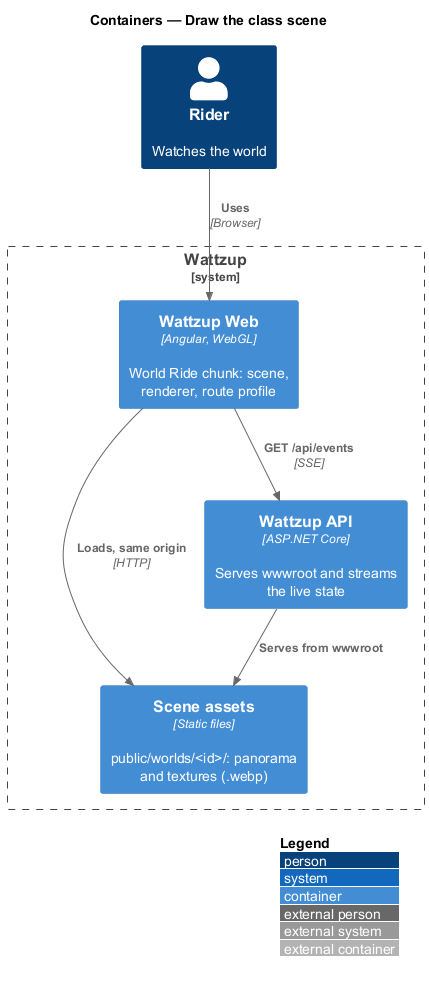
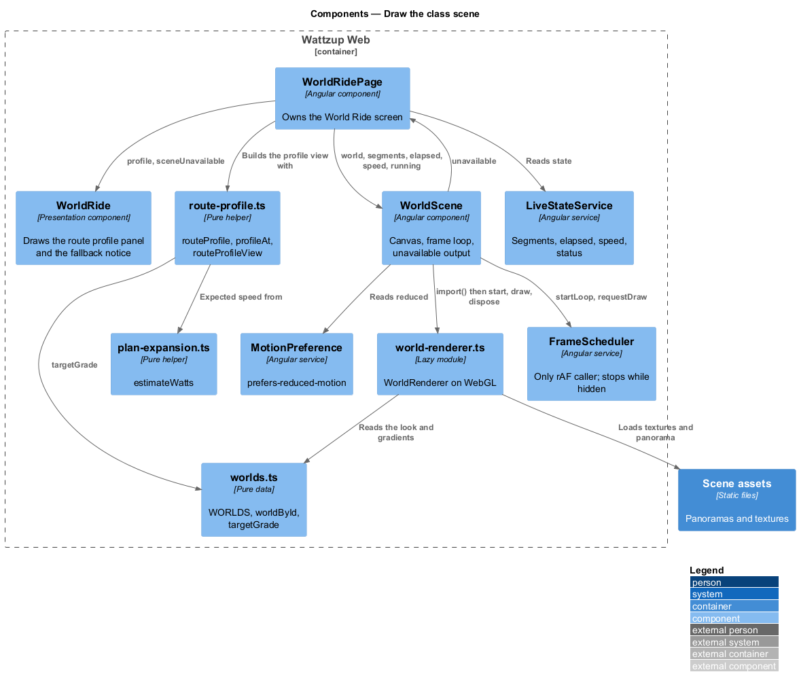
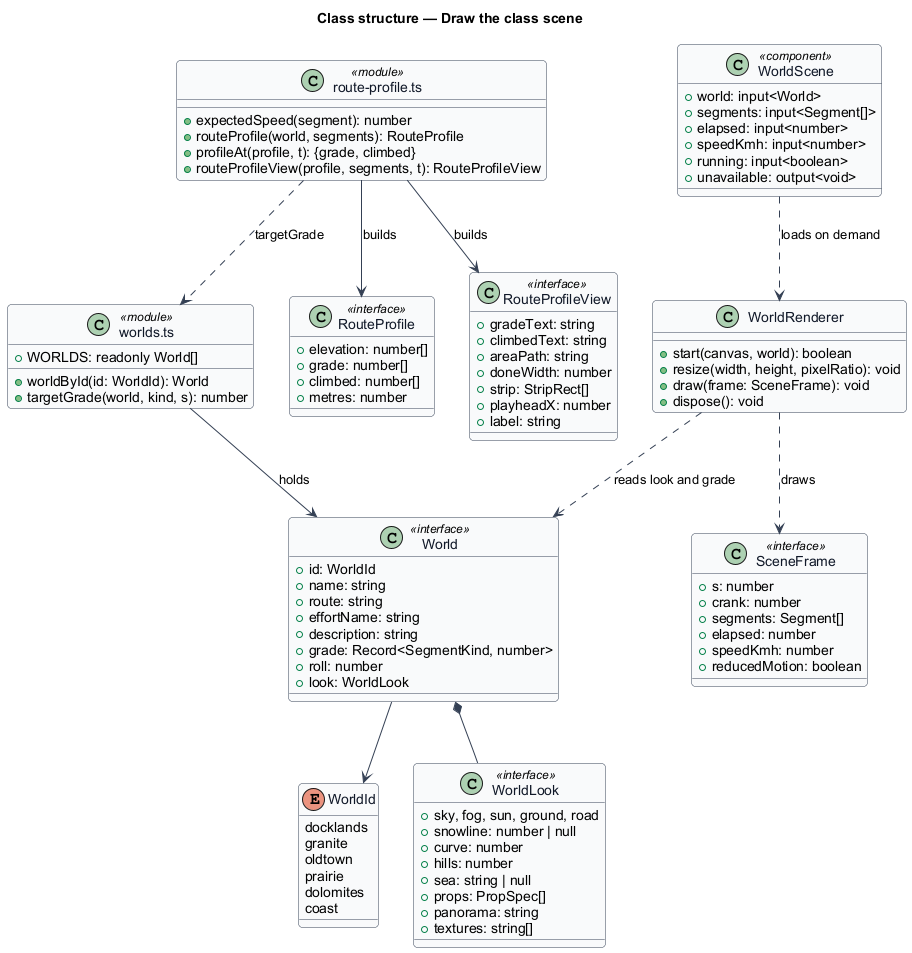
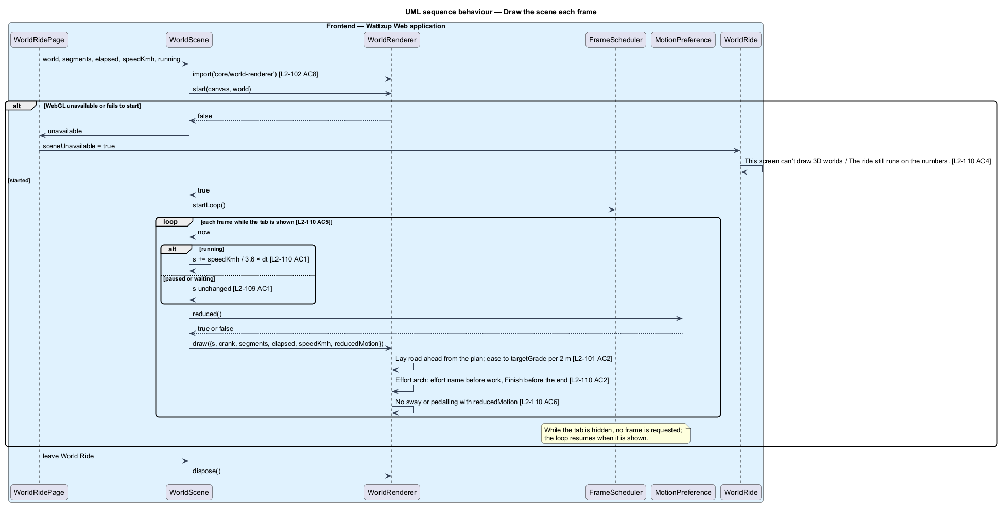
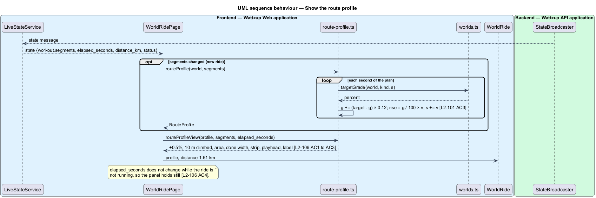

# Draw the class scene

## Overview

World Ride (L1-017) puts a class ride inside a 3D world built for that class. This feature draws the world: the six built-in scenes, the road whose gradient follows the plan, the route profile panel, and the fallback when the browser cannot draw 3D (L2-101, L2-106, L2-110). The screen and the HUD that sit on top belong to `world-ride/ride-in-a-world`.

**scene** — one of the built-in worlds (`docklands`, `granite`, `oldtown`, `prairie`, `dolomites`, `coast`, `caribana`, `westminster`, `centralpark`, `southbeach`, `ghent`, `blackpool`, `suburbia`, `nottinghill`, `knicks`, `vegas`, `route66`, `venice`, `amsterdam`, `giza`): a place with its own sky, light, ground, road surface, roadside objects and photographed distance

**target gradient** — road gradient, in percent, that a scene asks for at a point on the route: the scene's gradient for the segment kind plus a rolling term (L2-101 criterion 2)

**route profile** — elevation of the whole class, computed second by second from the plan before the ride starts (L2-101 criterion 3)

**climbed** — sum of the profile's rises above 0 up to a moment of the ride

**effort arch** — arch over the road ahead, labelled with the scene's effort name before the next `work` segment, or `Finish` before the end

The road follows the class, not the other way round. Efforts are where the road kicks up and recoveries are where it eases off, so the road on screen matches the resistance the workout engine sets. The scene never changes the bike's resistance. It reads the plan's segments, `elapsed_seconds`, `speed_kmh` and `status` from the live state, and draws them.

A scene is code and bundled assets, not catalogue data. The catalogue only names which scene a class uses (`world-ride/assign-class-scene`). All scene assets ship with the frontend and load from the same origin (L2-101 criterion 4, L1-009). The 3D renderer and the assets load only when World Ride opens (L2-102 criterion 8).

## Description

### Backend

None.

### Frontend (`frontend/projects/wattzup/src/app/`, with presentation components in `frontend/projects/components/`)

**Scene data (`core/worlds.ts`, new, with `worlds.spec.ts`).**
- **`World`**: `id`, `name`, `route`, `effortName` and `description`, as in the table of L2-101. `grade: Record<SegmentKind, number>` holds the gradient for `warmup`, `work`, `rest`, `cooldown` and `steady`. `roll` is the rolling gradient. `look: WorldLook` holds how the scene is drawn.
- **`WorldLook`**: the sky gradient, fog, sun, ground colours, road colours and centre line, snow line, lateral curve, hill height, sea, and the roadside props (towers, houses, pines, lamps, posts, bales, turbines, rocks). It also holds the paths of the photographed panorama and the surface textures. The values come from the Magic Patterns OS file `shared/worlds.ts`.
- **`WORLDS: readonly World[]`** in the order of L2-101, and `worldById(id: WorldId): World`.
- **`targetGrade(world, kind, s)`** returns `grade[kind] + roll × sin(s ÷ 310) × cos(s ÷ 870 + 1)` (L2-101 criterion 2). There is one unit test per scene.

**Route profile (`core/route-profile.ts`, new, with `route-profile.spec.ts`).**
- **`expectedSpeed(segment)`** returns `10 × ∛(max(estimateWatts(cadence, level), 1) ÷ 20) ÷ 3.6` m/s. `estimateWatts` is the existing helper in `core/plan-expansion.ts` (L2-049).
- **`routeProfile(world, segments)`** walks the plan one second at a time and returns `{ elevation: number[], grade: number[], climbed: number[], metres: number }`, one entry per second (L2-101 criterion 3):
  - the gradient *g* starts at `grade` of the first segment's kind;
  - each second it moves 0.12 of the way towards `targetGrade` at the current *s*;
  - the elevation rises by `g ÷ 100 × v`, and *s* by `v`;
  - `climbed` adds each rise above 0.
- **`profileAt(profile, t)`** returns `{ grade, climbed }` at whole second *t*, clamped to the plan.
- **`routeProfileView(profile, segments, t)`** returns the `RouteProfileView` the HUD draws:
  - `gradeText`, with a sign and one decimal (`+0.5%`);
  - `climbedText` (`10 m climbed`);
  - the profile area path, and the width ridden so far;
  - one strip rectangle per segment, with its tone (`work`, `rest` or `easy`, from `profileTone` in `core/ride-preview.ts`);
  - the playhead position;
  - the label `Route profile, <n> m of elevation`, where n is the highest point minus the lowest, rounded (L2-106 criteria 1 to 3).

  The distance text (`1.61 km`) is `formatDistance(distance_km)` from the live state. It is not taken from the profile.

**Route profile panel.** It is the `world-ride__profile` element of `WorldRide` (`world-ride/ride-in-a-world`). It draws `RouteProfileView` as one SVG with `role="img"` and the view's label. The ridden part is shaded (`is-done`), work, recover and easy tones mark the strip, and a line marks the playhead. Because the page computes the view from `elapsed_seconds`, the gradient, climbed and playhead stop moving while the ride is not running (L2-106 criterion 4).

**Scene component (`dashboard/world-scene/`, new).**
- **`WorldScene`** (`wz-world-scene`): an app component, because it injects `FrameScheduler` and `MotionPreference`. Its inputs are `world`, `segments`, `elapsed`, `speedKmh` and `running`. Its output is `unavailable`, emitted once when the renderer cannot start. It renders one `<canvas>`, labelled by the text alternative `A cyclist on <route> in <world name>` (L2-110 criterion 3).
- On first render it imports `core/world-renderer.ts` with a dynamic `import()`, so the renderer and its 3D library stay in the World Ride chunk (L2-102 criterion 8).
- It draws through `FrameScheduler.startLoop()` and `requestDraw()`. `FrameScheduler` is the app's only `requestAnimationFrame` caller, and it requests no frame while the tab is hidden, so the scene stops and starts with the tab (L2-110 criterion 5).
- On each frame it advances the rider along the route by `speedKmh` ÷ 3.6 × the frame's seconds, only while `running`. Paused, the world holds still (L2-109 criterion 1).

**Renderer (`core/world-renderer.ts`, new; WebGL through a 3D library, see Open questions).**
- **`WorldRenderer`**: `start(canvas, world): Promise<boolean>`, `resize(width, height, pixelRatio)`, `draw(frame: SceneFrame)` and `dispose()`. `start` resolves `false` when neither WebGPU nor WebGL2 starts (L2-110 criterion 4, L2-111 criterion 1). The `WORLD_RENDERER` token holds the loader; both composition roots, `app.config.ts` and `app.config.browser.ts`, bind it to the same dynamic import, so the browser edition draws the scene too (L2-102 criterion 9).
- **`SceneFrame`**: `{ s, crank, segments, elapsed, speedKmh, reducedMotion }`.
- It lays the road ahead of the rider from the plan. For each 2 m step ahead it finds the segment the rider will be in, from the time that distance takes at the current speed. It then eases the gradient towards `targetGrade` for that segment, so a ramp is in view before its effort starts (L2-110 criterion 1).
- Terrain, props, the panorama and the sea follow the camera, which sits just behind and above the rider's bike.
- The effort arch stands where the rider will be when the next segment starts. It reads the scene's effort name before a `work` segment, and `Finish` before the end (L2-110 criterion 2).
- With `reducedMotion`, the camera does not sway and the pedals do not turn. The world still moves as the rider rides (L2-110 criterion 6).
- **Riders (`core/world-cyclist.ts`).** `CyclistKit` shares the geometry and materials of every rider in the scene. `make(jersey, number, frame?)` builds a `Cyclist`: a road bike with spokes, chainring and bottle, and a rider in the jersey's colour with a race number, a vented helmet and socks. The legs follow the crank through two-bone IK, and `pose(angle)` also rocks the bike with each stroke. The rider is You; the simulated pacers ride beside them (`show-simulated-pacers`). Under each bike lies a contact shadow, drawn from the tier that has technique 37.
- **Old Town's street (`core/world-oldtown.ts`).** For `oldtown`, the renderer builds `OldTownStreet` in place of the generic roadside props. Its parts are:
  - procedural houses from seeded palettes, with shop or home ground floors, trades, roofs, gables, dormers, balconies, signs and flags. Each house draws its details from its own seeded sequence, so adding a detail reshuffles no other house, and its parts are merged into one mesh per material;
  - granite kerbs, flagstone pavements and race barriers, laid as ribbons over the road's points with textures fixed to the street;
  - lamps, a crowd (instanced), bunting, cloth banners, road paint and the TV motorbike;
  - a cathedral and a belfry, hazed by hand and closing the street.

  `lay(points, s)` and `place(s, heightAt)` recycle all of it along a 420 m loop at the road's height. The road is cobbled (`cobbleTextures()`), with a normal map of the setts from the tier that has technique 3. Every texture is drawn on a canvas, so the street loads no assets beyond the panorama.

- **Kit-built streets (`core/world-kit.ts`, `core/world-streets.ts`).** A scene listed in `STREETS` has a street module built on the shared kit: the `SceneStreet` contract (`build`, `lay`, `place`, `setTime` and an optional `sink` that drops the ground under a bridge), `Ribbons` laid along the road, seeded detail, canvas textures and the figures' limbs. The renderer builds it in place of the panorama and the generic posts, on the pattern of Old Town's street.
- **Caribana's parade (`core/world-caribana.ts`).** For `caribana`: Its parts are:
  - concrete pavements, steel crowd barricades, lakeshore grass, armour stone and Lake Ontario on the right, laid as ribbons over the road's points;
  - an instanced crowd behind the barricades (legs, torso, head), a fan in five waving a Caribbean flag;
  - mas bands on both aprons: instanced masqueraders in sequinned bodysuits with feathered backpieces and headdresses, chipping on the parade's clock and still for reduced motion;
  - music trucks with speaker walls and band banners, lamp standards flying flag banners, lakeshore maples and sailboats;
  - downtown Toronto ahead: glass towers, the dome and the CN Tower, hazed by hand.

  `lay`, `place` and `setTime` recycle it along a 360 m loop. Every texture is drawn on a canvas, so the scene loads no assets.

- **Westminster Bridge (`core/world-westminster.ts`).** For `westminster`:
  - the bridge deck: the rider's lane on the left, a red bus lane beside it and the oncoming carriageway on the right, York-stone pavements, green cast-iron balustrades with stone copings, and the Thames 7.5 m below (the ground is sunk under it);
  - rush-hour traffic on the ride's clock: red double-deckers and black cabs racing the rider in the bus lane and streaming towards them, lamps lit;
  - green triple-lantern standards on both parapets and commuters walking both pavements;
  - the Palace of Westminster ahead on the right bank, floodlit gold, with Elizabeth Tower's four lit dials and gilded spire, the Victoria Tower and lit Portland-stone blocks on both banks, hazed by hand.
- **Central Park (`core/world-centralpark.ts`).** For `centralpark`:
  - Park Drive: the rider's cyclists' lane between a runners' lane on the left and a horse lane on the right, lawns, and on the left the Reservoir's cinder track, granite wall, iron fence and water;
  - American elms arching over the drive, cast-iron lamps and green slatted benches;
  - joggers running both ways in the runners' lane (`Figures`, the kit's instanced people) and horse carriages trotting along the horse lane, all on the ride's clock;
  - Bethesda Terrace once a lap on the right, its fountain topped by the Angel of the Waters;
  - Midtown's towers over the trees ahead and Fifth Avenue across the Reservoir, hazed by hand.

- **South Beach's drive (`core/world-southbeach.ts`).** For `southbeach`:
  - pale pavements, race barriers hung with the race's banners, a coral-stone wall, the palm lawn, the sand, the surf line and the Atlantic out to the horizon on the right;
  - pastel art deco hotels on the left, two to five storeys, with eyebrow ledges over ribbon windows, stepped parapets, neon bands and a neon fin carrying each hotel's name; curved corner towers wrapped by their eyebrows, ziggurat finials with masts and frontages set back by up to 1.5 m, with a side street opening between some of them;
  - café terraces under striped umbrellas, royal palms, painted lifeguard towers on the sand, lamp posts flying pennants, cloth banners across the drive, the race lane's pink edge lines, and the fans' writing on the tarmac every 25 m beside the riders' line, so some is always close enough to read;
  - the shared crowd behind the barriers, one deep and in clusters on the beach side so the sand, the lifeguard towers and the sea show between them, joggers on the lawn path running towards the rider, beachgoers on the sand and at the surf line under striped beach umbrellas (the kit's `Figures`), and brown pelicans gliding along the shore on the street's clock;
  - the stepped deco tower at the end of the drive, 170 m high, with neon fins up each stage, its setbacks ringed in neon, a neon crown and a beacon on its spire. Its faces catch the dawn glow against the sunrise behind it, and it is hazed by hand.

  `lay`, `place` and `setTime` recycle it along a 400 m loop. Every texture is drawn on a canvas, so the scene loads no assets. The shared kit (`core/world-kit.ts`) also holds the crowd behind the barriers, the painted road writing and the race's cloth and barrier banners, which Old Town, Caribana and South Beach draw from it.
- **The Kuipke (`core/world-ghent.ts`).** For `ghent`, the first indoor scene:
  - the home straight's pine boards over the road, with the measurement, sprinters' and stayers' lines, the côte d'azur inside them and the banking sweeping up on the right to the sponsors' boards; the back straight mirrored across the infield;
  - steep tiers behind both bankings packed with a standing crowd (`Figures`) bouncing on the ride's clock, and more fans on the infield;
  - the infield's riders' cabins, its rail and bar, and a lap board that counts the rider's laps of the 166 m track (`floor(s ÷ 166) + 1`);
  - a closed roof: tie beams and lattice every 8 m, rows of floodlights and the six-day's banners. The physical sky is hidden by the ceiling.

  The straight repeats once a lap (166 m).
- **Blackpool Illuminations (`core/world-blackpool.ts`).** For `blackpool`, the promenade at dusk:
  - festoons of bulbs swung across the road between green promenade lamps every 15 m, lit arches every 90 m and illuminated tableaux (seaside motifs in neon tube) along the sea wall; the bulbs chase colour by colour on the ride's clock, held still under reduced motion;
  - on the left the tramway's two tracks with double-deck balloon trams that run and halt at the glass tram stops, and the Golden Mile's lit frontages (guest houses, arcades, chip shops and rock shops with neon signs);
  - on the right the paved promenade, the sea wall's green railings, the beach and the sea below (the ground sinks to the beach), with the North Pier running out once a lap to its domed pavilion;
  - holidaymakers strolling both pavements (`Figures`) and the Tower ahead, a red lattice ringed with light over the Tower Buildings.
- **Suburban Sunrise (`core/world-suburbia.ts`).** For `suburbia`, Maple Avenue at dawn:
  - kerbs, tree lawns with sugar maples, concrete sidewalks and front lawns either side;
  - a lot every 24 m each side: a clapboard house (one or two storeys) with a gable roof, chimney, lit and dark sash windows, a porch with posts and steps, a garage and driveway, a front walk, a mailbox by the kerb with its flag, and on some a white picket fence;
  - sprinklers ticking round their arcs, the morning paper arcing from the road onto each driveway, and neighbours waving from their porches, all on the ride's clock;
  - joggers and walkers on the sidewalks (`Figures`), backyard trees over the rooftops and the town's water tower ahead.
- **Notting Hill Carnival (`core/world-nottinghill.ts`).** For `nottinghill`, Ladbroke Grove on carnival Monday:
  - kerbs and grey flagged pavements up to four-storey pastel stucco terraces either side (sash windows, first-floor balconies, bays, steps and front doors);
  - steel crowd barriers along both kerbs and the crowd packed behind them (`Figures`), jumping to the music;
  - bunting in the islands' colours zigzagging across the road every 12 m;
  - sound systems at the kerb (speaker stacks whose cones pulse on the beat, a gazebo and the system's banner) and jerk chicken stalls with their smoke rising, all on the ride's clock;
  - three mas bands dancing up the road in feathered backpieces, slower than the rider;
  - the Westway crossing overhead once a lap and Trellick Tower on the skyline ahead.
- **The Canyon of Heroes (`core/world-knicks.ts`).** For `knicks`, lower Broadway on a Knicks championship parade morning:
  - a wide street: the race lane in the middle and an outer lane each side behind dashed lane lines, scattered with fallen ticker tape, the fans' writing every 25 m, granite kerbs and grey sidewalk slabs;
  - towers of limestone, granite, brick and glass on both sides, six to thirteen storeys at the base with a shopfront at the foot and a cornice over it, many with a tower set back above under a copper roof or a mast, wooden water tanks on the roofs, and cross streets opening between some of them; every other tower hangs the parade's drapes (`KNICKS`, `CHAMPS`, `NY`) down its front;
  - blue-railed barricades hung with the parade's banners, packed behind with the shared crowd in orange and blue waving orange, blue and white flags; street lamps carrying banner pairs, banners slung across the canyon on wires and strings of orange, blue and white pennants;
  - six parade floats rolling up the outer lanes at 2.2 m/s, so the riders reel them in one after another: a blue tractor unit pulling a flatbed skirted in the parade's colours, carrying a giant basketball, a gold trophy or a champions' board, with balloons tied above and five players (`Figures`) jumping on the deck;
  - ticker tape (2,800 scraps) and streamers (320) falling, fluttering and tumbling through the canyon on the street's clock, held still under reduced motion;
  - the canyon running on into the haze past the loop, and the Woolworth Building closing it 600 m ahead, about 300 m to the tip: its cream terra-cotta base, the tower stepping back with Gothic pinnacles at every corner, and its verdigris copper pyramid crown with a lantern and spire, lifted so it reads green against the sky, hazed lightly by hand.

  `lay`, `place` and `setTime` recycle it along a 480 m loop. Its far landmark is hazed with the kit's `hazedMaterial`, and its fronts are tiled with the kit's `scaleFaceUv`, both shared with South Beach.
- **Las Vegas Strip (`core/world-vegas.ts`).** For `vegas`, the boulevard after midnight:
  - the rider's kerb lane, the carriageway's other lanes, a gravel median planted with uplit date palms, the far carriageway and sidewalks both sides;
  - casinos both sides, each a lit front with its name in neon, a marquee pylon of chasing bulbs by the kerb and a hotel tower lit floor by floor with its name at the top;
  - a lake once a lap on the right where rows of fountains dance, before a curved hotel;
  - a junction every 160 m with a crossing and a mast arm whose signals cycle green, amber and red on the ride's clock;
  - cars in both directions with head- and tail-lights, people on the sidewalks (`Figures`), the Welcome sign on the median and the observation tower ahead.
- **Route 66 Desert (`core/world-route66.ts`).** For `route66`, the Mother Road across northern Arizona on a golden afternoon:
  - the oncoming lane with its double yellow line and sealed cracks, gravel shoulders, and red sand rising gently away either side, scattered with sagebrush, rocks and saguaros;
  - a telegraph line of timber poles and sagging wires on the right;
  - Route 66 shields every 160 m, a painted billboard, and a run of five little red rhyming signs to sprint for;
  - a chrome diner with its DINER sign and gas pumps under a canopy once a lap on the right, and a motel with its MOTEL and flickering VACANCY neon on the left;
  - classic cars with tail fins and a big rig coming the other way, tumbleweeds rolling across, all on the ride's clock;
  - red mesas with banded cliffs and talus slopes standing round the horizon, keeping their distance.
- **Ocean Front Walk (`core/world-venice.ts`).** For `venice`, the bike path beside Venice Beach's boardwalk on a late afternoon:
  - the path's dashed yellow centre line and white edges with the fans' writing every 25 m, race barriers hung with the race's banners on both sides, feather flags along them, cloth banners across the path and Venice's sign, VENICE in white letters on a steel frame, once a loop;
  - on the right the boardwalk's pale concrete, vendors' stalls under pop-up canopies and low stucco shops of one to three storeys in bright paint, each with a shopfront, a sign board and a striped awning, murals on some upper fronts and on the end walls facing the rider, and alleys between them;
  - tall Mexican fan palms in rows on both sides, each a thin ringed trunk, a skirt of dead fronds and a crown of fans;
  - on the left the sand out to the surf and the Pacific, with Muscle Beach's fenced outdoor gym, its sign over the entrance facing the riders 165 m into the loop, two basketball courts with a game on, the skate park's bowls and fun box, and LA County's pale blue lifeguard towers;
  - the shared crowd behind the barriers, in loose knots on the boardwalk so its life shows between them and one deep in clusters on the beach side; skaters on their boards rolling the boardwalk both ways, street performers dancing and juggling in rings of watchers (the first just ahead as the warm-up rolls out), lifters at Muscle Beach, players on the courts and people on the sand and at the surf line (the kit's `Figures`);
  - the Santa Monica Pier out in the bay ahead: its deck on piles, a pavilion, a coaster's loop and the Ferris wheel turning on the street's clock, ringed with gold lights, with the Santa Monica Mountains along the horizon behind, all hazed by hand.

  `lay`, `place` and `setTime` recycle it along a 500 m loop.
- **Amsterdam Canals (`core/world-amsterdam.ts`).** For `amsterdam`, the Herengracht on a spring morning:
  - a brick street in herringbone clinker, the quay's paving, the canal's stone edge, brick walls and water below (the ground sinks to the water), the far quay and the narrow pavement on the rider's side;
  - canal houses on both sides, cut out of the sky along their stepped, bell, neck and spout gables, with white-framed windows, hoist beams and doors;
  - elms and dark green lamps on both quays, and bicycles crowding the quay's edge;
  - a humpback brick bridge across the canal every 120 m, with parapets;
  - houseboats moored along both walls, and a glass-roofed canal boat gliding by;
  - commuters cycling both ways on upright bikes (`Figures` on a shared bike) and people on the pavements, all on the ride's clock.
- **Giza Plateau (`core/world-giza.ts`).** For `giza`, the desert road round the pyramids at sunrise:
  - limestone kerbs, sand drifted over the road's edges and dunes rising away on both sides;
  - limestone blocks and rubble scattered over the sand, and low mastaba tombs along the road;
  - the Sphinx once a lap on the right, crouched in its cut hollow, its nemes headdress striped;
  - a camel caravan on the left verge, each camel with a rider (`Figures`), plodding on the ride's clock;
  - clumps of date palms out on the sand;
  - Khufu, Khafre (its casing cap still on), Menkaure and the queens' pyramids on the left, and Cairo's blocks, domes and minarets in the haze on the right, all keeping their bearing round the plateau.

**Fallback.** When `WorldScene` emits `unavailable`, `WorldRidePage` sets `sceneUnavailable`. `WorldRide` then draws no scene and shows the `world-ride__source` status notice `This screen can't draw 3D worlds` / `The ride still runs on the numbers.` Every panel keeps working (L2-110 criterion 4). With no scene, the HUD sits on `--color-bg-app`, as in `pages/world-ride/renderer-unavailable`.

**Assets (`frontend/public/worlds/<id>/`, new).** Each scene's panorama and its ground and road textures are bundled as `.webp` files and copied into the build. They are served from the same origin (L2-101 criterion 4). The design references them on the Magic Patterns CDN. The CDN copies are never loaded.

**Readability.** The HUD panels use `--color-bg-hud` with a backdrop blur over every scene, in both themes (L2-110 criterion 7). The contrast pairs are checked in `docs/design-system/tokens/contrast-pairs.json`.

### Screen states

| Mock | State |
|---|---|
| `pages/world-ride/docklands` | Neon Docklands at 4:50, warm-up, `+0.5%`, `10 m climbed`, next `Bridge ramp` |
| `pages/world-ride/granite` | Col du Granit at 5:20, work 1 of 4, `+3.0%`, `67 m climbed` |
| `pages/world-ride/oldtown` | Old Town Criterium at 4:50, warm-up, next `Cobbled sprint` |
| `pages/world-ride/prairie` | Prairie Paceline at 4:10, work 1 of 4, `+0.0%`, `4 m climbed` |
| `pages/world-ride/dolomites` | Dolomites at 15:00, `Steady`, `+0.8%`, `57 m climbed`, `Last stretch to the finish arch` |
| `pages/world-ride/coast` | Cliffside Coast at 4:50, warm-up, next `Headland surge` |
| `pages/world-ride/caribana` | Caribana Parade at 4:50, warm-up, next `Mas band surge` |
| `pages/world-ride/westminster` | Westminster Rush Hour at 4:50, warm-up, next `Chime sprint` |
| `pages/world-ride/centralpark` | Central Park Loop at 4:50, warm-up, next `Harlem Hill surge` |
| `pages/world-ride/southbeach` | South Beach Sunrise at 2:53, warm-up, next `Sunrise chase` |
| `pages/world-ride/ghent` | Ghent Six-Day at 4:50, warm-up, next `Bell-lap sprint` |
| `pages/world-ride/blackpool` | Blackpool Illuminations at 4:50, warm-up, next `Tower sprint` |
| `pages/world-ride/suburbia` | Suburban Sunrise at 4:50, warm-up, next `Cul-de-sac kick` |
| `pages/world-ride/nottinghill` | Notting Hill Carnival at 4:50, warm-up, next `Sound system surge` |
| `pages/world-ride/knicks` | Knicks Championship Parade at 1:53, warm-up, next `Float sprint` |
| `pages/world-ride/vegas` | Las Vegas Strip at 4:50, warm-up, next `Green-light sprint` |
| `pages/world-ride/route66` | Route 66 Desert at 4:50, warm-up, next `Signpost sprint` |
| `pages/world-ride/venice` | Venice Beach Boardwalk at 1:53, warm-up, next `Palm sprint` |
| `pages/world-ride/amsterdam` | Amsterdam Canals at 4:50, warm-up, next `Bridge-hop push` |
| `pages/world-ride/giza` | Giza Plateau at 4:50, warm-up, next `Pyramid step` |
| `pages/world-ride/renderer-unavailable` | No scene, the notice, and the HUD on the app background |
| `pages/class-worlds/default` | The six scenes side by side with their descriptions (design canvas, not a product screen) |

### Acceptance tests

No backend test: this feature has no backend part.

Playwright (`frontend/e2e/`, Chromium only), in `e2e/world-ride.spec.ts` with the page object `e2e/pages/world-ride.page.ts`:
- `draws the scene of the class's world with its text alternative` (L2-101 AC1, L2-110 AC3)
- `shows the grade, climbed and distance for the ride's moment` (L2-106 AC1)
- `names the route profile by its elevation range` (L2-106 AC3)
- `holds the grade and profile still while paused` (L2-106 AC4)
- `shows This screen can't draw 3D worlds when WebGL is off, and the HUD still works` (L2-110 AC4). The fixture's `FakeWebGl` switch makes `getContext('webgl2')` return `null`.
- `loads no scene asset from another origin` (L2-101 AC4). The shared fixture fails the test on any request to another origin.

Unit tests:
- `worlds.spec.ts`: one `targetGrade` case per scene, at *s* 0 and at a point where the rolling term is not 0 (L2-101 AC2).
- `route-profile.spec.ts`: the profile of a `hiit`, an `intervals` and a `flat` plan. Each checks the elevation, the climbed total and the metres at chosen seconds, and the `routeProfileView` text and label (L2-101 AC3, L2-106 AC1 to AC3).
- `scene-driver.spec.ts`: the rider does not advance while not running, and a frame's step is capped. `WorldScene` itself has no TestBed test: the loop's start and stop while running, the text alternative and `unavailable` (the notice) are proven through Playwright in `e2e/world-ride.spec.ts`, which switches WebGPU and WebGL off with the `webgl` fixture (L2-110 AC1, AC4 to AC6).

That no two scenes look the same (L2-101 AC1) and that the HUD stays readable over each scene (L2-110 AC7) are visual. The visual sweep covers them, and runs only when a person asks.

### Open questions

- **3D library.** Closed by ADR 0019 (Three.js, pinned, in its own lazy chunk behind `WorldRenderer`), amended by ADR 0020 (its WebGPU renderer, falling back to WebGL2).
- **Scene detail.** L2-101 fixes the gradients, names and descriptions. The exact look of each scene (prop spacing, colours, fog) follows `shared/worlds.ts` and the mocks' stills. It has no acceptance criterion beyond L2-101 criterion 1.
- **Speed for the road ahead.** The renderer lays the road ahead at the current `speed_kmh`. The profile panel uses each segment's expected speed. When the rider rides much faster or slower than expected, the two differ in distance, but not in which segment a ramp belongs to.
- **Asset size.** The size budget for the World Ride chunk and its assets is <TO SUPPLY>. Only the initial bundle has a budget (300 KB gzipped).

## Requirements

| L2 ID | Refines (L1) | Requirement |
|-------|--------------|-------------|
| `L2-101` | `L1-017` | The scenes. Each scene has a name, a route, an effort name, a description and a road gradient per segment kind, with a rolling gradient laid over it. Each draws its own place; the target gradient and the route profile follow the stated formulas; assets are bundled and served from the same origin. |
| `L2-106` | `L1-017` | World Ride route profile. The panel shows the gradient, the metres climbed and the distance, draws the whole class as terrain with the ridden part shaded, and stops while the ride is not running. |
| `L2-110` | `L1-017` | World Ride scene rendering. The scene is a WebGL view from behind the rider's bike. The road follows the plan, with an effort arch ahead. It falls back to a notice when WebGL is unavailable, stops when the tab is hidden, respects reduced motion, and keeps the HUD readable at every width. |
| `L2-049` | `L1-002` | Power and ride-total estimates. The expected speed of a segment uses the estimate `max(0, round(cadence × (0.55 + level × 0.155)))`. |
| `L2-102` | `L1-017` | Opening World Ride. Criterion 8: the scene loads only on World Ride, and the initial bundle stays within 300 KB gzipped. |

## Diagrams

### System context

The rider watches the class's world in Wattzup. The scene uses no outside system: every asset ships with Wattzup.

### Containers

Wattzup Web draws the scene from the live state that the Wattzup API streams. The scene assets come from the same origin as the app.

### Components

`WorldScene` loads `WorldRenderer` on demand and draws on each frame from `FrameScheduler`. `route-profile.ts` and `worlds.ts` are pure, and give the HUD its profile view.

### Class structure

`World` holds a scene's facts and look. `routeProfile` turns a world and a plan into a `RouteProfile`, and `routeProfileView` turns that into what the panel draws. `WorldRenderer` takes a `SceneFrame` per frame.

### Behaviour — draw the scene each frame

The scene starts its renderer, or reports that it cannot. While the ride runs, each frame advances the rider and lays the road ahead from the plan. A hidden tab requests no frames (L2-110 criteria 1, 4 and 5).

### Behaviour — show the route profile

On each state message, the page reads the profile at `elapsed_seconds` and passes the view to the HUD (L2-106).

