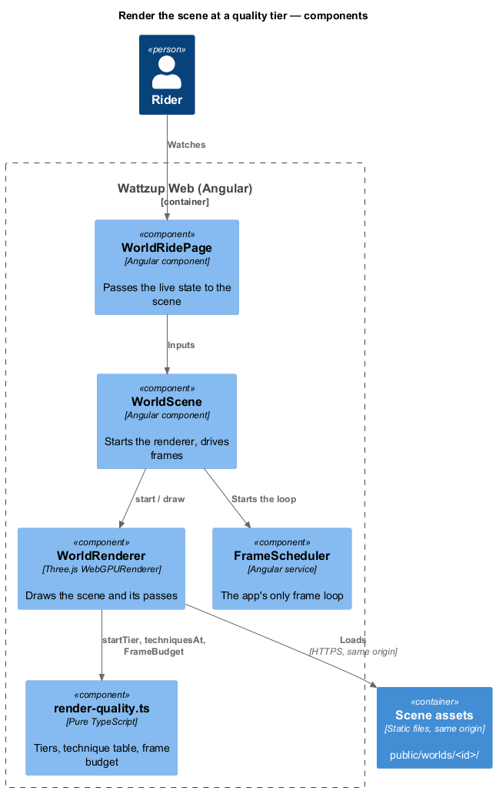
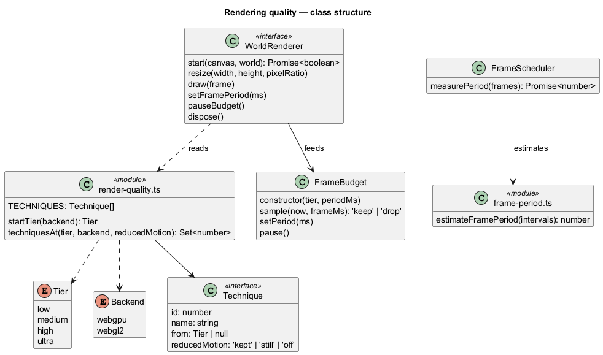
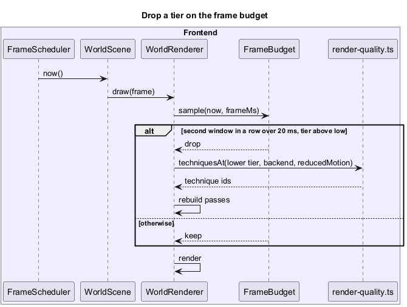

# Render the scene at a quality tier

## Overview

World Ride (L1-017) draws each class's world behind the HUD (`world-ride/draw-class-scene`). This feature makes that world look as good as the screen allows. It covers the renderer backend, the four quality tiers and the techniques each one turns on, the frame budget that lowers the tier, and how reduced motion and missing assets are handled (L2-111, ADR 0021).

**quality tier** — one of `low`, `medium`, `high` and `ultra`; each turns on the techniques of L2-111 whose _From tier_ is that tier or lower

**technique** — one of the fifty rendering techniques of L2-111, numbered as in its table, in its bike-scene form

**backend** — what the renderer draws through: WebGPU when an adapter is granted, else WebGL2

**frame period** — how long one refresh of the rider's display lasts, measured when World Ride opens: 33.3 ms at 30 Hz, 16.7 ms at 60 Hz, 6.9 ms at 144 Hz

**frame budget** — the frame period _P_; a 2-second window whose median frame is over 1.2 × _P_ (budget plus 20 %) counts as over budget

**fallback form** — what a technique draws when it is not on, or its asset is missing: the form of the next lower tier, or nothing

The tier is a property of the screen and the scene, not of the rider. Nothing about it is stored, sent to the backend or shown in a panel. The rider sees only the world; the HUD works the same at every tier (L2-111 criterion 7).

## Description

### Backend

None.

### Frontend (`frontend/projects/wattzup/src/app/core/`)

**Quality rules (`core/render-quality.ts`, new, with `render-quality.spec.ts`).** Pure code, no Three.js.

- **`Tier`**: `'low' | 'medium' | 'high' | 'ultra'`. **`Backend`**: `'webgpu' | 'webgl2'`.
- **`TECHNIQUES`**: the fifty rows of L2-111 as `{ id, name, from: Tier | null, reducedMotion: 'kept' | 'still' | 'off' }`. `from: null` marks a technique that is not built (21, 29).
- **`startTier(backend)`** returns `ultra` for `webgpu` and `high` for `webgl2` (L2-111 criterion 3).
- **`techniquesAt(tier, backend, reducedMotion)`** returns the set of technique ids drawn (criteria 2 and 5):
  - a technique is drawn when its `from` is at or below `tier`;
  - `ultra` techniques are dropped on `webgl2`;
  - with reduced motion, the `off` techniques are dropped. The `still` ones stay, and the renderer freezes their time.
- **`FrameBudget`** keeps the 2-second windows (criterion 4):
  - `new FrameBudget(tier, periodMs = 1000 / 60)` starts at the tier, judging against the period;
  - `sample(now, frameMs)` records one frame;
  - when a window closes, it takes the window's median and returns `'drop'` after the second window in a row over 1.2 × the period, else `'keep'`;
  - `setPeriod(ms)` takes a newly measured period and starts its windows afresh, so no window that straddles the change is judged; `pause()` judges nothing until the next `setPeriod` (criterion 9);
  - `'drop'` is never returned at `low`, and nothing ever returns `'raise'`.

**Frame period (`core/frame-period.ts`, new, with `frame-period.spec.ts`).** Pure code (criterion 9).

- **`estimateFramePeriod(intervals: readonly number[]): number`** leaves out the first interval and any over 100 ms, takes the median of the rest and snaps it to the nearest common refresh rate (30, 48, 50, 60, 75, 90, 120, 144, 165 or 240 Hz). With fewer than 10 intervals left, it returns 1000 / 60.

**Measuring (`core/frame-scheduler.ts`).** `FrameScheduler` stays the app's only `requestAnimationFrame` caller.

- **`measurePeriod(frames = 30): Promise<number>`** requests `frames + 1` frames back to back, draws nothing in them, and resolves `estimateFramePeriod` of their intervals. It waits while the tab is hidden.

**Who measures, and who passes the period on (`dashboard/world-scene/world-scene.ts`).**

- At open, `WorldScene` awaits `frames.measurePeriod()` alongside the renderer's import, before `start`, so the scene's own work does not slow the measurement. Once `start` resolves `true`, it calls `renderer.setFramePeriod(period)`.
- On `visibilitychange` to visible, and on a change of `matchMedia('(resolution: <devicePixelRatio>dppx)')` (the window moved to another screen), it calls `renderer.pauseBudget()`, holds the scene's picture (draws no frame) and measures again; then it calls `renderer.setFramePeriod(period)` and draws on.
- `WorldRenderer` (`core/world-renderer-port.ts`) gains `setFramePeriod(ms)` and `pauseBudget()`, which hand the period to its `FrameBudget` and pause it.

**Renderer (`core/world-renderer.ts`).** It moves to `WebGPURenderer` from `three/webgpu` (ADR 0021).

- `start(canvas, world)` becomes `Promise<boolean>`. It awaits `renderer.init()`, which picks the backend: WebGPU, else WebGL2.
- On each `draw`, it feeds `FrameBudget`. On `'drop'`, it rebuilds its pass chain for the lower tier. Until `setFramePeriod` is first called, the budget judges against 60 Hz.
- It builds the scene and the post-processing chain from `techniquesAt(...)`. Each technique is one module under `core/world-render/` that is told whether it is on. When it is off, or its asset is missing, it draws its fallback form (criterion 6).
- **Pass order:**
  1. depth and velocity pre-pass (7, 33);
  2. shadow cascades (12, 37);
  3. opaque geometry, with clustered lights (4, 9, 14, 15, 38, 39);
  4. sky and atmosphere (11, 25, 40), then volumetrics (26);
  5. transparent geometry and water (20, 27, 30);
  6. GTAO (36), SSR or ray-traced reflections (10, 45), then GI (13, 46, 47, 48);
  7. auto exposure (35), glare (49), heat haze (50), motion blur (33, 34);
  8. TAA or FXAA (7), then AgX tone mapping (17).

  Techniques 3, 5, 18, 19, 22, 23, 24, 32, 41, 42, 43 and 44 shape the geometry, the materials and the assets, not the passes.

- **Reduced motion.** `SceneFrame.reducedMotion` drops the `off` techniques and holds the clock of the `still` ones (L2-111 criterion 5; L2-110 criterion 6).

**The bend at every tier (L2-111 criterion 8, ADR 0023).** The road's bend is a vertex-stage `positionNode` on every material, not a technique: it is on at every tier and on both backends, and no tier turns it off. Its cost is a few arithmetic steps per vertex and one 2 KB upload a frame; frustum culling is off for bent meshes. The frame budget is the same as on a straight road, so a screen that cannot hold its tier on a bending road drops one as it would for any other load (`world-ride/draw-class-scene`, The bending road).

**Test-only tier hook (`core/world-ride-probe.ts`, #672).** The performance sweep (`frontend/e2e/sweeps/performance.sweep.ts`) must draw every tier on demand. Its fixture, `e2e/fixtures/world-ride-probe.ts`, sets `window.__wzWorldRide = { tier }` before the app boots. `readWorldRideProbe` reads it when the renderer starts. The scene then opens at that tier (`ultra` draws at `high` on WebGL2), and its `FrameBudget` is built `pinned`, so no window lowers it. The renderer keeps `__wzWorldRide.report` current: `{ tier, backend, frames, drawCalls, programs }`, the time between each drawn frame and the last frame's draw calls (counted across every pass, so `info.autoReset` is off while the hook is set) and the programs alive (`renderer.info`, #674). The sweep rides each scene's first class at each pinned tier, skips 3 s, records 20 s and attaches the median and p95 frame time with the counts; it judges no number. The hook is not a rider option and is not in the README; nothing in the app sets the global, only the lazy World Ride chunk reads it, and the behaviour specs never use it.

**Scene component.** `WorldScene` awaits `start`. It emits `unavailable` when `start` resolves `false` or rejects (L2-111 criterion 1).

**Assets (`frontend/public/worlds/<id>/`).** Captured and baked assets are made offline from each scene's capture, then bundled. A scene lists what it has in `worlds/<id>/manifest.json`; a technique whose asset is not listed draws its fallback form. The assets are:

- photogrammetry meshes (1);
- scans and material maps (2, 3);
- lightmaps (5);
- probes (13, 40);
- impostor atlases (43);
- splats (44);
- virtual-texture pages (41).

### Screen states

No new screen state. The scene looks better or plainer; the HUD mocks `pages/world-ride/*` hold at every tier.

### Acceptance tests

No backend test: this feature has no backend part.

Playwright (`frontend/e2e/world-ride.spec.ts`):

- `shows This screen can't draw 3D worlds when WebGL is off, and the HUD still works`, already there (L2-111 AC1). The `FakeWebGl` switch also hides `navigator.gpu`.

Unit tests (`render-quality.spec.ts`):

- `startTier` for each backend (AC3);
- `techniquesAt`: one case per tier on each backend, and with reduced motion. Each checks the techniques drawn against the table, with 21 and 29 never drawn and `ultra` only on WebGPU (AC2, AC5);
- `FrameBudget`: two windows over budget drop one tier; one window over budget keeps it; nothing drops below `low`; no window ever raises it (AC4). One case per row of 30 Hz at 34 and 45 ms, 60 Hz at 18 and 25 ms, and 144 Hz at 8 and 18 ms (AC4); while paused and across `setPeriod`, no window is judged (AC9).
- `estimateFramePeriod`: one case per row of 30, 60, 120 and 144 Hz, jittery intervals, a long first interval and gaps over 100 ms left out, and too few intervals falling back to 60 Hz (AC9).
- `FrameScheduler.measurePeriod`: driven by a fake `requestAnimationFrame` clock, never a sleep (AC9).

A behaviour spec cannot set the refresh rate of the rider's display: the headless browser always reports its own. The unit tests prove the rules; the e2e specs prove World Ride still opens and draws.

How each tier looks (AC2), and the fallback form of each technique when its asset is missing (AC6), are judged by eye and by the visual sweep, which runs only when a person asks. That the HUD stays responsive (AC7) holds because the HUD is DOM and the scene draws on the app's frame loop.

### Open questions

- **Captured assets.** The photogrammetry, scans, splats and baked data of each scene are <TO SUPPLY>. Until they exist, techniques 1, 2, 3, 5, 13, 40, 41, 43 and 44 draw their fallback forms.
- **Ray-tracing builder.** Techniques 45 to 48 need a BVH over the scene. Building it in-house or adding a package (an amendment of ADR 0021) is <TO SUPPLY>.
- **World Ride chunk budget.** Only the initial bundle has a budget. A budget for the World Ride chunk and each scene's assets is <TO SUPPLY>.

## Requirements

| L2 ID    | Refines (L1) | Requirement                                                                                                                                                                                                                                                                                             |
| -------- | ------------ | ------------------------------------------------------------------------------------------------------------------------------------------------------------------------------------------------------------------------------------------------------------------------------------------------------- |
| `L2-111` | `L1-017`     | World Ride rendering quality. The scene draws with WebGPU or WebGL2 at a quality tier that turns on the techniques of the table, starts high and drops on a frame budget of the display's measured frame period, honours reduced motion, falls back when an asset is missing, and never blocks the HUD. |
| `L2-110` | `L1-017`     | World Ride scene rendering. The fallback notice, the hidden tab and reduced motion apply at every tier.                                                                                                                                                                                                 |
| `L2-101` | `L1-017`     | The scenes. Every captured or baked asset is bundled and served from the same origin.                                                                                                                                                                                                                   |

## Diagrams

### Components

`WorldScene` starts `WorldRenderer`, which asks `render-quality.ts` which tier and techniques are in force, and builds its passes from the answer.

### Class structure

`TECHNIQUES` is the table of L2-111. `techniquesAt` reads it for a tier, a backend and reduced motion. `FrameBudget` turns frame times into `keep` or `drop`, judged against the frame period that `estimateFramePeriod` measured.

### Behaviour — drop a tier on the frame budget

Before the first frame, `WorldScene` measures the display's frame period and hands it to the renderer (L2-111 criterion 9). Each frame then feeds the budget. After two windows in a row over 1.2 × the period, the renderer drops one tier and rebuilds its passes (criterion 4). When the tab returns or the window changes screen, the budget pauses while the period is measured again.

