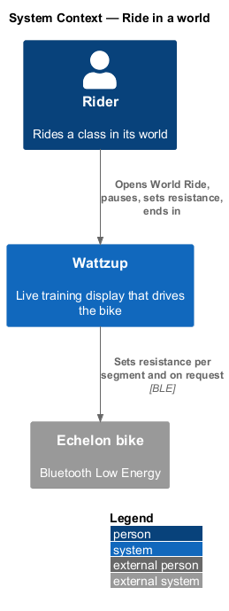
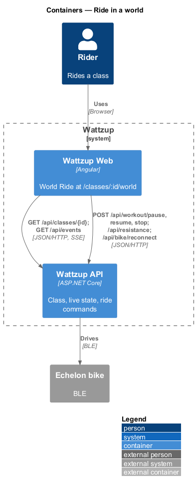
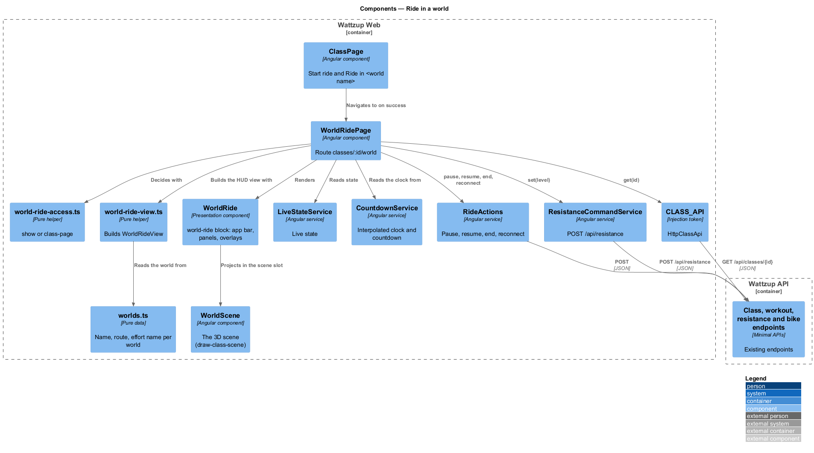
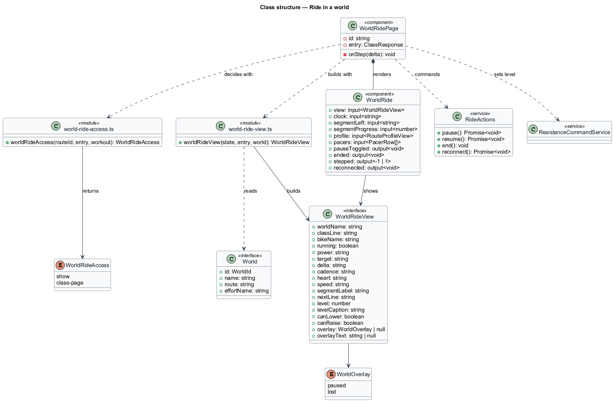
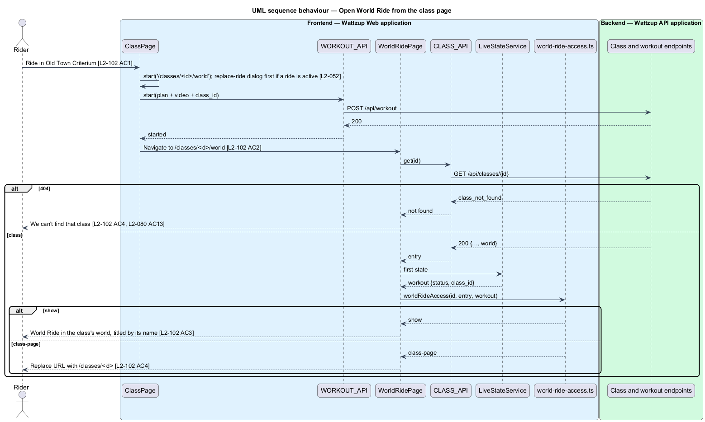
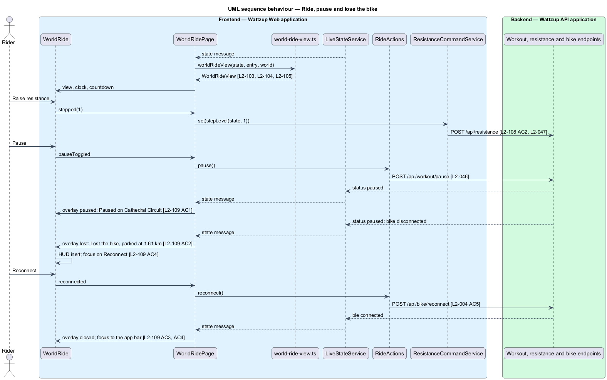

# Ride in a world

## Overview

World Ride (L1-017) shows a class ride inside the class's own scene: a 3D road whose climbs follow the plan, with the ride's numbers and controls laid over it. This feature is the screen at `/classes/:id/world`. It covers how the rider opens the screen from the class page, which ride it shows, and the panels over the scene (L2-102 to L2-105, L2-108, L2-109). The scene itself and the route profile belong to `world-ride/draw-class-scene`. The pacer board belongs to `world-ride/show-simulated-pacers`.

**World Ride** — screen at `/classes/:id/world` that shows the ride in progress of class `:id` in that class's scene

**HUD** — heads-up display: the app bar and panels drawn over the scene (metrics, current segment, route profile, pacers, resistance)

**world** — the scene of the class being ridden, as named by its `world` field (`world-ride/assign-class-scene`), with its name, route and effort name (L2-101)

**effort name** — what a `work` segment is called in a world, e.g. `Cobbled sprint` in Old Town Criterium

**ride in progress** — workout whose `status` is neither `ended`, `ended: bike shut off` nor `stopped`

World Ride adds no backend endpoint. It reads the class through `GET /api/classes/{id}` and the ride from the live state. It drives the ride through the endpoints the Ride Dashboard already uses: pause, resume, resistance, reconnect and stop. The dashboard at `/` keeps showing the same ride. Leaving World Ride never changes the workout (L2-102 criterion 6).

The class page (`classes/ride-a-class`) gains one action, `Ride in <world name>`. It starts the ride exactly as Start ride does, and opens World Ride instead of the dashboard (L2-102 criteria 1 and 2).

## Description

### Backend

None new. `GET /api/classes/{id}` serves `world`, and the live state carries `workout.class_id` (`world-ride/assign-class-scene`). Pause, resume, resistance, reconnect and stop are unchanged (L2-046, L2-047, L2-004, L2-051).

### Frontend (`frontend/projects/wattzup/src/app/`, with presentation components in `frontend/projects/components/`)

**Route.** `app.routes.ts` gains `classes/:id/world`, placed before `classes/:id`. It loads `WorldRidePage` with `loadComponent`, so the page, the scene renderer and the scene assets stay out of the initial bundle (L2-102 criterion 8). The initial bundle keeps its 300 KB gzipped budget.

**Pure rules (`core/`, new, each with its `.spec.ts`).**
- **`world-ride-access.ts`**: `worldRideAccess(routeId, entry, workout)` returns `'show'` or `'class-page'`. It returns `'show'` only when all three hold (L2-102 criteria 3 and 4):
  - `entry.world` is not `null`;
  - `workout` is a ride in progress;
  - `workout.class_id` equals `routeId`.
- **`world-ride-view.ts`**: `worldRideView(state, entry, world)` returns the `WorldRideView` the HUD renders. It reuses the existing rules:
  - **App bar** (L2-103): the world's `name`, `<route> · <class title>`, `device_label`, and the Pause or Resume label from `status`.
  - **Metrics** (L2-104): `powerDelta` (`core/power-delta.ts`) for `On target`, `+<n> W` or `-<n> W`, and `Paused` when not running. `formatLive` and `formatSpeed` (`core/metric-format.ts`) give `--` for `null`. Heart is always `--`, because `heart_rate` is always `null` (ADR 0003).
  - **Segment** (L2-105): `kindLabel` and `roundLabel` (`core/segment-labels.ts`) give `Work · 1 of 8`, `Recover · <r> of <n>`, `Warm-up`, `Cool-down` and `Steady`. `nextLabel` gives the next segment. When it is `work`, its label is replaced with the world's effort name, as in `Next: Cobbled sprint · 0:30 at level 24`. On the last segment the line reads `Last stretch to the finish arch`.
  - **Resistance** (L2-108): `controlsState` (`core/resistance-controls.ts`) gives the level and which buttons are enabled. The caption reads `Manual` in `manual` mode, else `Resistance / 32`.
  - **Overlay** (L2-109): `'paused'` for `paused`, `'lost'` for `paused: bike disconnected`, else `null`. The lost text is `<device_label> stopped answering. You're parked at <distance_km> km on <route>. Wake it with a pedal stroke, then reconnect.`, with the distance to two decimals.
- **`worlds.ts`** (`world-ride/draw-class-scene`) gives `worldById(id)`: the name, route and effort name.

**Presentation component (`frontend/projects/components/src/lib/world-ride/`, new).**
- **`WorldRide`** (`wz-world-ride`): renders the `world-ride` block of the design system, with its elements as in `docs/mocks/pages/world-ride/*`. Its inputs are `view: WorldRideView`, `clock: string`, `segmentLeft: string`, `segmentProgress: number`, `profile: RouteProfileView` (from `world-ride/draw-class-scene`) and `pacers: PacerRow[]` (from `world-ride/show-simulated-pacers`). Its outputs are `pauseToggled`, `ended`, `stepped` (`-1` or `1`) and `reconnected`. It injects no service, token or router. The scene is projected into the `[slot=scene]` slot, so the block draws the HUD over it. The parts it renders:
  - **App bar.** The lockup links to `/` with the accessible name `Wattzup dashboard`. `Class` with a back arrow links to `/classes/<id>`. Then the `h1` world name over the class line, the bike's name, the clock `<elapsed> / <total>`, the Pause or Resume button and End (L2-103 criterion 1). The `href`s are inputs: the component does not use the router.
  - **Metrics panel.** `world-ride__power` with `W est.` (title and description `Estimated from cadence and resistance`), the target line, and the `Cadence`, `Heart` and `Speed` description list (L2-104).
  - **Segment panel.** `world-ride__interval`: the label, the countdown with `role="timer"`, the `progress` named `Segment progress`, and the next line (L2-105).
  - **Resistance panel.** `world-ride__resistance`: `Lower resistance`, the output named `Resistance` with its caption, and `Raise resistance`. Each button is disabled as `controlsState` says (L2-108).
  - **Overlays.** The paused overlay `role="status"`: `Paused on <route>` / `The world holds still until you pedal again.`. The lost-bike overlay `role="alert"`: `Lost the bike`, the lost text, and `Reconnect`. While it shows, the HUD is `inert` and focus moves to `Reconnect`. When it closes, focus returns to the app bar's first control (L2-109).
  - **Ride complete overlay.** When `status` becomes `ended` or `ended: bike shut off` with a `session_id`, the scene holds still, the HUD is `inert`, and the overlay of L2-084 shows over it with `See your ride` (focused) and `Ride another class`. With `session_id` `null`, the page navigates to `/` (L2-109 criterion 5).
  - Every control is at least 44 × 44 px with a visible focus ring, in the Tab order of L2-103 criterion 1 (L2-103 criterion 4).
  - **Layout.** Under 1024 px the resistance panel and the bike's name are hidden (L2-108 criterion 4). Under 768 px the class line, the total and the Pause label are hidden, along with the board. Under 640 px the route profile is hidden and the panels stack (L2-110 criterion 8).

**Page (`dashboard/world-ride-page/`, new).**
- **`WorldRidePage`** (route `classes/:id/world`; the document title is the world's name):
  - **Entry.** It calls `CLASS_API.get(id)` and waits for the first live state from `LiveStateService`. A 404 shows `ClassNotFound` (L2-102 criterion 4). Otherwise `worldRideAccess` decides: `'class-page'` replaces the URL with `/classes/<id>` (L2-102 criteria 3 and 4).
  - **Rendering.** It renders `wz-world-ride` with `worldRideView(...)`. The clock and countdown come from `CountdownService`, interpolated as L2-024. The profile view and the pacer rows come from the helpers of the two sibling features. The scene is `wz-world-scene` (`world-ride/draw-class-scene`), projected into the scene slot.
  - **Commands.** `pauseToggled` calls `RideActions.pause()` or `resume()`, whose toasts cover failure (L2-103 criterion 2, L2-046). `stepped` calls `ResistanceCommandService` with `stepLevel(state, delta)` (L2-108 criterion 2, L2-047). `ended` calls `RideActions.end()`, which opens the end-ride dialog. Ending leads where L2-084 says (L2-102 criterion 7). `reconnected` calls `RideActions.reconnect()` (L2-109 criterion 2).
  - **Leaving.** Following the lockup or `Class` sends no workout request (L2-102 criterion 6).

**Class page change (`dashboard/class-page/`).**
- `ClassPage` gains `Ride in <world name>` beside Start ride, as a secondary `btn`, when `entry.world` is set (L2-102 criterion 1). The class page mock gains the button in the same change.
- `start()` gains a destination: `/` for Start ride and `/classes/<id>/world` for `Ride in …`. Everything else is shared: the replace-ride dialog, `toStartRequest(draft, id)` with its `class_id`, `Starting…`, and the error alert (L2-102 criterion 2).

### Screen states

| Mock | State |
|---|---|
| `pages/world-ride/default` | Old Town Criterium at 5:00 of 30:00, `Work · 1 of 8`, 142 W against 418 W (`-276 W`), resistance 24 |
| `pages/world-ride/docklands`, `granite`, `oldtown`, `prairie`, `dolomites`, `coast` | Each of the six classes in its own world, at the times of the Class Worlds canvas |
| `pages/world-ride/paused` | `Resume`, and `Paused on Cathedral Circuit` |
| `pages/world-ride/ended` | `Ride complete` over the held scene, with `See your ride` focused (L2-109 criterion 5) |
| `pages/world-ride/disconnected` | `Lost the bike`, parked at 1.61 km on Cathedral Circuit, with `Reconnect`; the HUD inert |
| `pages/world-ride/renderer-unavailable` | No scene; the HUD works (`world-ride/draw-class-scene`) |
| `pages/class/default` | `Ride in Old Town Criterium` beside Start ride |

The mocks' `loading`, `error` and `scenery-ready` states belong to Google Photorealistic 3D Tiles, which L1-017 leaves out of scope.

### Acceptance tests

The backend paths are covered by `world-ride/assign-class-scene` and the existing workout, resistance and bike tests. This feature adds no API test.

Playwright (`frontend/e2e/`, Chromium only):
- **Fixtures.** The shared fixture answers `/api/classes/{id}` from recordings that carry `world`, and pushes states whose `workout.class_id` names the class. `e2e/fixtures/` gains a `FakeWebGl` switch, so the scene can be made unavailable without a GPU.
- **Page object.** `e2e/pages/world-ride.page.ts`. The class page object gains `rideInWorld()`.
- **Spec `e2e/world-ride.spec.ts`:**
  - `shows Ride in Old Town Criterium on a class with a world, and not on one without` (L2-102 AC1)
  - `starts the class ride with class_id and opens World Ride` (L2-102 AC2)
  - `asks to replace a ride in progress before opening World Ride` (L2-102 AC2, L2-052)
  - `shows the running class in its world, titled by the world's name` (L2-102 AC3)
  - `sends the rider to the class page with no ride, another class's ride or a class without a world` (L2-102 AC4)
  - `leads Class back to the class page and the lockup to the dashboard, sending no workout request` (L2-102 AC6)
  - `opens the end-ride dialog from End` (L2-102 AC7)
  - `shows the world, route, class, bike and clock in the app bar` (L2-103 AC1)
  - `pauses and resumes the ride` (L2-103 AC2)
  - `shows power against target, cadence, heart as -- and speed` (L2-104 AC1 to AC4)
  - `shows the segment, countdown and next effort by its world name` (L2-105 AC1 to AC3)
  - `reads Last stretch to the finish arch on the last segment` (L2-105 AC4)
  - `steps resistance, reads Manual, and disables at 1, 32 and without the bike` (L2-108 AC1 to AC3)
  - `holds the world still with Paused on <route>` (L2-109 AC1)
  - `shows Lost the bike with the parked distance, and Reconnect calls the bike` (L2-109 AC2 to AC4)
  - `shows Ride complete over the held world when the plan ends` (L2-109 AC5)

Unit tests:
- `world-ride-access.spec.ts`: one case per row of L2-102 criteria 3 and 4.
- `world-ride-view.spec.ts`: each segment kind, the next line for `work` and for the other kinds, the last segment, `null` readouts, `manual` mode, and each overlay status.

The bundle budget (L2-102 criterion 8) is checked by `frontend/scripts/` in CI. The layout criteria (L2-108 criterion 4, L2-110 criterion 8) are covered by the responsive sweep, which runs only when a person asks.

### Open questions

- **One block or several components.** The design system extracts World Ride as one block, `world-ride`. `WorldRide` therefore renders the whole HUD from one view. If the design system later gives the board or the resistance panel its own block, those parts move into components of their own.

## Requirements

| L2 ID | Refines (L1) | Requirement |
|-------|--------------|-------------|
| `L2-102` | `L1-017` | Opening World Ride. World Ride is the screen `/classes/:id/world`. It shows the ride in progress of class `:id` in that class's scene. The class page shall gain the `Ride in <world name>` action. |
| `L2-103` | `L1-017` | World Ride app bar. It shows the lockup, `Class`, the world's name over `<route> · <class title>`, the bike's name, `<elapsed> / <total>`, Pause or Resume, and End. |
| `L2-104` | `L1-017` | World Ride live metrics. The panel shows the readouts of L2-021 in the World Ride layout: estimated power against target, cadence, heart (always `--`) and speed. |
| `L2-105` | `L1-017` | World Ride current segment. The panel shows the countdown of L2-024 and the phase of L2-025, and names the next effort in the scene's words. |
| `L2-108` | `L1-017` | World Ride resistance. − and + send `POST /api/resistance`; the caption reads `Manual` in manual mode; the buttons are disabled at 1, at 32 and without the bike. |
| `L2-109` | `L1-017` | World Ride pause and lost bike. A paused ride holds the scene still under `Paused on <route>`. A lost bike shows `Lost the bike` with `Reconnect`. A ride that ends shows `Ride complete` over the held scene. |
| `L2-080` | `L1-014` | Class page. Start ride's request, replace-ride dialog and error alert are shared with `Ride in <world name>`. |
| `L2-084` | `L1-015` | Ending a ride opens its summary. The `Ride complete` overlay and `See your ride`. |
| `L2-051` | `L1-007` | End-ride dialog. End opens it; ending leads to the session or the class library. |
| `L2-046` | `L1-004` | Pause and resume. Pause and Resume call the workout endpoints and show a toast when they fail. |
| `L2-047` | `L1-003` | Manual resistance override. A level set by the rider puts the workout in `manual` mode until the next segment. |

## Diagrams

### System context

The rider opens World Ride from a class in Wattzup. Wattzup drives the bike while the rider watches the class's world.

### Containers

Wattzup Web reads the class and the live state from the Wattzup API. It sends the ride commands back to the API, which drives the bike over Bluetooth.

### Components

`WorldRidePage` decides access with `world-ride-access.ts` and builds the HUD view with `world-ride-view.ts`. It renders `WorldRide` with the scene projected under it, and sends commands through `RideActions` and `ResistanceCommandService`.

### Class structure

`WorldRideView` is a pure value built from the live state, the class and its world. `WorldRide` renders it and emits the rider's commands. Only `WorldRidePage` turns those commands into requests.

### Behaviour — open World Ride from the class page

`Ride in <world name>` starts the class ride as Start ride does. On success it opens World Ride, which shows the ride only when the running workout is this class's (L2-102 criteria 1 to 4).

### Behaviour — ride, pause and lose the bike

Each state message renders the HUD again. Pause holds the world still. A lost bike makes the HUD inert, and `Reconnect` asks the backend to scan again (L2-103, L2-108, L2-109).

