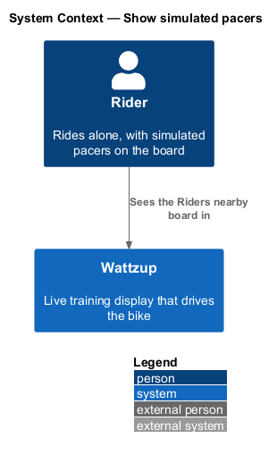
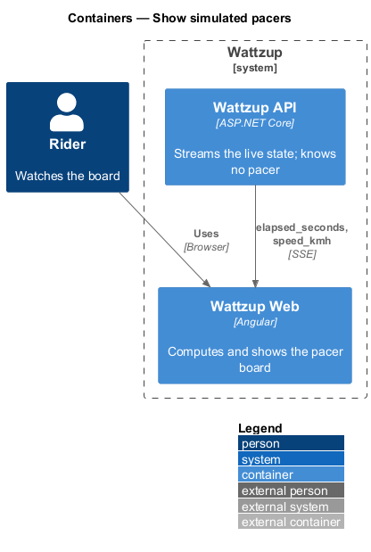
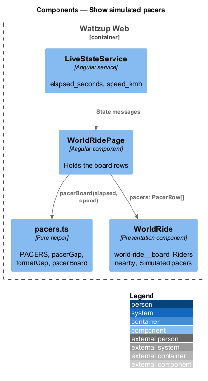
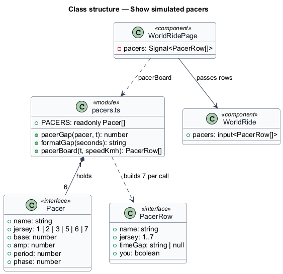
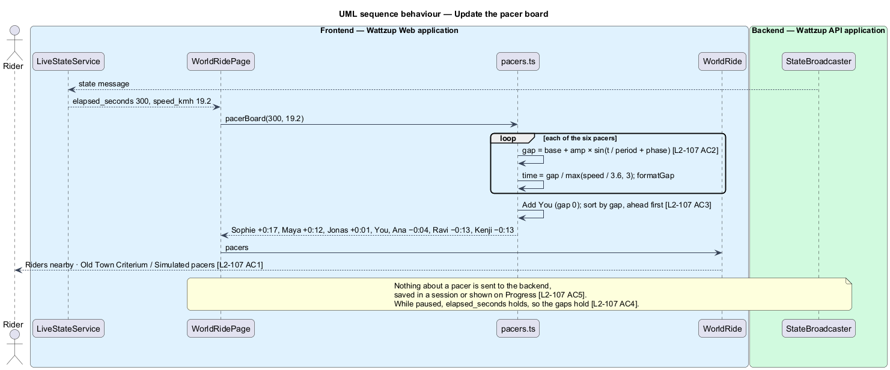

# Show simulated pacers

## Overview

World Ride (L1-017) shows a board of riders around the rider, as a group ride would. Wattzup is single-user and knows no other rider, so the board lists six **simulated pacers**. This feature is that board: who the pacers are, how their gaps move, how the board says they are simulated, and the guarantee that they are never recorded (L2-107).

**simulated pacer** — invented rider on the World Ride board whose gap to the rider follows a fixed wave; it is not a person and not a recording

**gap** — distance, in metres, of a pacer ahead of the rider (negative is behind)

**time gap** — gap divided by the rider's speed, shown as `+m:ss` ahead or `−m:ss` behind

The board exists for company and pace, not for competition. L1-015 shows only real rides, so the pacers are labelled `Simulated pacers` under the board's heading. They live only in the browser. They are computed from `elapsed_seconds` and `speed_kmh`, are never sent to the backend, and never appear in a session, the Session Summary or Progress (L2-107 criteria 1 and 5).

The six pacers and their waves come from the Magic Patterns OS file `shared/worlds.ts`. The same six pacers ride in every world.

## Description

### Backend

None. No endpoint, state field or session field carries a pacer (L2-107 criterion 5).

### Frontend (`frontend/projects/wattzup/src/app/`, with presentation in `frontend/projects/components/`)

**Pure rules (`core/pacers.ts`, new, with `pacers.spec.ts`).**
- **`Pacer`**: `{ name, jersey, base, amp, period, phase }`. **`PACERS`** holds the six rows of L2-107 in table order. `jersey` is the number of the pacer's design-system rider colour, `--color-rider-<n>`, applied through the `world-ride__rider--<n>` modifier. The numbers follow the mocks: Sophie Dubois 1, Maya Okafor 2, Jonas Lindqvist 3, Ana Ferreira 5, Ravi Patel 6, Kenji Watanabe 7. Number 4 is `You`. The colour stays with the pacer whatever the board's order. It is never a hex value (Read tokens by role, AGENTS.md).
- **`pacerGap(pacer, t)`** returns `base + amp × sin(t ÷ period + phase)` metres (L2-107 criterion 2).
- **`formatGap(seconds)`** rounds to whole seconds and returns `+m:ss` for 0 and above, else `−m:ss` with U+2212.
- **`pacerBoard(t, speedKmh)`** returns `PacerRow[]`, built as follows (L2-107 criteria 2 and 3):
  - each pacer's time gap is `pacerGap ÷ max(speedKmh ÷ 3.6, 3)` seconds;
  - the `You` row is added with gap 0, `you: true` and no time;
  - the rows are sorted by gap, from furthest ahead to furthest behind.

  A `null` `speed_kmh` counts as 0, so the 3 m/s floor applies.
- **`PacerRow`**: `{ name, jersey, timeGap: string | null, you: boolean }`.
- **`pacersOnRoad(t, far)`** returns `PacerOnRoad[]` (`{ jersey, metres, lane }`) for the pacers from 4 m behind the rider to `far` metres ahead, furthest first. Each pacer keeps its own lane, at least 0.8 m from the next (L2-107 criterion 7).

**In the scene.** The renderer (`draw-class-scene`) draws each pacer from `pacersOnRoad` as a cyclist at its gap, on its lane and in its jersey colour, with its jersey number as its race number. It hides pacers that are out of range. Each pacer rides a frame of its own paint, and half wear a white helmet.

**Board.** It is the `world-ride__board` element of `WorldRide` (`world-ride/ride-in-a-world`). It renders:
- the heading `Riders nearby · <world name>`, with `Simulated pacers` directly under it (L2-107 criterion 1);
- an ordered list (`world-ride__riders`) with one `world-ride__rider--<n>` item per row. Each item shows the jersey swatch, the name and the time gap;
- the `You` row with `aria-current="true"`, styled through that attribute.

The name carries each row's meaning. The jersey colour adds to it and never replaces it (L2-107 criterion 3). Under 768 px the board is hidden (L2-107 criterion 6).

**Page.** `WorldRidePage` computes `pacerBoard(elapsed_seconds, speed_kmh)` from the live state. The board follows the server's `elapsed_seconds`, which stops while the ride is not running, so the gaps stop too (L2-107 criterion 4). The page holds the rows in a signal and passes them to `WorldRide`. Nothing else reads them.

**Mock.** `docs/mocks/pages/world-ride/*` show the `Simulated pacers` line under the board heading (L2-107).

### Example

At `elapsed_seconds` 300 and 19.2 km/h (5.33 m/s), Maya Okafor's gap is 46 + 28 × sin(300 ÷ 140 + 0.3) = 64.0 m, which is 12.0 s, shown as `+0:12`. This matches `pages/world-ride/default`. The board there reads Sophie Dubois `+0:17`, Maya Okafor `+0:12`, Jonas Lindqvist `+0:01`, You, Ana Ferreira `−0:04`, Ravi Patel `−0:13`, Kenji Watanabe `−0:13`.

### Acceptance tests

No backend test: this feature has no backend part.

Playwright (`frontend/e2e/world-ride.spec.ts`, Chromium only, page object `e2e/pages/world-ride.page.ts`):
- `labels the board Riders nearby · <world> and Simulated pacers` (L2-107 AC1)
- `lists the pacers and You by gap at the ride's moment` (L2-107 AC2, AC3)
- `marks You as the current row` (L2-107 AC3)
- `keeps the gaps still while paused` (L2-107 AC4)
- `sends no pacer to the backend` (L2-107 AC5). Every request body during the ride is checked for pacer names.

Unit tests (`pacers.spec.ts`):
- one `pacerGap` case per pacer row (L2-107 AC2);
- `formatGap` for 0, a positive value, a negative value and rounding;
- the 3 m/s floor at a standstill and with `null` speed;
- the sort order, using the example above (L2-107 AC3).

That the pacers never reach a session or Progress (L2-107 AC5) follows from the backend having no pacer field. `history/record-session` builds a session only from the workout engine's samples. The hidden board under 768 px (L2-107 AC6) is covered by the responsive sweep, which runs only when a person asks.

### Open questions

- **Pacers on a flat world.** The same six waves run in every world and every plan. Whether a world or a plan should change their pace is <TO SUPPLY>.
- **Board when paused.** The gaps hold while the ride is paused. The board stays visible, as in `pages/world-ride/paused`.

## Requirements

| L2 ID | Refines (L1) | Requirement |
|-------|--------------|-------------|
| `L2-107` | `L1-017` | Simulated pacers. The *Riders nearby* board lists six simulated pacers around the rider, computed in the frontend only and labelled `Simulated pacers`. Each gap is `base + amp × sin(t ÷ period + phase)` metres, shown as a time gap. The rows are sorted by gap, with `You` marked current. They stop while the ride is not running. They are never sent to the backend or recorded. The board is hidden under 768 px. |

## Diagrams

### System context

The board is computed in Wattzup Web alone. The pacers never leave the rider's browser.

### Containers

Wattzup Web reads `elapsed_seconds` and `speed_kmh` from the live state, and sends nothing about pacers to the Wattzup API.

### Components

`WorldRidePage` calls `pacerBoard` on each state message and passes the rows to the `WorldRide` board.

### Class structure

`PACERS` holds the six fixed waves. `pacerBoard` turns them, the ride time and the speed into sorted `PacerRow` values.

### Behaviour — update the board

Each state message gives a new time and speed. The board is computed again and drawn, and nothing is sent back (L2-107).

